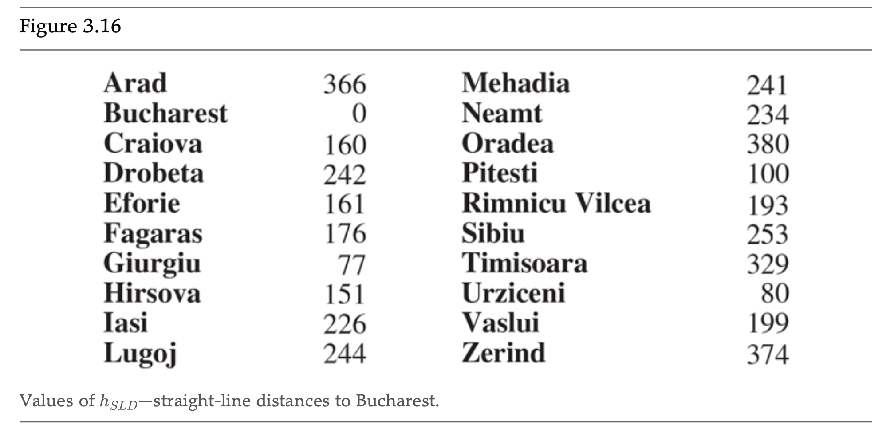

# C1 — Problemas de IA y búsqueda en espacios de estados

*Elementos de Inteligencia Artificial · Ciencia de Datos · Curso 2026-2027*

*Todas las figuras de esta nota están reproducidas del capítulo 3 de Russell, S. y Norvig, P., "Artificial
Intelligence: A Modern Approach", 4.ª edición, Pearson, 2020, y se incluyen únicamente con fines docentes. El pie de
cada figura indica su número en el original. Las trazas, tablas y el texto son elaboración propia a partir de ese
capítulo.*

---

El teléfono dice que hay veintidós minutos hasta la facultad y propone una ruta. Para calcularla no miró todos los
caminos posibles: entre dos puntos de una ciudad mediana hay más recorridos de los que cualquier computadora podría
enumerar. Pero tampoco adivinó, porque la ruta es buena. Hizo algo intermedio, y ese algo intermedio es el tema de esta
clase.

La misma forma aparece en problemas que no se parecen en nada entre sí: armar el recorrido de un repartidor, resolver un
rompecabezas, decidir la secuencia de movimientos de un brazo robótico, elegir en qué orden probar las configuraciones
de un modelo. En ninguno de esos casos la respuesta sale de una fórmula que uno evalúa y listo. Sale de recorrer
posibilidades. Y como recorrerlas todas no es una opción, hay que recorrerlas con criterio.

Ese "con criterio" es lo que vamos a volver preciso. Vamos a pasar de una intuición razonable —probar primero lo que
parece más prometedor— a algo que se puede programar y, sobre todo, sobre lo que se pueden hacer afirmaciones: si el
método va a encontrar una respuesta, si esa respuesta va a ser la mejor posible, y cuánto tiempo y cuánta memoria va a
costar averiguarlo. La distancia entre que algo funcione y saber por qué y cuándo funciona es buena parte de lo que
separa la ingeniería del ensayo y error.

Vale la pena decir desde ahora por qué este tema abre el curso en lugar de ser un capítulo suelto. Lo que viene después
—CSP, planificación, metaheurísticas y, más adelante, el ajuste de hiperparámetros de un modelo— son variaciones sobre
el gesto que vamos a estudiar acá. Cambia el vocabulario, cambia la estructura del espacio; la pregunta de fondo se
mantiene.

---

## 1. Qué problemas resuelve la búsqueda

Cuando para resolver un problema no es obvio cuál es la acción correcta a tomar, un agente puede necesitar planear con
anticipación: considerar una secuencia de acciones que formen un camino hacia un estado objetivo. A este tipo de agente
se le llama **agente que resuelve problemas**, y el proceso computacional que realiza se llama **búsqueda**.

Antes de tomar cualquier acción en el mundo real, el agente simula secuencias de acciones en su modelo, buscando hasta
encontrar una secuencia que alcance la meta. A tal secuencia se le llama **solución**. El agente podría tener que
simular múltiples secuencias que no alcancen la meta, pero eventualmente encontrará una solución, o encontrará que no es
posible encontrarla.

Conviene fijar desde ahora la idea que va a atravesar todo el curso: **buscar es explorar un espacio de soluciones
demasiado grande para mirarlo entero**. Todo lo que viene después —CSP, planificación, metaheurísticas, y más adelante
el ajuste de hiperparámetros de un modelo— son formas distintas de hacer eso mismo con el conocimiento que uno tenga
del problema.

### Ejemplos de problemas de búsqueda

**Un viaje por Rumanía.** Imaginemos un agente de vacaciones en Rumanía. Quiere conocer los sitios turísticos, mejorar
su rumano, disfrutar la vida nocturna, evitar la resaca. El problema de decisión es complejo. Supongamos ahora que está
en la ciudad de Arad y tiene un boleto no reembolsable para volar desde Bucarest al día siguiente. El agente observa las
señales de tránsito y ve que salen tres carreteras de Arad: una hacia Sibiu, una hacia Timisoara y una hacia Zerind.
Ninguna de esas ciudades es la meta, así que, a menos que el agente conozca la geografía de Rumanía, no sabrá qué
carretera tomar.

**La aspiradora robot.** Un robot debe dejar limpias todas las celdas de una habitación. Con dos celdas, el espacio de
estados completo cabe en un dibujo: ocho estados y tres acciones por estado (*Left*, *Right*, *Suck*).

**El rompecabezas deslizante.** Hay que llevar las fichas a su configuración objetivo deslizándolas hacia el hueco.

Y un ejemplo de que esto no es un juego académico: un algoritmo de búsqueda y optimización para las rutas de los
autobuses escolares de Boston ahorró 5 millones de dólares, redujo el tráfico y la contaminación del aire, y ahorró
tiempo a conductores y estudiantes (Bertsimas et al., 2019).

---

## 2. La formulación de un problema de búsqueda

Formalmente, un problema de búsqueda se define por los siguientes elementos:

- Un conjunto de estados posibles del entorno, al que llamamos **espacio de estados**.

- Un **estado inicial**.

- Un **conjunto de estados meta** (o estados objetivo). Puede ser un solo estado, varios, o definirse mediante una
  función de prueba de meta. Por ejemplo, en el problema de ruta el estado inicial es la ciudad donde se encuentra el
  agente (Arad) y el estado meta es la ciudad de destino (Bucarest). En el problema de la aspiradora robot, el estado
  inicial es la posición y orientación del robot y la disposición de las celdas sucias y limpias, y el estado meta es
  cualquier estado en el que todas las celdas estén limpias —aquí la meta se define por una función de prueba, no por
  enumeración.

- Un **conjunto de acciones posibles**. Dado un estado $s$, la función $ACTIONS(s)$ devuelve el conjunto de acciones que
  pueden ejecutarse en $s$.

- Una **función de transición** de estados, que toma un estado y una acción y devuelve el estado sucesor.
  $RESULT(s, a)$ es el estado que resulta de ejecutar la acción $a$ en el estado $s$.

- Una **función de costo** de camino, que asigna un costo a cada acción. $COST(s, a, s')$ es el costo de tomar la acción
  $a$ en el estado $s$ y llegar al estado $s'$. En el problema de ruta, ese costo podría ser la distancia entre las dos
  ciudades; en el de la aspiradora, podría ser siempre 1.

Una secuencia de acciones es un **camino** en el espacio de estados. El costo de un camino es la suma de los costos
individuales de las acciones a lo largo del camino. Una **solución** es un camino desde el estado inicial hasta un
estado meta, y una **solución óptima** es una solución de costo mínimo entre todas las posibles.

El espacio de estados puede representarse como un **grafo**, donde los nodos son los estados y las aristas son las
acciones que conectan los estados.

### La abstracción es una decisión de diseño

Nuestra formulación del problema de llegar a Bucarest es un modelo —una descripción matemática abstracta— y no la cosa
real. Se le llama abstracción porque ignora muchos detalles del mundo: las condiciones del tráfico, las paradas para
comer, las obras viales, los accidentes.

**La elección de una buena abstracción consiste en eliminar la mayor cantidad de detalles posible manteniendo la validez
del modelo y asegurando que las acciones abstractas sean fáciles de llevar a cabo.** Esta decisión no es un trámite
previo al algoritmo: es parte del trabajo, y de ella depende que el problema resulte fácil o intratable. Volveremos
sobre esto en la conferencia de CSP, cuando veamos que reformular un problema puede cambiar su dificultad más que
cambiar de algoritmo, y en la C5, cuando eso mismo aparezca como un resultado teórico.

---

## 3. Algoritmos de búsqueda

Un algoritmo de búsqueda recibe un problema de búsqueda como entrada y devuelve una solución, o una indicación de
fracaso.

- Un **árbol de búsqueda** es una estructura de datos que consiste en nodos conectados por aristas. *Cada nodo
  representa un estado* del espacio de estados, y *cada arista representa una acción* que lleva de un estado a otro. El
  nodo *raíz representa el estado inicial* y *los nodos hoja representan los estados alcanzables* a través de secuencias
  de acciones.

- **Expandir un nodo** significa generar sus hijos. Para expandir un nodo, el algoritmo considera las acciones
  disponibles en ese estado, utiliza la función $RESULT$ para ver a dónde conducen, y genera un nuevo nodo (nodo hijo o
  sucesor) para cada uno de los estados resultantes.

- **La frontera** es el conjunto de nodos que se han generado pero no se han expandido. La frontera separa dos regiones
  del espacio de estados: una región interna, donde todos los nodos han sido expandidos, y una región externa, donde los
  nodos no han sido alcanzados.

- Un **estado se dice alcanzado** cuando se generó un nodo para él.

Conviene no confundir dos cosas que se parecen: el **espacio de estados** es el grafo del problema, y existe aunque
nadie lo recorra; el **árbol de búsqueda** es lo que un algoritmo concreto construye mientras explora. Un mismo espacio
de estados produce árboles de búsqueda distintos según el algoritmo, y un mismo estado puede aparecer en varios nodos
del árbol, alcanzado por caminos distintos.

### ¿Cómo elegir qué nodo expandir?

**Búsqueda primero el mejor (*best-first search*).** Se expande primero el nodo con el menor valor de una función de
evaluación $f(n)$. En cada iteración elegimos para expandir el nodo de la frontera con menor $f(n)$; si es un estado
meta lo devolvemos, y si no, aplicamos $EXPAND$ para generar sus hijos.

La estructura de datos que usamos aquí es una **cola con prioridad**: se extrae primero el nodo con menor valor según la
función de evaluación. Y aquí está la idea que organiza todo el resto de la conferencia:

> **Casi todos los algoritmos de búsqueda son el mismo algoritmo con distintas $f(n)$.**
> Si usamos una cola FIFO → búsqueda en anchura (BFS). Si usamos una pila (LIFO) → búsqueda en profundidad (DFS).
> Si $f(n) = g(n)$ → costo uniforme. Si $f(n) = h(n)$ → voraz. Si $f(n) = g(n) + h(n)$ → A\*.

### Propiedades de los algoritmos de búsqueda

- **Completitud.** Un algoritmo es completo cuando garantiza encontrar una solución si existe y, si no existe, lo
  reporta correctamente.
- **Optimalidad en costo.** Un algoritmo es óptimo si la solución que encuentra es la de menor costo.
- **Complejidad temporal.** Cuánto demora el algoritmo en encontrar la solución. Puede medirse en tiempo o en cantidad
  de estados generados.
- **Complejidad espacial.** Cuánta memoria necesita para efectuar la búsqueda.

La complejidad se mide en términos de:

- $d$: la profundidad, o número de acciones, de una solución óptima.
- $m$: el mayor número de acciones en cualquier camino.
- $b$: el factor de ramificación, o número de sucesores que hay que considerar para un nodo.

---

## 4. Búsqueda no informada

Un algoritmo de búsqueda no informada no tiene información adicional sobre el problema más allá de la que se proporciona
en su definición. No tiene conocimiento sobre la cercanía de un estado a la meta. Por ejemplo, en el problema de ruta,
un agente que no conoce la geografía de Rumanía no tiene idea de si ir a Zerind o a Sibiu es un mejor primer paso para
llegar a Bucarest.

### Búsqueda en anchura (BFS)

Es **completa**, incluso en espacios de estados infinitos. Siempre encuentra la **solución más corta** en número de
acciones, porque expande todos los nodos a una profundidad dada antes de expandir cualquier nodo a una profundidad
mayor. Por tanto es óptima **solo si el costo de cada acción es igual**.

**Prueba de meta temprana (*early goal test*):** si el objetivo se encuentra al generar los nodos hijos, se devuelve
inmediatamente, porque no puede existir una solución más corta.

**Todos los nodos se mantienen en memoria**, así que la complejidad espacial es $O(b^d)$, igual que la temporal. Con
$b = 10$ y $d = 5$, el número de nodos sería $10^5 = 100\,000$: si cada nodo ocupa 1 KB, se necesitarían 100 MB, lo cual
es factible. Pero con $d = 10$ harían falta unas 3 horas y 10 TB, lo cual ya no lo es. **En BFS la memoria es un
problema mayor que el tiempo.**

### Búsqueda de costo uniforme

Es un caso especial de best-first search donde la función de evaluación es el costo del camino desde el nodo inicial
hasta $n$: $f(n) = g(n)$.

Su complejidad se caracteriza en términos de $C^*$ (costo de la solución óptima) y $\varepsilon$ (el costo mínimo de
cualquier acción): en el peor caso es $O(b^{1 + \lfloor C^*/\varepsilon \rfloor})$, que puede ser mucho mayor que
$O(b^d)$. Explora árboles grandes con costos de camino bajos antes de explorar caminos con costos más altos, incluso si
estos tienen menos acciones.

**Es completa y óptima en costo**, porque la primera solución que encuentra tendrá un costo al menos tan bajo como el de
cualquier otro nodo en la frontera.

### Búsqueda en profundidad (DFS)

No es óptima en costo: devuelve la primera solución que encuentra, que puede no ser la mejor. Para espacios de estados
finitos y en forma de árbol es eficiente y completa, pero en grafos puede no serlo si hay ciclos; en general es
incompleta.

¿Por qué sería útil, entonces? **Por la memoria.** Su complejidad temporal es $O(b^m)$ y la espacial $O(bm)$, donde $m$
es la profundidad máxima del árbol. No es necesario mantener una tabla de estados alcanzados y la frontera es muy
pequeña. Algunos problemas que necesitarían terabytes con BFS pueden resolverse con kilobytes con DFS. En áreas de la IA
como CSP y juegos, DFS es la base de muchos algoritmos —lo veremos en la próxima conferencia.

*¿Cómo evitar que DFS se vaya por un camino muy profundo o infinito?*

**Búsqueda en profundidad limitada.** Se establece un límite $l$ en la profundidad; si se alcanza, no se generan hijos.
No es completa, salvo que $l$ sea mayor o igual que la profundidad de la solución más corta. No es óptima. Complejidad
temporal $O(b^l)$ y espacial $O(bl)$.

**Búsqueda en profundidad iterativa (IDDFS).** Combina las ventajas de BFS y DFS: realiza una serie de búsquedas en
profundidad con límites crecientes, comenzando con $l = 0$ y aumentando de 1 en 1 hasta encontrar la solución. Es
completa y óptima si el costo de cada acción es igual. Complejidad temporal $O(b^d)$ y espacial $O(bd)$.

Puede parecer un desperdicio repetir el trabajo de las iteraciones anteriores, pero no lo es tanto: en un árbol con
factor de ramificación $b$, la inmensa mayoría de los nodos está en el último nivel, así que repetir los niveles
superiores cuesta poco. **En general, IDDFS es el método de búsqueda no informada preferido cuando el espacio de estados
es mayor de lo que cabe en memoria y no se conoce la profundidad de la solución.**

### Búsqueda bidireccional

Los algoritmos vistos hasta ahora comienzan en el estado inicial y pueden alcanzar cualquiera de múltiples estados
objetivo. Un enfoque alternativo, la búsqueda bidireccional, busca simultáneamente hacia adelante desde el estado
inicial y hacia atrás desde el estado (o estados) objetivo, con la esperanza de que las dos búsquedas se encuentren.

La motivación es aritmética: $b^{d/2} + b^{d/2}$ es mucho menor que $b^d$ —unas 50 000 veces menos cuando $b = 10$ y
$d = 10$.

### Tabla comparativa

| Algoritmo | ¿Completo? | ¿Óptimo en costo? | Tiempo | Espacio |
|---|---|---|---|---|
| Anchura (BFS) | Sí, si $b$ es finito | Solo si todos los costos son iguales | $O(b^d)$ | $O(b^d)$ |
| Costo uniforme | Sí | **Sí** | $O(b^{1+\lfloor C^*/\varepsilon\rfloor})$ | $O(b^{1+\lfloor C^*/\varepsilon\rfloor})$ |
| Profundidad (DFS) | No, en general | No | $O(b^m)$ | $O(bm)$ |
| Profundidad limitada | Solo si $l \ge d$ | No | $O(b^l)$ | $O(bl)$ |
| Profundización iterativa | Sí | Solo si todos los costos son iguales | $O(b^d)$ | $O(bd)$ |
| Bidireccional | Sí | Sí, con cuidado en el criterio de encuentro | $O(b^{d/2})$ | $O(b^{d/2})$ |

Al final, todos los algoritmos de búsqueda no informada son el mismo algoritmo con diferentes estrategias de expansión.
Lo que cambia entre ellos no es la inteligencia, sino el orden. **Para ser más listos hace falta información sobre el
problema**, y de eso trata la sección siguiente.

---

## 5. Búsqueda informada

Las estrategias de búsqueda informada utilizan información adicional específica del dominio sobre la ubicación de los
objetivos —una **heurística**— para guiar la búsqueda.

$h(n)$ es una **función heurística** que estima el costo del camino más barato desde el nodo $n$ hasta un estado
objetivo. En el problema de ruta, $h(n)$ podría ser la distancia en línea recta desde la ciudad $n$ hasta Bucarest:

Nótese que **los valores de $h$ no pueden calcularse a partir de la descripción del problema**: hacen falta información
y conocimiento adicionales del dominio. El mapa da las distancias por carretera; las distancias en línea recta son un
dato aparte, que alguien tuvo que aportar.

Esto es más importante de lo que parece, y conviene retenerlo: **una heurística es conocimiento del dominio inyectado en
el algoritmo**. Cambiarla cambia el rendimiento sin cambiar el problema. En la C5 volveremos sobre esta idea con otro
nombre —sesgo inductivo— y veremos que es exactamente lo mismo que hace un algoritmo de aprendizaje cuando generaliza.

### Búsqueda voraz primero el mejor (*greedy best-first search*)

Expande el nodo con menor valor heurístico, bajo la hipótesis de que el nodo que parece más cercano llevará más rápido a
la solución. La función de evaluación es $f(n) = h(n)$.

**Traza: de Arad a Bucarest con $h_{SLD}$.**

| Paso | Frontera (nodo: $h$) | Se expande |
|---|---|---|
| 1 | Arad: 366 | Arad |
| 2 | **Sibiu: 253** · Timisoara: 329 · Zerind: 374 | Sibiu |
| 3 | **Fagaras: 176** · Rimnicu Vilcea: 193 · Timisoara: 329 · Arad: 366 · Zerind: 374 · Oradea: 380 | Fagaras |
| 4 | **Bucarest: 0** · … | Bucarest → meta |

Devuelve el camino Arad → Sibiu → Fagaras → Bucarest, de costo $140 + 99 + 211 = 450$.

**Pero ese camino no es el óptimo.** El camino Arad → Sibiu → Rimnicu Vilcea → Pitesti → Bucarest cuesta 418. La
búsqueda voraz se dejó llevar por la apariencia: Fagaras parecía más cerca de Bucarest que Rimnicu Vilcea, y lo está en
línea recta, pero la carretera que sale de Fagaras es larga. **El algoritmo nunca miró lo que ya había gastado.**

Propiedades de la búsqueda voraz:

- Es completa si el espacio de estados es finito (y se controlan los estados repetidos).
- **No es óptima.**
- En el peor caso su complejidad temporal es $O(|V|)$, donde $V$ es el número de nodos del grafo. Con una buena
  heurística, sin embargo, el número de nodos expandidos puede ser mucho menor, llegando a $O(bm)$ en algunos casos.

### A\*

Utiliza una función de evaluación que combina las dos cosas que la voraz y el costo uniforme miraban por separado:

$$f(n) = g(n) + h(n)$$

donde $g(n)$ es el costo del camino desde el inicio hasta $n$ —lo que ya gastamos— y $h(n)$ estima el costo desde $n$
hasta el objetivo —lo que falta. Es decir, $f(n)$ estima el costo total del mejor camino que pasa por $n$.

**Traza: de Arad a Bucarest.**

| Paso | Se expande | $f$ | Frontera resultante ($g + h = f$) |
|---|---|---|---|
| 1 | Arad | 366 | Sibiu $140+253=393$ · Timisoara $118+329=447$ · Zerind $75+374=449$ |
| 2 | Sibiu | 393 | **Rimnicu $220+193=413$** · Fagaras $239+176=415$ · Timisoara 447 · Zerind 449 · Oradea $291+380=671$ |
| 3 | Rimnicu Vilcea | 413 | **Fagaras 415** · Pitesti $317+100=417$ · Timisoara 447 · Zerind 449 · Craiova $366+160=526$ · Oradea 671 |
| 4 | Fagaras | 415 | **Pitesti 417** · Timisoara 447 · Zerind 449 · Bucarest $450+0=450$ · Craiova 526 · Oradea 671 |
| 5 | Pitesti | 417 | **Bucarest $418+0=418$** · Timisoara 447 · Zerind 449 · Bucarest 450 · Craiova 526 · Oradea 671 |
| 6 | Bucarest | 418 | meta |

Devuelve Arad → Sibiu → Rimnicu Vilcea → Pitesti → Bucarest, de costo **418**: el óptimo.

Nótese el paso 4. Bucarest aparece por primera vez en la frontera con $f = 450$, **pero no se selecciona para
expansión**, y por tanto no se declara solución, porque en ese momento no es el nodo de menor costo de la frontera —ese
es Pitesti, con 417. Dicho de otro modo: podría existir una solución a través de Pitesti cuyo costo fuera tan bajo como
417, así que el algoritmo no se conforma con una que cuesta 450. En el paso siguiente aparece un camino distinto a
Bucarest, con $f = 418$, que sí es el mínimo de la frontera, se selecciona y se detecta como la solución óptima.

De aquí sale una regla práctica que se olvida con frecuencia: **en A\* la meta se comprueba al expandir, no al generar.**

### Admisibilidad y consistencia

Una **heurística admisible** es aquella que nunca sobreestima el costo real para alcanzar el objetivo. Una heurística
admisible es, por tanto, optimista. **Con una heurística admisible, A\* es óptimo en costo.**

Una **heurística consistente** es aquella que, para cada nodo $n$ y cada sucesor $n'$ generado por una acción $a$,
cumple:

$$h(n) \le c(n, a, n') + h(n')$$

donde $c(n, a, n')$ es el costo real de llegar de $n$ a $n'$ mediante $a$. Es una especie de desigualdad triangular para
heurísticas: el atajo estimado nunca puede ser mejor que dar un paso real y estimar desde allí.

**Si la heurística es consistente, entonces también es admisible** (el recíproco no es cierto). Y si es consistente, A\*
es óptimo en costo, por la siguiente razón: con una heurística consistente, el valor $f(n) = g(n) + h(n)$ **nunca
disminuye** a lo largo de un camino. Esto significa que, una vez que un nodo es expandido, ya se encontró el camino más
barato hasta él; por tanto, cuando se expande el nodo meta, se garantiza que se encontró el camino de costo mínimo.

Con una heurística inconsistente podemos terminar con múltiples caminos que llegan al mismo estado y, si cada nuevo
camino tiene un costo menor que el anterior, acabaremos con varios nodos para ese estado en la frontera, lo que cuesta
tiempo y espacio. Por eso algunas implementaciones de A\* se aseguran de ingresar un estado en la frontera una sola vez,
y si se encuentra un mejor camino hacia él, actualizan todos sus sucesores —lo que requiere que los nodos tengan
punteros a los hijos además de al padre. Estas complicaciones han llevado a muchos implementadores a evitar las
heurísticas inconsistentes, aunque Felner et al. (2011) argumentan que los peores efectos rara vez ocurren en la
práctica y que no hay que tenerles miedo.

Con una heurística **inadmisible**, A\* puede o no ser óptimo. Sigue siéndolo en dos casos:

- Si existe al menos un camino óptimo en el que la heurística es admisible para todos sus nodos, ese camino será
  encontrado, sin importar lo que diga la heurística para los estados fuera de él.
- Si la solución óptima tiene costo $C^*$ y la segunda mejor tiene costo $C$, y $h$ sobreestima algunos costos pero
  nunca por más de $C - C^*$, entonces A\* sigue devolviendo soluciones óptimas.

### Contornos y eficiencia óptima

Una forma útil de visualizar la búsqueda es por **contornos** en el espacio de estados:

- Los contornos del costo uniforme son "circulares" alrededor del estado inicial: se expanden por igual en todas
  direcciones, sin preferencia por el objetivo.
- Los contornos de A\* con una buena heurística se estiran hacia el estado objetivo y se estrechan alrededor del camino
  óptimo.

Si $C^*$ es el costo de la solución óptima, entonces:

- Ningún nodo con $f(n) < C^*$ puede descartarse, porque podría formar parte de un camino óptimo (nodos seguramente
  expandidos).
- Ningún nodo con $f(n) > C^*$ necesita expandirse, porque no puede formar parte de un camino óptimo.
- Los nodos con $f(n) = C^*$ pueden o no formar parte de un camino óptimo, así que pueden necesitar expandirse.

Entre los nodos con $f(n) < C^*$, A\* los expande todos, y **ningún otro algoritmo que extienda caminos desde el estado
inicial usando la misma información heurística puede expandir menos y seguir garantizando un camino óptimo** —porque
cualquiera de ellos podría formar parte de la solución óptima. Por eso se dice que A\* es **óptimamente eficiente**.
(Entre los nodos con $f(n) = C^*$ un algoritmo podría tener suerte y elegir primero el bueno; esa diferencia no se
considera al definir la eficiencia óptima.)

A\* es eficiente porque **poda** los nodos del árbol de búsqueda que no hacen falta para encontrar una solución óptima.
El concepto de poda —descartar posibilidades sin explorarlas, con una garantía de que no se pierde nada— es importante
en varias áreas de la IA y va a reaparecer en CSP y en juegos.

### ¿Es A\* la respuesta a todos los problemas de búsqueda?

A\* es completo, óptimo en costo con una heurística admisible y óptimamente eficiente. Suena a que el tema está cerrado.
No lo está, y la razón es la memoria: **A\* mantiene todos los nodos alcanzados en memoria**, y para muchos problemas el
número de nodos crece exponencialmente con la longitud de la solución. Este es su mayor inconveniente, y de él salen las
variantes que siguen. Fíjense en el patrón, porque es el mismo del resto del curso: **cuando la garantía sale demasiado
cara, se renuncia a la garantía a cambio de recursos.**

**A\* ponderado (*weighted A\**).** Usa $f(n) = g(n) + w \cdot h(n)$ con $w \ge 1$. Al aumentar $w$ se da más peso a la
heurística, lo que suele acelerar la búsqueda a costa de la optimalidad: con $w > 1$ la heurística deja de ser
admisible. Los ingenieros civiles usan algo parecido, el *índice de desvío*, un multiplicador sobre la distancia en
línea recta que tiene en cuenta la curvatura típica de las carreteras. Esto lleva a toda una familia de algoritmos
"suficientemente buenos":

- **Búsqueda subóptima acotada:** se garantiza una solución dentro de un factor constante $W$ del costo óptimo.
  Weighted A\* da esta garantía.
- **Búsqueda con costo acotado:** se busca una solución cuyo costo sea menor que una constante dada.
- **Búsqueda con costo no acotado:** se acepta una solución de cualquier costo, con tal de encontrarla rápido.

**Búsqueda en haz (*beam search*).** Es una variante que limita el tamaño de la frontera. Lo más sencillo es mantener
solo los $k$ nodos con mejor $f(n)$ y descartar el resto. Una versión alternativa no fija un límite duro, sino que
mantiene todo nodo cuyo $f$ esté dentro de $\delta$ del mejor: así, cuando hay pocos nodos buenos se conservan pocos, y
cuando no hay ninguno claramente bueno se conservan más hasta que aparezca uno.

- No es completa: puede descartar todos los nodos de un nivel y quedarse sin nada que expandir.
- No es óptima: puede descartar el camino óptimo si no está entre los $k$ mejores.
- Muy buena en memoria y normalmente rápida, y para muchos problemas encuentra soluciones cercanas a la óptima.

Si el costo uniforme o A\* expanden contornos concéntricos, la búsqueda en haz explora solo una porción enfocada de esos
contornos: la que contiene los mejores candidatos.

**A\* con profundización iterativa (IDA\*).** Combina A\* con la profundización iterativa: da los beneficios de A\* sin
mantener todos los estados en memoria, a costa de visitar algunos varias veces. La diferencia con IDDFS es que **el
límite no es la profundidad, sino el valor $f(n) = g(n) + h(n)$**: en cada iteración el límite es el menor $f$ de
cualquier nodo que excedió el límite en la iteración anterior. En otras palabras, cada iteración busca exhaustivamente
un contorno $f$, encuentra un nodo justo más allá, y usa su $f$ como el próximo contorno.

IDA\* sufre del problema contrario al de A\*: **usa muy poca memoria**. Al olvidar muchos de los estados alcanzados, puede
terminar reexplorando los mismos estados muchas veces. Una idea razonable sería determinar cuánta memoria tenemos y usar
toda la que podamos sin excederla. Eso es lo que hace el siguiente algoritmo.

**A\* acotado en memoria (SMA\*).** Procede como A\*, expandiendo la mejor hoja, hasta que la memoria se llena. En ese
punto no puede agregar un nodo nuevo sin eliminar uno viejo: **elimina siempre la hoja con el valor $f$ más alto**, y
propaga el valor $f$ del nodo olvidado a su padre. Así, el ancestro de un subárbol olvidado conoce la calidad del mejor
camino que había en él, y SMA\* solo regenera ese subárbol cuando se demuestra que todos los demás caminos son peores.

¿Y si todas las hojas tienen el mismo $f$? Para no elegir el mismo nodo para eliminar y para expandir, SMA\* expande la
mejor hoja más nueva y elimina la peor hoja más antigua.

SMA\* es completo y, con suficiente memoria, óptimo en costo. En problemas muy difíciles, sin embargo, puede verse
obligado a alternar continuamente entre muchos caminos candidatos de los que solo un pequeño subconjunto cabe en
memoria, y entonces se vuelve ineficiente: los nodos deben regenerarse una y otra vez. **Las limitaciones de memoria
pueden volver un problema intratable en tiempo.**

---

## 6. De dónde salen las heurísticas

Ya vimos que una heurística es conocimiento del dominio. La pregunta práctica es de dónde se saca ese conocimiento.

### Un ejemplo: el 8-puzzle

El objetivo es deslizar las fichas horizontal o verticalmente hacia el espacio vacío hasta que la configuración coincida
con la meta.

En el 8-puzzle hay $9!/2 = 181\,440$ estados alcanzables, así que una búsqueda podría mantenerlos todos en memoria. Pero
en el 15-puzzle hay $16!/2$, más de 10 billones de estados: para buscar en ese espacio necesitamos la ayuda de una buena
heurística admisible.

Dos heurísticas comunes para el 8-puzzle:

- $h_1$: el número de fichas mal ubicadas.
- $h_2$: la suma de las distancias de las fichas a su posición correcta (distancia Manhattan).

Las dos son admisibles, y por la misma razón: cada ficha mal colocada necesita **al menos** un movimiento ($h_1$), y
necesita **al menos** tantos movimientos como su distancia Manhattan ($h_2$), porque cada movimiento desplaza una ficha
una sola casilla.

### Si tenemos varias heurísticas, ¿cuál elegir?

- La precisión de una heurística afecta el desempeño del algoritmo, porque condiciona cuántos nodos se expanden.
- Si para todo nodo $n$ se cumple $h_2(n) \ge h_1(n)$, se dice que $h_2$ **domina** a $h_1$.
- La dominancia se traduce en eficiencia. Como $h_2$ es al menos tan grande como $h_1$ en todos los nodos, cualquier
  nodo que A\* expanda seguro con $h_2$ (es decir, con $h_2(n) < C^*$) también lo expandirá con $h_1$, ya que
  $h_1(n) \le h_2(n) < C^*$ —y $h_1$ podría expandir además otros. Por tanto **conviene usar la heurística de valores
  mayores**, mientras siga siendo admisible y su cómputo no resulte demasiado caro.
- Si tenemos varias heurísticas admisibles y ninguna domina claramente a las otras, podemos definir una nueva:
  $h(n) = \max\{h_i(n)\}$. Sigue siendo admisible, porque el máximo de estimaciones que no sobreestiman tampoco
  sobreestima.

Nótese el compromiso: una heurística más informada expande menos nodos, pero cuesta más calcular por nodo. **El
algoritmo más rápido no es el que expande menos nodos, sino el que minimiza el producto de nodos por costo de
evaluarlos.** Es la primera aparición de un patrón que veremos una y otra vez en el curso.

### Cómo construir heurísticas

**A partir de una relajación del problema.** Un problema relajado es el mismo problema con menos restricciones sobre las
acciones. El grafo del espacio de estados del problema relajado es un supergrafo del original, porque quitar
restricciones añade aristas.

Como el problema relajado añade aristas, cualquier solución óptima del problema original es también una solución del
relajado; pero el relajado puede tener soluciones mejores, si las aristas añadidas son atajos. De ahí que **el costo de
una solución óptima del problema relajado sea una heurística admisible para el original**. Y como esa heurística es un
costo exacto de algún problema, cumple la desigualdad triangular y por tanto **es consistente**.

Veámoslo en el 8-puzzle. La regla original es:

> Una ficha puede moverse de la posición X a la posición Y si Y está vacía y X e Y son adyacentes.

Si quitamos restricciones obtenemos las dos heurísticas de antes:

- Si quitamos "**Y está vacía**" y "**X e Y son adyacentes**", cualquier ficha puede ir directo a su lugar: el costo
  óptimo del problema relajado es el número de fichas mal ubicadas, es decir $h_1$.
- Si quitamos solo "**Y está vacía**", una ficha puede moverse a cualquier casilla adyacente: el costo óptimo es la suma
  de las distancias Manhattan, es decir $h_2$.

Es decir, las dos heurísticas no se inventaron: **se derivaron de la representación del problema**, quitando
restricciones de forma sistemática. Esta idea reaparece con toda su fuerza en la conferencia de planificación, donde las
heurísticas se obtienen automáticamente por relajación.

Un detalle crucial: los problemas relajados que genera esta técnica **tienen que poder resolverse esencialmente sin
búsqueda**. Si el problema relajado es difícil de resolver, los valores de la heurística serán caros de obtener, y
habremos cambiado un problema por otro igual de malo.

**A partir del costo de solución de un subproblema.** Otra fuente es resolver exactamente una parte del problema e
ignorar el resto. En el 8-puzzle, por ejemplo, podemos considerar el subproblema de colocar solo las fichas 1, 2, 3 y 4
en su lugar, ignorando dónde queden las demás. El costo óptimo de ese subproblema es una cota inferior del costo del
problema completo, y por tanto una heurística admisible. Como el subproblema es pequeño, sus costos óptimos pueden
calcularse de antemano y guardarse en una tabla —una **base de datos de patrones**—, de modo que durante la búsqueda la
heurística se consulta en lugar de calcularse.

---

## 7. Qué llevarse de esta conferencia

1. **Formular es decidir.** El espacio de estados, las acciones y el costo no vienen dados con el problema: los elige
   quien modela, y de esa elección depende que el problema sea tratable.
2. **Casi todos los algoritmos son el mismo algoritmo** con distinta función de evaluación $f(n)$. Entender eso es más
   útil que memorizar seis algoritmos.
3. **Una heurística es conocimiento del dominio inyectado en el algoritmo.** Cambiarla cambia el rendimiento sin cambiar
   el problema, y puede derivarse sistemáticamente relajando restricciones.
4. **Las garantías cuestan.** A\* garantiza optimalidad y paga con memoria; beam, IDA\*, SMA\* y weighted A\* renuncian a
   algo a cambio de recursos. Elegir dónde ponerse en ese compromiso es una decisión de ingeniería, no una verdad
   matemática, y no hay una respuesta buena para todos los problemas. Esa última frase es, literalmente, el teorema que
   veremos en la C5.

---

## 8. Ejercicios

Intenten resolverlos antes de mirar las soluciones. Los tres últimos conectan con el Proyecto 1.

**1.** Formule el problema de la aspiradora robot como problema de búsqueda: estados, estado inicial, acciones,
transición, prueba de meta y costo. Si la habitación tiene $n$ celdas, ¿cuántos estados tiene el espacio de estados?

**2.** Sobre el mapa de Rumanía, dé un ejemplo concreto que muestre que BFS no es óptimo en costo cuando las acciones
tienen costos distintos. ¿Qué devolvería BFS de Arad a Bucarest y cuánto cuesta?

**3.** Ejecute la búsqueda de costo uniforme de Arad a Bucarest. ¿Qué solución devuelve? Compare el número de nodos que
expande con el de A\* y explique la diferencia.

**4.** Demuestre que si una heurística es consistente, entonces es admisible. *(Sugerencia: induzca sobre el número de
pasos hasta la meta.)*

**5.** ¿Por qué A\* con heurística consistente es óptimo en costo? Escriba el argumento con sus palabras, en tres o
cuatro líneas.

**6.** ¿Es admisible la heurística $h(n) = 2 \cdot h_{SLD}(n)$ en el problema de Rumanía? Justifique con un caso
concreto del mapa. Si no lo es, ¿qué garantía conserva A\* al usarla?

**7.** En el 8-puzzle, construya un estado donde $h_1 = h_2$ y otro donde $h_2$ sea estrictamente mayor. ¿Puede existir
un estado donde $h_1 > h_2$? Justifique.

**8.** *(Hacia el Proyecto 1.)* En el problema del rover, proponga dos heurísticas admisibles para estimar el costo de
llegar de un punto a otro, cada una obtenida relajando una restricción distinta del problema. Diga qué restricción
relaja cada una y por qué eso garantiza que no sobreestiman.

<!-- ---

## 9. Soluciones

**1.** Un estado es la posición del robot más el estado de limpieza de cada celda: $(\text{posición}, \text{limpia}_1,
\dots, \text{limpia}_n)$. El estado inicial es cualquiera; las acciones son *mover* (a una celda adyacente) y *aspirar*;
$RESULT$ cambia la posición o marca la celda actual como limpia; la prueba de meta es "todas las celdas limpias"; el
costo puede ser 1 por acción. El espacio de estados tiene $n \cdot 2^n$ estados: $n$ posiciones posibles del robot por
cada una de las $2^n$ configuraciones de limpieza. Nótese que crece exponencialmente con el número de celdas, y esto es
un problema de juguete.

**2.** BFS devuelve la solución con menos acciones: Arad → Sibiu → Fagaras → Bucarest, con 3 acciones y costo
$140 + 99 + 211 = 450$. La óptima en costo es Arad → Sibiu → Rimnicu Vilcea → Pitesti → Bucarest, con 4 acciones y costo
418. BFS optimiza el número de acciones, que solo coincide con el costo cuando todas las acciones cuestan lo mismo.

**3.** Devuelve la solución óptima, de costo 418, igual que A\*. La diferencia está en el trabajo: el costo uniforme
ignora la heurística, así que expande en todas las direcciones por igual —incluidas Timisoara, Zerind y toda la rama de
Craiova— mientras su frontera no supere los 418. A\* usa $h$ para descartar esas ramas antes: Zerind tiene $f = 449$
desde el primer paso y nunca llega a expandirse. Es la diferencia entre contornos circulares y contornos estirados hacia
la meta.

**4.** Sea $n$ un nodo a $k$ pasos de la meta por un camino óptimo, y $h^*(n)$ el costo real de ese camino. Inducción
sobre $k$. Si $k = 0$, $n$ es meta y la consistencia con el propio nodo da $h(n) \le 0$, luego $h(n) = h^*(n) = 0$.
Supongamos el resultado cierto para $k-1$ y sea $n'$ el siguiente nodo del camino óptimo. Por consistencia,
$h(n) \le c(n, a, n') + h(n')$; por hipótesis de inducción, $h(n') \le h^*(n')$; y por ser el camino óptimo,
$c(n, a, n') + h^*(n') = h^*(n)$. Encadenando, $h(n) \le h^*(n)$: la heurística no sobreestima, es decir, es admisible.

**5.** Con $h$ consistente, $f$ no decrece a lo largo de ningún camino: $f(n') = g(n') + h(n') = g(n) + c(n,a,n') +
h(n') \ge g(n) + h(n) = f(n)$. Como A\* expande siempre el nodo de menor $f$ de la frontera, cuando expande un nodo ya ha
encontrado el camino más barato hasta él —cualquier otro camino pasaría por un nodo de la frontera con $f$ mayor o
igual. En particular, al expandir la meta se cumple $h = 0$, luego $f = g$ es el costo de un camino a la meta, y es el
mínimo de la frontera: no puede haber ninguno mejor pendiente.

**6.** No es admisible. Por ejemplo, en Pitesti $h_{SLD} = 100$ y el costo real hasta Bucarest es 101, así que
$2 \cdot h_{SLD} = 200$ sobreestima. Esto es precisamente A\* ponderado con $w = 2$: se pierde la optimalidad, pero se
conserva una garantía acotada —la solución devuelta no cuesta más de $w$ veces el óptimo, es decir, es a lo sumo el
doble. A cambio, normalmente expande bastantes menos nodos. Es un buen ejemplo del compromiso del punto 4 de la
sección 7.

**7.** $h_1 = h_2$ ocurre cuando toda ficha mal colocada está a distancia Manhattan exactamente 1, por ejemplo un estado
que se resuelve deslizando una sola ficha adyacente al hueco. $h_2 > h_1$ ocurre en cuanto alguna ficha esté a dos o más
casillas de su lugar. **No puede existir un estado con $h_1 > h_2$**: cada ficha mal ubicada aporta 1 a $h_1$ y aporta
su distancia Manhattan —que es al menos 1— a $h_2$, de modo que $h_2 \ge h_1$ siempre. Por eso $h_2$ domina a $h_1$.

**8.** Dos ejemplos, entre varios posibles. *(a)* Relajar el terreno: suponer que todas las celdas cuestan lo mismo que
la más barata. El costo óptimo de ese problema relajado nunca supera el real, porque cualquier camino cuesta en el
problema real al menos lo que cuesta en el relajado. *(b)* Relajar los obstáculos: suponer que el rover puede atravesar
cualquier celda. Añade aristas al grafo, así que el óptimo del relajado es una cota inferior del óptimo real; con
movimiento en rejilla, esto da la distancia Manhattan al objetivo. En los dos casos el argumento es el mismo y es el de
la sección 6: **quitar restricciones solo puede abaratar la solución, nunca encarecerla**, y por eso el costo del
problema relajado no sobreestima. -->

---

## Referencias

Russell, S. y Norvig, P. *Artificial Intelligence: A Modern Approach*, 4.ª edición, 2020. Capítulo 3.

Nota sobre la elaboración de este texto: elaborado con asistencia de inteligencia artificial, con el modelo de Anthropic Claude Opus 5 (identificador <code>claude-opus-5</code>), en septiembre de 2026, a partir del esquema, las fuentes y las indicaciones de la profesora de la asignatura.

