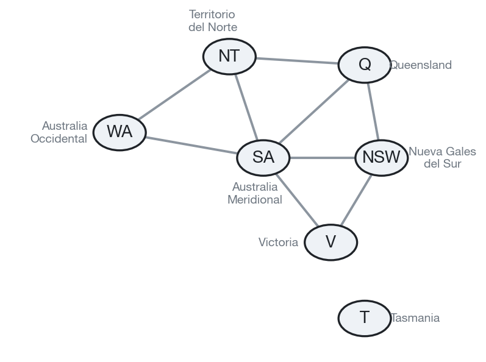
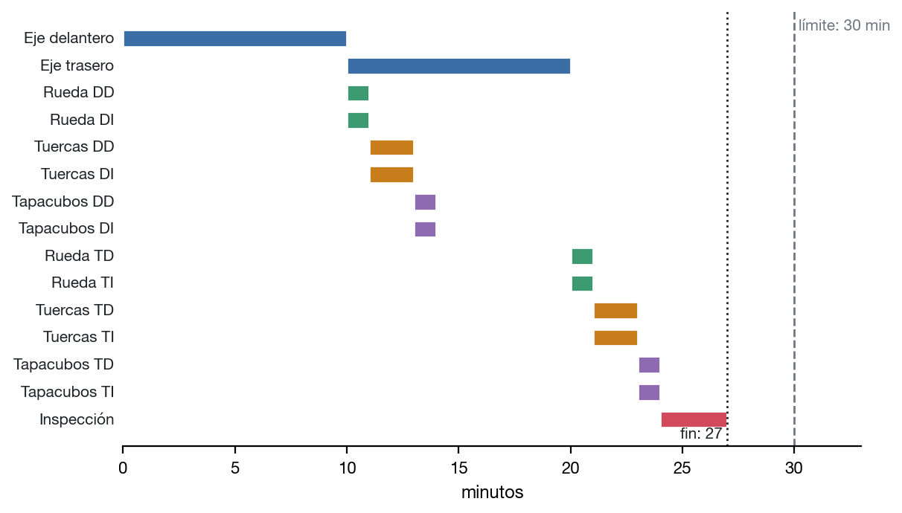
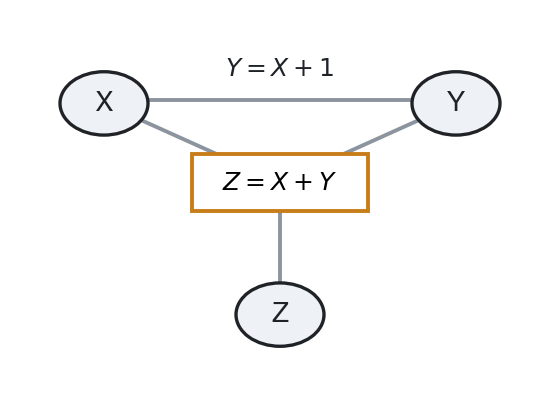
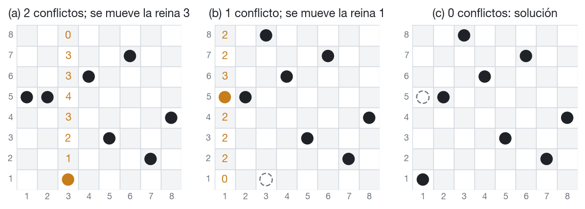
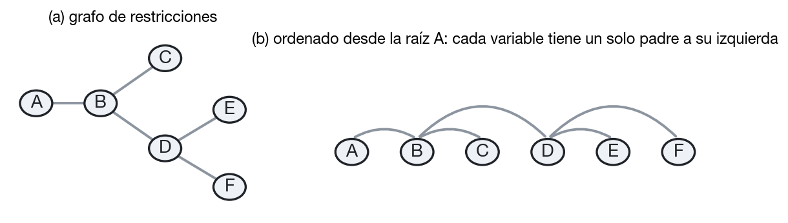
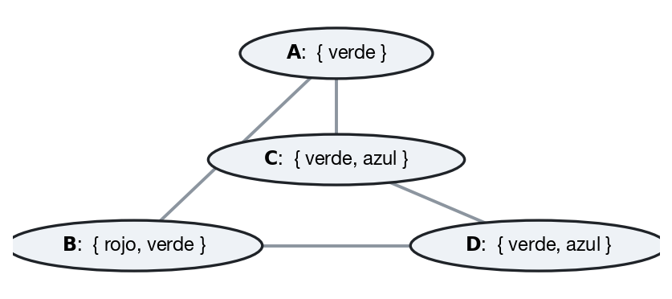
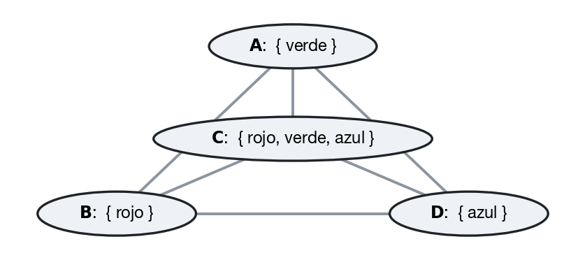

# C2 — Problemas de satisfacción de restricciones

*Elementos de Inteligencia Artificial · Ciencia de Datos · Curso 2026-2027*

*Las figuras de esta nota son de elaboración propia. Los ejemplos del mapa de Australia, del ensamblaje del automóvil y
de las reinas siguen el capítulo 6 de Russell, S. y Norvig, P., "Artificial Intelligence: A Modern Approach", 4.ª
edición, Pearson, 2020; las trazas y las cuentas se han rehecho y comprobado para esta nota.*

---

En la conferencia anterior nos quedamos con una herramienta bastante poderosa. Casi cualquier problema en el que haya que
llegar a algún lado —una ciudad, un rompecabezas resuelto, una configuración de un robot— se puede escribir como estados,
acciones y una prueba de meta, y a partir de ahí un algoritmo como A\* hace el resto. Si además tenemos una buena
heurística, lo hace rápido. Es tentador pensar que ya está: que todo problema es un problema de búsqueda y que lo único
que cambia de uno a otro es la heurística.

Hoy vamos a poner a prueba esa idea con un problema que todos conocen de cerca, porque lo sufren cada fin de semestre: el
calendario de exámenes. Alguien en la facultad tiene que decidir qué examen va en qué día y a qué hora, y tiene que
hacerlo de modo que nadie tenga dos exámenes a la vez. No parece un problema de inteligencia artificial; parece un
problema de paciencia. Pero con treinta asignaturas la paciencia no alcanza, y es un buen ejemplo para ver dónde
empieza a quedarse corta la búsqueda de la C1 y qué hay que cambiar para hacerlo mejor.

Así que vamos a intentar lo siguiente: modelarlo con lo que ya sabemos, y después mirar con
cuidado qué salió bien y qué no.

Una facultad tiene que repartir 30 exámenes en 10 franjas horarias, con una condición: dos exámenes que comparten
estudiantes no pueden caer en la misma franja. Formulémoslo como un problema de búsqueda de la C1:

- **Estados:** un horario parcial, es decir, qué exámenes están ya colocados y en qué franja.
- **Estado inicial:** el horario vacío.
- **Acciones:** colocar un examen todavía sin franja en una de las 10 franjas.
- **Modelo de transición:** $RESULT(s, a)$ es el horario $s$ con ese examen añadido en esa franja.
- **Prueba de meta:** los 30 exámenes están colocados y ningún par incompatible comparte franja.
- **Costo:** 1 por acción.

La formulación es correcta, y cualquier algoritmo de la C1 encontraría un horario si existe. Pero al mirarla con
cuidado aparecen cuatro cosas que no encajan con los problemas de aquella conferencia.

1. **El camino no importa, solo el estado final.** En Rumanía la respuesta era la ruta; aquí es el horario, y nadie
   pregunta en qué orden se llenó. El costo tampoco dice nada: toda solución tiene exactamente 30 acciones, así que
   todas cuestan lo mismo, y la maquinaria de la C1 para encontrar el camino más barato no tiene nada que optimizar.
2. **El orden de las acciones es irrelevante, y la búsqueda no lo sabe.** El mismo horario se alcanza colocando los
   exámenes en cualquiera de sus $30!$ órdenes posibles, y el árbol de búsqueda los trata como caminos distintos. Hay
   $10^{30}$ horarios completos, pero el árbol tiene $30! \cdot 10^{30}$ hojas: unas $10^{32}$ veces más.
3. **La prueba de meta es una caja negra.** Si en el segundo paso se colocaron en la misma franja dos exámenes
   incompatibles, ese horario ya no tiene arreglo. Pero el algoritmo solo sabe preguntar "¿es esto la meta?", y la
   respuesta es "no" tanto para ese horario como para cualquier otro incompleto. Seguirá colocando los 28 exámenes
   restantes, de todas las formas posibles, antes de descubrir que ninguna extensión funciona.
4. **La heurística hay que inventarla.** Para guiar la búsqueda, alguien tendría que escribir a mano una heurística
   específica de horarios —por ejemplo, contar cuántos exámenes tienen ya pocas franjas libres—, y la del próximo
   problema habría que inventarla de nuevo.

Las cuatro tienen la misma raíz. En la C1 los estados eran **atómicos**: el algoritmo no veía dentro de ellos. Pero
este problema tiene una estructura evidente —cada examen es una decisión separada, y la condición habla de pares de
exámenes— que la formulación de búsqueda esconde. Esta nota trata de lo que se gana cuando el algoritmo puede **mirar
dentro del estado**. Si el estado se describe como variables con valores, el orden deja de importar por construcción
(punto 2), una asignación parcial que ya viola una condición se descarta en el acto (punto 3), y aparecen dos cosas
nuevas: **deducir** antes de buscar, y usar **heurísticas que sirven para cualquier problema**, porque se calculan a
partir de la forma de las restricciones y no del significado de las variables (punto 4).

---

## 1. De estados atómicos a estados factorizados

Un **problema de satisfacción de restricciones** (*constraint satisfaction problem*, CSP) tiene tres componentes:

- Un conjunto de **variables** $X = \{X_1, \dots, X_n\}$.
- Un conjunto de **dominios** $D = \{D_1, \dots, D_n\}$, uno por variable: $D_i$ es el conjunto de valores que puede
  tomar $X_i$. Los dominios no tienen por qué ser iguales ni del mismo tamaño; una variable booleana tiene dominio
  $\{\text{verdadero}, \text{falso}\}$, otra puede tener $\{1, 2, 3\}$.
- Un conjunto de **restricciones** $C$ que dicen qué combinaciones de valores están permitidas. Cada restricción tiene
  un **alcance** —las variables que involucra— y una **relación** —los valores que pueden tomar juntas.

Si $X_1, X_2 \in \{1, 2, 3\}$ y queremos que $X_2$ sea mayor que $X_1$, la restricción puede escribirse como una regla,
$\langle (X_1, X_2),\ X_2 > X_1 \rangle$, o como la lista explícita de pares permitidos,
$\langle (X_1, X_2),\ \{(1,2), (1,3), (2,3)\} \rangle$. Son la misma restricción; la primera forma es compacta, la
segunda es la que un algoritmo podría recorrer.

Una **asignación** da valores a algunas variables o a todas: $\{X_1 = 1, X_3 = 2\}$. Hay tres adjetivos que conviene
distinguir:

- **consistente**: no viola ninguna restricción;
- **completa**: todas las variables tienen valor; si no, es **parcial**;
- **solución**: completa *y* consistente.

Resolver un CSP es encontrar una solución, o demostrar que no la hay. En general es un problema NP-completo, así que
no cabe esperar un algoritmo polinomial para todos los casos. Lo que sí cabe esperar —y es buena parte de lo que
sigue— es que la *estructura* de un problema concreto lo haga mucho más fácil que el peor caso.

Comparado con la C1, el cambio es de representación. Allí un estado era un punto indivisible del espacio; aquí un estado
es una asignación, y el algoritmo ve qué variables tiene, qué valores les quedan y qué restricciones las ligan. A esto se
le llama **representación factorizada**.

---

## 2. Modelar un problema como CSP

### Ejemplo 1: colorear un mapa

Queremos colorear los estados y territorios de Australia con tres colores de modo que dos regiones vecinas no tengan el
mismo color. Como CSP:

- **Variables:** una por región, $X = \{WA, NT, SA, Q, NSW, V, T\}$ (usamos las abreviaturas en inglés, que son las del
  libro: Australia Occidental, Territorio del Norte, Australia Meridional, Queensland, Nueva Gales del Sur, Victoria y
  Tasmania).
- **Dominios:** $D_i = \{\text{rojo}, \text{verde}, \text{azul}\}$ para todas.
- **Restricciones:** una por frontera, $\langle (WA, NT),\ WA \neq NT \rangle$, y así hasta nueve:
  $WA \neq NT$, $WA \neq SA$, $NT \neq SA$, $NT \neq Q$, $SA \neq Q$, $SA \neq NSW$, $SA \neq V$, $Q \neq NSW$,
  $NSW \neq V$.

Cuando todas las restricciones relacionan dos variables, el problema se dibuja como un **grafo de restricciones**: un
nodo por variable y una arista por restricción (figura 1). El grafo ya dice cosas antes de resolver nada: SA es la
variable más conectada, y Tasmania no toca a nadie.



**Qué se gana al formularlo así.** Supongamos que ya decidimos $SA = \text{azul}$. Un algoritmo de búsqueda de la C1,
que no ve dentro del estado, seguiría considerando las $3^5 = 243$ combinaciones de colores de los cinco vecinos de SA.
Un algoritmo de CSP ve la restricción y deduce que ninguno de esos cinco puede ser azul: quedan $2^5 = 32$
combinaciones, un 87 % menos, sin haber buscado nada. Y en cuanto una asignación *parcial* viola una restricción, se
puede descartar de golpe todo lo que la extiende, en lugar de esperar a tener el estado completo para preguntar si es
la meta. Esas dos ideas —deducir y descartar pronto— son las que desarrollan las secciones 3 y 4.

### Ejemplo 2: programar tareas en una línea de montaje

El segundo ejemplo se parece mucho más al rover del Proyecto 1: hay tareas, duraciones, precedencias y recursos
compartidos. Una fábrica monta la parte final de un automóvil en **15 tareas**: instalar los dos ejes (delantero y
trasero), las cuatro ruedas, apretar las tuercas de cada rueda, poner los cuatro tapacubos e inspeccionar el conjunto.
Hay que decidir cuándo empieza cada tarea.

- **Variables:** el minuto de inicio de cada tarea, $\{Eje_D, Eje_T, Rueda_{DD}, Rueda_{DI}, Rueda_{TD}, Rueda_{TI},
  Tuercas_{DD}, \dots, Tapa_{TI}, Inspección\}$ (D/T: delantero o trasero; D/I en segunda posición: derecha o izquierda).
- **Dominios:** los enteros de 0 a 27, porque todo tiene que terminar en 30 minutos y la tarea más corta que podría
  quedar al final, la inspección, dura 3.
- **Restricciones**, de cuatro familias:
  - *Precedencia.* Una rueda no se monta antes de terminar su eje (10 min), las tuercas no se aprietan antes de montar
    la rueda (1 min), el tapacubos va después de las tuercas (2 min): $Eje_D + 10 \le Rueda_{DD}$,
    $Rueda_{DD} + 1 \le Tuercas_{DD}$, $Tuercas_{DD} + 2 \le Tapa_{DD}$, y así para cada rueda.
  - *Recurso exclusivo.* Los dos ejes necesitan la misma herramienta, así que no pueden solaparse:
    $(Eje_D + 10 \le Eje_T) \lor (Eje_T + 10 \le Eje_D)$. Esta es una **restricción disyuntiva**: no dice cuál va
    primero, solo que uno de los dos órdenes tiene que cumplirse.
  - *Tarea final.* La inspección empieza cuando todo lo demás ha terminado: $X + d_X \le Inspección$ para cada tarea
    $X$ de duración $d_X$.
  - *Plazo.* $Inspección + 3 \le 30$.

La figura 2 muestra una solución. El orden de los ejes lo decide la restricción disyuntiva; lo demás se encadena por
precedencias y el conjunto termina en el minuto 27.



El ejemplo es pequeño, pero la forma escala: problemas de programación de tareas con miles de variables se resuelven a
diario con estas técnicas. En la nota 2b vamos a llegar exactamente a este tipo de problema desde el otro lado, cuando
un plan del rover tenga que respetar tiempos y recursos.

> **Para ampliar.** Russell y Norvig (sección 6.1) tienen otros dos ejemplos clásicos de modelación: la criptoaritmética y el sudoku.

### Tipos de dominios

- **Discretos y finitos**, como los colores del mapa o las filas de un tablero. Es el caso más común y el que trata el
  resto de la nota.
- **Discretos e infinitos**, como los enteros sin cota. Si el ensamblaje no tuviera plazo, cada inicio podría ser
  cualquier entero y no se podrían listar los pares permitidos: las restricciones hay que expresarlas como ecuaciones
  o desigualdades, $Rueda_{DD} \ge Eje_D + 10$. Para restricciones lineales sobre enteros hay algoritmos específicos;
  para restricciones no lineales generales sobre enteros el problema es indecidible.
- **Continuos**, como los tiempos de observación de un telescopio espacial. El caso más conocido es la programación
  lineal, que se resuelve en tiempo polinomial; es territorio de la investigación de operaciones.

### Tipos de restricciones

- **Unarias**: limitan una sola variable, como $SA \neq \text{verde}$. Se eliminan de entrada recortando el dominio.
- **Binarias**: relacionan dos variables, como $SA \neq NSW$. Un CSP con solo restricciones unarias y binarias se
  llama **CSP binario** y se dibuja como un grafo, como en la figura 1.
- **Globales** o de orden superior: involucran un número arbitrario de variables (no necesariamente todas). La más
  usada es $AllDifferent(X_1, \dots, X_k)$: todas distintas. Las restricciones de orden superior se dibujan con un
  **hipergrafo**, donde un nodo cuadrado representa la restricción y se une a cada variable que involucra (figura 3).



Toda restricción de orden superior sobre dominios finitos puede reescribirse como un conjunto de restricciones
binarias, introduciendo variables auxiliares; por eso muchos algoritmos se describen solo para el caso binario. Aun
así, en la práctica se prefieren las restricciones globales por dos razones: el modelo es más claro y menos propenso a
errores, y existen algoritmos de inferencia especializados para cada una, más potentes que tratar sus piezas binarias
por separado (sección 3). La transformación a binario está en el apéndice.

Dos familias de restricciones globales merecen nombre propio porque van a aparecer en el Proyecto 1:

- **Restricciones de recursos.** $Atmost(10, P_1, P_2, P_3, P_4)$ dice que la suma no puede pasar de 10: no más de 10
  personas repartidas entre cuatro tareas, no más carga que la batería. Veremos cómo se propagan en la sección 3.
- **Restricciones de preferencia.** Todas las anteriores son *absolutas*: violarlas invalida la solución. Pero en
  muchos problemas reales también hay preferencias —"la profesora R prefiere no dar clase por la tarde"— cuya
  violación no invalida un horario pero lo empeora. Se modelan como un costo asociado a cada asignación, y el problema
  pasa a ser encontrar la solución de menor costo total: un **problema de optimización con restricciones**
  (*constrained optimization problem*, COP). Los COP se resuelven con las mismas técnicas más una cota sobre el costo,
  o con búsqueda local y metaheurísticas (C3).

---

## 3. Inferencia: propagación de restricciones

Un algoritmo de búsqueda de la C1 solo puede hacer una cosa: expandir un nodo. Un algoritmo de CSP puede hacer además
otra, que es **deducir**: usar las restricciones para quitar de los dominios valores que no pueden formar parte de
ninguna solución. Quitar un valor de una variable puede permitir quitar valores de sus vecinas, y así sucesivamente;
por eso se llama **propagación de restricciones**. Puede hacerse una vez antes de buscar, como preprocesamiento, o
después de cada paso de la búsqueda (sección 4). A veces basta para resolver el problema entero.

La idea clave es la **consistencia local**: exigir que cada pequeña parte del problema sea coherente por sí sola, y
dejar que esas coherencias locales se propaguen.

### Consistencia de nodo

Una variable es **consistente de nodo** si todos los valores de su dominio satisfacen sus restricciones unarias. Si a
los habitantes de Australia Meridional no les gusta el verde, $D_{SA} = \{\text{rojo}, \text{verde}, \text{azul}\}$ se
reduce a $\{\text{rojo}, \text{azul}\}$ y el problema ya no tiene restricciones unarias. Es el nivel trivial, pero fija
el patrón: **una consistencia local se impone borrando valores**.

### Consistencia de arco

Una variable $X_i$ es **consistente de arco** respecto de $X_j$ si para cada valor de $D_i$ existe *algún* valor en
$D_j$ que satisface la restricción entre ambas. Ese valor de $X_j$ se llama el **soporte** del valor de $X_i$. Un valor
sin soporte no puede estar en ninguna solución, y se puede borrar.

*Ejemplo.* Sea $Y = X^2$ con $X, Y$ dígitos del 0 al 9. Para que $X$ sea consistente de arco respecto de $Y$ hay que
quitar de $D_X$ todo valor cuyo cuadrado no sea un dígito: queda $D_X = \{0, 1, 2, 3\}$. Para que $Y$ lo sea respecto
de $X$, hay que quitar de $D_Y$ lo que no sea un cuadrado de un valor de $D_X$: queda $D_Y = \{0, 1, 4, 9\}$. Ahora el
problema entero es consistente de arco.

*Contraejemplo.* En el mapa, la restricción $SA \neq WA$ con dominios completos no borra nada: para cualquier color de
SA hay otro color disponible para WA. Consistencia de arco no significa que se borre algo; significa que ya no queda
nada que borrar.

### El algoritmo AC-3

AC-3 hace consistente de arco un CSP entero. Mantiene una cola de **arcos** —pares ordenados $(X_i, X_j)$, uno en cada
sentido por restricción binaria— y revisa uno por vez:

```
función AC-3(csp): devuelve falso si detecta inconsistencia, verdadero si no
    cola ← todos los arcos (Xi, Xj) del csp
    mientras cola no esté vacía:
        (Xi, Xj) ← sacar el primero de cola
        si REVISAR(csp, Xi, Xj):
            si Di está vacío: devolver falso
            para cada Xk vecino de Xi, con Xk ≠ Xj:
                añadir (Xk, Xi) a cola
    devolver verdadero

función REVISAR(csp, Xi, Xj): devuelve verdadero si modificó Di
    modificado ← falso
    para cada x en Di:
        si ningún y en Dj satisface la restricción entre Xi y Xj:
            borrar x de Di
            modificado ← verdadero
    devolver modificado
```

El detalle importante es la línea que vuelve a encolar arcos. Si $D_i$ se achicó, algún vecino $X_k$ puede haber
perdido el soporte que tenía en $X_i$, así que hay que revisar $(X_k, X_i)$ otra vez. El arco $(X_j, X_i)$ no hace
falta, porque lo que se borró de $X_i$ era justamente lo que no tenía soporte en $X_j$.

**Traza paso a paso.** Tres variables $X, Y, Z$ con dominio $\{1, 2, 3\}$ y dos restricciones, $X < Y$ e $Y < Z$. Los
arcos son $(X,Y)$, $(Y,X)$, $(Y,Z)$ y $(Z,Y)$, y entran a la cola en ese orden.

| Paso | Arco revisado | Qué se borra y por qué | Dominio resultante | Se encola | Cola tras el paso |
|---|---|---|---|---|---|
| 1 | $(X, Y)$ | $X = 3$: no hay $y > 3$ en $D_Y$ | $D_X = \{1, 2\}$ | nada: el único vecino de $X$ es $Y$ | $(Y, X)$, $(Y, Z)$, $(Z, Y)$ |
| 2 | $(Y, X)$ | $Y = 1$: no hay $x < 1$ en $D_X$ | $D_Y = \{2, 3\}$ | $(Z, Y)$, que ya estaba | $(Y, Z)$, $(Z, Y)$ |
| 3 | $(Y, Z)$ | $Y = 3$: no hay $z > 3$ en $D_Z$ | $D_Y = \{2\}$ | $(X, Y)$ | $(Z, Y)$, $(X, Y)$ |
| 4 | $(Z, Y)$ | $Z = 1$ y $Z = 2$: no hay $y < z$ en $D_Y = \{2\}$ | $D_Z = \{3\}$ | nada: el único vecino de $Z$ es $Y$ | $(X, Y)$ |
| 5 | $(X, Y)$ | $X = 2$: no hay $y > 2$ en $D_Y = \{2\}$ | $D_X = \{1\}$ | nada: el único vecino de $X$ es $Y$ | vacía |

Al vaciarse la cola todos los dominios tienen un único valor: $X = 1$, $Y = 2$, $Z = 3$. La propagación resolvió el
problema sin buscar. Obsérvese el paso 5: el arco $(X, Y)$ ya se había revisado en el paso 1 sin problemas, pero el
paso 3 le quitó soporte a $X = 2$, y por eso se volvió a encolar. Sin esa línea del algoritmo, $X = 2$ habría quedado
en el dominio.

**Complejidad.** Con $n$ variables, dominios de tamaño a lo sumo $d$ y $c$ restricciones binarias, cada arco puede
volver a la cola a lo sumo $d$ veces (una por cada valor que se borre de su extremo), y revisarlo cuesta $O(d^2)$. El
costo total en el peor caso es $O(c\,d^3)$: polinomial. El resultado es un CSP **equivalente** al original —tiene
exactamente las mismas soluciones— pero con dominios más chicos.

### Lo que la consistencia de arco no ve

Intentemos colorear Australia con **dos** colores. AC-3 no borra nada: cada par de regiones vecinas, mirado por
separado, se puede colorear con rojo en un lado y azul en el otro. Y sin embargo no hay solución, porque WA, NT y SA
se tocan entre las tres y con dos colores no pueden ser todas distintas. La consistencia de arco mira las restricciones
**de a una**, y este conflicto solo aparece al mirar tres variables juntas.

Por eso existen consistencias más fuertes. Un par $\{X_i, X_j\}$ es **consistente de camino** respecto de una tercera
variable $X_m$ si toda asignación consistente de $X_i, X_j$ se puede extender con algún valor de $X_m$ compatible con
las dos. En el ejemplo, $(WA = \text{rojo}, SA = \text{azul})$ es una asignación consistente del par, pero NT no tiene
ningún color distinto de ambos; lo mismo con $(WA = \text{azul}, SA = \text{rojo})$. El par no es consistente de camino
respecto de NT, y al imponerlo se descubre que no queda ninguna asignación posible: el problema no tiene solución.

La generalización es la **$k$-consistencia**: toda asignación consistente de $k-1$ variables se puede extender a una
$k$-ésima. La consistencia de nodo es la 1-consistencia, la de arco la 2 y la de camino la 3. Si un problema con $n$
variables fuera fuertemente $n$-consistente (es decir, $k$-consistente para todo $k \le n$), se resolvería **sin
retroceder**: se asigna cada variable en orden y siempre hay un valor compatible con las anteriores. Pero imponer
$n$-consistencia cuesta tiempo y memoria exponenciales en $n$, que es lo que queríamos evitar. En la práctica se usa
casi siempre la consistencia de arco, ocasionalmente la de camino, y casi nunca niveles más altos: **cuánto deducir
antes de buscar es un compromiso**, no una cuestión de principio.

### Propagación en restricciones globales

**$AllDifferent$.** Si una restricción $AllDifferent$ involucra $m$ variables y entre todas sus dominios solo suman $n$
valores distintos con $m > n$, la restricción no se puede cumplir. Un algoritmo simple: mientras haya variables con un
único valor posible, quitarlas y borrar ese valor de las demás; si algún dominio se vacía o quedan más variables que
valores, hay inconsistencia. Con tres variables $\{rojo, verde\}$, $\{rojo, verde\}$, $\{rojo, verde\}$ la
consistencia de arco no ve nada, y este recuento detecta el problema al instante. Es un buen ejemplo de por qué
conviene conservar la restricción global en lugar de partirla en $\neq$ binarios.

**Recursos.** Con $Atmost(10, P_1, \dots, P_4)$ y $D_i = \{3, 4, 5, 6\}$, la suma de los mínimos ya es $12 > 10$:
inconsistente. Si en cambio $D_i = \{2, 3, 4, 5, 6\}$, la suma de los mínimos de las otras tres es 6, así que ninguna
puede valer más de $10 - 6 = 4$, y se borran el 5 y el 6 de cada dominio.

**Propagación de cotas.** Cuando los dominios son intervalos grandes de enteros no se listan valor por valor: se
representan por su cota inferior y superior, y se propagan las cotas. Dos vuelos con capacidades de 165 y 385
pasajeros empiezan con $F_1 \in [0, 165]$ y $F_2 \in [0, 385]$. Si deben llevar 420 pasajeros entre los dos,
$F_1 + F_2 = 420$, entonces $F_1 \ge 420 - 385 = 35$ y $F_2 \ge 420 - 165 = 255$: los dominios quedan
$F_1 \in [35, 165]$ y $F_2 \in [255, 385]$. Un CSP es **consistente de cotas** si los extremos de cada intervalo tienen
soporte. Es el tipo de propagación que un solver aplica a la batería o al tiempo de misión del rover.

---

## 4. Búsqueda con retroceso

Cuando la propagación termina y quedan variables con varios valores, hay que buscar. El espacio de búsqueda natural es
el de las asignaciones parciales: el estado inicial es la asignación vacía, una acción asigna un valor a una variable
todavía sin asignar, y la meta es una asignación completa y consistente.

**Una observación que ahorra un factor $n!$.** Si en cada nodo pudiéramos asignar cualquiera de las $n$ variables con
cualquiera de sus $d$ valores, el factor de ramificación en la raíz sería $nd$, en el siguiente nivel $(n-1)d$, y el
árbol tendría $n! \cdot d^n$ hojas, cuando solo hay $d^n$ asignaciones completas distintas. La redundancia viene de
contar como distintos $\{WA = \text{rojo}, NT = \text{verde}\}$ y $\{NT = \text{verde}, WA = \text{rojo}\}$. Los CSP
son **conmutativos**: el orden en que se toman las decisiones no cambia el resultado. Es el segundo problema que
encontramos al formular el horario de exámenes como búsqueda, al principio de la nota. Basta entonces con elegir, en
cada nodo, **una sola variable** y ramificar sobre sus valores. El árbol tiene profundidad $n$, factor de ramificación
$d$ y $d^n$ hojas.

### El algoritmo

La **búsqueda con retroceso** (*backtracking search*) es búsqueda en profundidad sobre ese árbol: elige una variable,
prueba sus valores de uno en uno, y cuando ningún valor funciona devuelve el fallo al nivel anterior, que prueba su
siguiente valor.

```
función BÚSQUEDA-CON-RETROCESO(csp): devuelve una solución o fallo
    devolver RETROCEDER(csp, {})

función RETROCEDER(csp, asignación): devuelve una solución o fallo
    si asignación está completa: devolver asignación
    var ← ELEGIR-VARIABLE(csp, asignación)
    para cada valor en ORDENAR-VALORES(csp, var, asignación):
        si valor es consistente con asignación:
            añadir {var = valor} a asignación
            inferencias ← INFERIR(csp, var, asignación)
            si inferencias ≠ fallo:
                añadir inferencias al csp
                resultado ← RETROCEDER(csp, asignación)
                si resultado ≠ fallo: devolver resultado
                deshacer inferencias
            quitar {var = valor} de asignación
    devolver fallo
```

A diferencia de las búsquedas de la C1, el algoritmo mantiene **una única asignación** que modifica y deshace, en
lugar de guardar muchos estados: la memoria es lineal en $n$.

Lo interesante son las tres funciones que el pseudocódigo deja abiertas: `ELEGIR-VARIABLE`, `ORDENAR-VALORES` e
`INFERIR`. En la C1 la única forma de mejorar una búsqueda era una heurística que dependía del problema. Aquí, como el
algoritmo ve las variables y las restricciones, esas tres funciones se pueden llenar con **heurísticas independientes
del dominio**, que funcionan igual para mapas, horarios o misiones de un rover. Son la versión CSP de la tesis de la
C1: el conocimiento que guía la búsqueda sale de la estructura del problema.

### Qué variable elegir

El orden fijo ($X_1, X_2, \dots$) o aleatorio no usa ninguna información del estado actual. Dos heurísticas mucho
mejores:

- **Mínimos valores restantes** (*minimum remaining values*, MRV): elegir la variable con **menos valores legales**
  en su dominio actual. También se la llama "variable más restringida" o *fail-first*: si una variable está a punto de
  quedarse sin valores, conviene descubrirlo ya, antes de invertir trabajo en otras ramas. Si una variable tiene cero
  valores, MRV la elige de inmediato y el fallo se detecta sin seguir bajando.
- **Grado** (*degree heuristic*): en caso de empate en MRV, elegir la variable que participa en **más restricciones
  con variables no asignadas**. Al principio del coloreado todas tienen tres valores; SA tiene grado 5, el más alto, y
  empezar por ella es lo que más restringe al resto.

### Qué valor probar primero

- **Valor menos restrictivo** (*least constraining value*, LCV): probar primero el valor que **elimina menos opciones
  de los vecinos**. Si ya tenemos $WA = \text{rojo}$ y $NT = \text{verde}$, a SA (vecina de las dos) solo le queda el
  azul. Si ahora vamos a asignar Q, elegir $Q = \text{azul}$ le quita a SA ese último color y la deja sin valores,
  mientras que $Q = \text{rojo}$ no le quita nada: SA conserva el azul. LCV prefiere rojo.

**¿Por qué *fail-first* para variables y *fail-last* para valores?** Porque las dos decisiones son distintas. Toda
variable tiene que recibir un valor tarde o temprano, así que conviene enfrentar primero la más difícil: si falla,
falla pronto y barato. En cambio, de cada variable basta con que *un* valor funcione, así que conviene probar primero
el que más probablemente lleve a una solución. Si quisiéramos todas las soluciones, o si el problema no tuviera
ninguna, el orden de los valores daría igual: habría que probarlos todos.

### Intercalar búsqueda e inferencia

La propagación de la sección 3 se puede aplicar no solo antes de buscar sino **después de cada asignación**: cada
decisión es información nueva que se propaga. Esto es lo que hace la función `INFERIR`.

- **Comprobación hacia adelante** (*forward checking*, FC). Al asignar $X = x$, borrar $x$ —o, en general, todo valor
  incompatible con $x$— del dominio de cada vecino no asignado de $X$. Si algún dominio queda vacío, fallar ya. Además
  de podar, deja los dominios actualizados, que es justo lo que MRV necesita para contar valores legales.
- **Mantener la consistencia de arco** (*maintaining arc consistency*, MAC). Al asignar $X$, ejecutar AC-3 empezando
  por los arcos $(X_j, X)$ de los vecinos no asignados, y dejar que la propagación siga en cascada.

La diferencia se ve con un ejemplo. Tras $WA = \text{rojo}$ y $Q = \text{verde}$, FC borra el rojo de NT y SA (vecinos
de WA) y el verde de NT, SA y NSW (vecinos de Q). NT y SA quedan con un solo valor, azul, y FC se detiene: no mira la
restricción entre NT y SA, que es precisamente la que ahora está violada. MAC sí la mira, vacía el dominio de SA y
retrocede en ese mismo nodo. FC es una propagación de un solo paso; MAC es la propagación completa.

### Traza paso a paso: MRV, grado, LCV y comprobación hacia adelante

Coloreemos Australia con las tres heurísticas y FC. Los empates que las heurísticas no resuelven se deshacen por el
orden en que listamos las variables en la sección 2 (WA, NT, SA, Q, NSW, V, T) y por el orden rojo, verde, azul de los valores. La tabla muestra, tras cada asignación, los dominios de las variables
que siguen sin asignar, con los colores abreviados en minúscula (r, v, a) para no confundirlos con los nombres de las
variables.

| Paso | Variable elegida y por qué | Valor | WA | NT | Q | NSW | V | T |
|---|---|---|---|---|---|---|---|---|
| 0 | — | — | rva | rva | rva | rva | rva | rva |
| 1 | **SA**: empate en MRV (todas 3); grado 5, el mayor | r: en LCV todos empatan | va | va | va | va | va | rva |
| 2 | **NT**: empate en MRV (2) entre WA, NT, Q, NSW, V; grado 2 (WA y V solo tienen grado 1), empatado con Q y NSW; va primera en el orden | v | a | · | a | va | va | rva |
| 3 | **Q**: MRV 1, empatado con WA; grado 1 (NSW) contra 0 de WA | a | a | · | · | v | va | rva |
| 4 | **NSW**: MRV 1, empatado con WA; grado 1 (V) contra 0 | v | a | · | · | · | a | rva |
| 5 | **WA**: MRV 1, empatado con V; grado 0 los dos; WA va antes en el orden | a | · | · | · | · | a | rva |
| 6 | **V**: MRV 1 | a | · | · | · | · | · | rva |
| 7 | **T**: la única que queda | r | · | · | · | · | · | · |

La solución es SA rojo, NT verde, Q azul, NSW verde, WA azul, V azul y T rojo, y **no hubo ni un retroceso**: cada
valor probado fue el definitivo. Tres cosas para mirar en la tabla. En el paso 1, la heurística de grado es la que
hace el trabajo, porque MRV no distingue nada al principio. A partir del paso 3, MRV encuentra siempre variables con un
solo valor: son decisiones forzadas, y el algoritmo las toma primero. Y Tasmania queda para el final con sus tres
colores intactos, porque no está conectada a nada: MRV y grado la ignoran mientras haya algo más urgente.

Con 7 variables la diferencia entre ordenar bien y ordenar mal es pequeña. En problemas grandes, MRV frente a un orden
fijo o aleatorio puede ahorrar varios órdenes de magnitud en el número de nodos.

---

## 5. Retroceso inteligente y aprendizaje de restricciones

### El problema del retroceso cronológico

Cuando una rama falla, el algoritmo de la sección 4 vuelve a **la última variable asignada** y prueba su siguiente
valor. Eso se llama **retroceso cronológico**, y a menudo es una pérdida de tiempo.

Tomemos un orden fijo, $Q, NSW, V, T, SA, WA, NT$, y supongamos que ya se asignó $Q = \text{rojo}$,
$NSW = \text{verde}$, $V = \text{azul}$, $T = \text{rojo}$. Al llegar a SA no hay ningún color posible: rojo lo tiene
Q, verde NSW y azul V. El retroceso cronológico vuelve a T y le cambia el color. Pero Tasmania no tiene nada que ver
con el conflicto: probará sus tres colores, SA fallará tres veces por el mismo motivo, y solo entonces el algoritmo
subirá a V.

### Saltar a la causa: el conjunto de conflicto

Lo razonable es retroceder a una variable que **pueda arreglar el problema**. Para cada variable se lleva un **conjunto
de conflicto**: las asignaciones anteriores que le quitaron valores. El de SA en el ejemplo es
$\{Q = \text{rojo}, NSW = \text{verde}, V = \text{azul}\}$. Cuando SA se queda sin valores, el algoritmo salta
directamente a **la más reciente de esas variables**, V, sin pasar por T. Esto se llama **salto hacia atrás**
(*backjumping*).

Los conjuntos de conflicto salen gratis con la comprobación hacia adelante: cada vez que $X = x$ borra un valor de
$Y$, se añade $X = x$ al conjunto de conflicto de $Y$. Hay un detalle que conviene saber: el backjumping simple **no
aporta nada si ya se usa FC o MAC**, porque esas técnicas detectan el problema antes de que la variable llegue a
quedarse sin valores —en el ejemplo, FC habría vaciado el dominio de SA al asignar V, y retrocedido desde ahí. La idea,
sin embargo, sí es útil en su forma más fuerte.

### Retroceso dirigido por conflicto

Consideremos la asignación parcial $\{WA = \text{rojo}, NSW = \text{rojo}\}$. Parece inocente —WA y NSW ni siquiera
son vecinas—, pero **no se puede completar**: SA, NT y Q tienen que ser todas distintas entre sí (forman un triángulo),
y ninguna puede ser roja, porque SA y NT tocan a WA y SA y Q tocan a NSW. Quedan dos colores para tres variables
mutuamente vecinas.

Supongamos que tras esas dos asignaciones el algoritmo asigna T, y luego intenta NT, Q, V y SA. Todas las
combinaciones van a fallar. Cuando finalmente NT agota sus valores, ¿a dónde retroceder? El backjumping simple no sirve,
porque NT no tiene un conflicto directo con NSW: sus valores no los borró NSW, sino que fallaron más abajo. El
**retroceso dirigido por conflicto** (*conflict-directed backjumping*) resuelve esto **acumulando** los conjuntos de
conflicto a medida que se retrocede:

1. SA falla, y su conjunto de conflicto es $\{WA, NT, Q\}$: fueron ellas las que le quitaron los colores.
2. Se salta a Q, la más reciente de ese conjunto. Q hereda el conflicto de SA, menos ella misma, y lo une al suyo
   propio, $\{NT, NSW\}$: queda $\{WA, NT, NSW\}$. Esto significa que no hay solución desde Q en adelante dadas esas
   tres asignaciones.
3. Q agota sus valores y se salta a NT, la más reciente de $\{WA, NT, NSW\}$. NT hereda $\{WA, NSW\}$ y lo une a su
   conflicto propio, $\{WA\}$: queda $\{WA, NSW\}$.
4. NT agota sus valores y el algoritmo salta directamente a **NSW**, pasando por encima de T, que no tiene nada que ver.

El conjunto final $\{WA, NSW\}$ es exactamente la explicación del fallo que dimos arriba.

### Aprender de los fallos

El retroceso dirigido por conflicto dice *a dónde* volver. El **aprendizaje de restricciones** (*constraint learning*)
va un paso más allá: evita **volver a cometer el mismo error** en otra rama. Cuando se identifica un conjunto de
asignaciones que no puede formar parte de ninguna solución —un ***no-good***—, se añade al problema como una
restricción nueva que prohíbe esa combinación.

En el ejemplo anterior, el no-good es $\{WA = \text{rojo}, NSW = \text{rojo}\}$. Si la búsqueda más tarde reconstruyera
esa misma combinación por otro camino —por ejemplo, después de cambiar el valor de alguna variable asignada antes—,
la restricción aprendida la podaría al instante, sin volver a explorar el subárbol. En problemas pequeños no se nota;
en problemas grandes, donde los mismos conflictos reaparecen una y otra vez en ramas distintas, es una de las técnicas
que más rendimiento aporta a los solvers modernos. Es también el corazón de los resolvedores de SAT actuales, que
vamos a usar para planificar en la nota 2b.

---

## 6. Búsqueda local para CSP

Todo lo anterior construye la solución variable por variable. La alternativa es la de la búsqueda local de la C1 y
de la C3: partir de una **asignación completa**, aunque viole restricciones, e ir cambiando el valor de una variable
por vez hasta que no quede ninguna violada.

La heurística más usada para elegir el cambio es **mínimos conflictos** (*min-conflicts*): tomar al azar una variable
que esté en conflicto y darle el valor que **viole menos restricciones**, dado el resto de la asignación.

```
función MÍNIMOS-CONFLICTOS(csp, máx_pasos): devuelve una solución o fallo
    actual ← una asignación completa inicial para csp
    repetir máx_pasos veces:
        si actual es solución: devolver actual
        var ← una variable en conflicto, elegida al azar
        valor ← el valor v de var que minimiza CONFLICTOS(var, v, actual)
        asignar var = valor en actual
    devolver fallo
```

**Ejemplo: ocho reinas.** Una reina por columna; la variable $Q_c$ es la fila de la reina de la columna $c$, con la
fila 1 abajo. La figura 4a muestra una asignación completa con dos conflictos: las reinas 1 y 2 comparten la fila 5, y
las reinas 3 y 5 comparten una diagonal. Elegimos la reina 3. Los números de su columna dicen cuántos conflictos
tendría en cada fila: el mínimo, 0, está en la fila 8, y la movemos ahí. Queda un conflicto (figura 4b), el de las
reinas 1 y 2. Elegimos la reina 1; su único mínimo está en la fila 1. Al moverla, no queda ningún conflicto (figura 4c).



Es un ejemplo elegido para que salga en dos pasos, pero el algoritmo es sorprendentemente eficaz en general: en el
problema de las $n$ reinas, sin contar la colocación inicial, el número de pasos es casi independiente de $n$, y el
problema de **un millón** de reinas se resuelve en unos 50 pasos en promedio. Funciona también en problemas reales
difíciles: aplicado a la programación de observaciones del telescopio espacial Hubble, redujo el tiempo necesario para
planificar una semana de observaciones de tres semanas a unos diez minutos.

**Las mesetas.** El paisaje de mínimos conflictos suele tener **mesetas**: regiones enormes de asignaciones con el
mismo número de conflictos, donde ningún cambio individual mejora. Las formas de salir son las de la C3, aquí en
versión breve: permitir **movimientos laterales** a asignaciones igual de buenas; **búsqueda tabú**, que prohíbe
volver a los valores cambiados recientemente para no dar vueltas en círculo; **recocido simulado**, que acepta a veces
movimientos que empeoran. Una técnica propia de los CSP es la **ponderación de restricciones**: cada restricción lleva
un peso, inicialmente 1; en cada paso se elige el cambio que minimiza el peso total de las restricciones violadas, y
después se aumenta el peso de las que siguen violadas. Las restricciones difíciles van ganando peso, lo que da
pendiente a las mesetas y concentra el esfuerzo donde está el problema.

**Una ventaja práctica: reparar.** Si un horario de vuelos con miles de vuelos se invalida porque cierra un aeropuerto,
backtracking tendría que empezar de cero y probablemente produciría un horario muy distinto. La búsqueda local empieza
**desde el horario actual** y lo repara con pocos cambios. Para el rover —y para cualquier sistema que opere en un
mundo que cambia— esta propiedad vale mucho.

---

## 7. La estructura del problema

Hasta aquí las heurísticas miraban variables y valores. La última fuente de eficiencia es la **forma del grafo de
restricciones**.

### Subproblemas independientes

Tasmania no está conectada con el resto: colorear Tasmania y colorear el continente son problemas independientes, y
cualquier solución de uno combinada con cualquier solución del otro es una solución del total. En general, los
**componentes conexos** del grafo son subproblemas independientes. La ganancia es enorme: si $n$ variables se dividen
en subproblemas de $c$ variables cada uno, el costo pasa de $O(d^n)$ a $O(\frac{n}{c}\, d^c)$, **lineal** en $n$. Dividir
un CSP booleano de 100 variables en cuatro subproblemas de 25 lleva el peor caso de $2^{100}$ a $4 \cdot 2^{25}$
asignaciones: de la edad del universo a menos de un segundo.

### CSP con estructura de árbol

Los subproblemas completamente independientes son raros, pero hay otra estructura casi tan buena. Si el grafo de
restricciones es un **árbol** —entre cada par de variables hay exactamente un camino—, el CSP se resuelve en tiempo
**lineal** en el número de variables, sin retroceder:

1. Elegir una raíz y ordenar las variables de modo que cada una aparezca después de su padre (figura 5).
2. Recorrer las variables **de la última a la segunda**, haciendo el arco (padre, hijo) consistente: borrar del
   dominio del padre los valores sin soporte en el hijo.
3. Recorrer las variables **de la primera a la última**, asignando a cada una cualquier valor compatible con su padre.



El paso 3 nunca falla: cuando se asigna una variable, su padre ya tiene un valor, y el paso 2 garantizó que ese valor
tiene soporte en el hijo. Hay $n - 1$ arcos y cada uno cuesta $O(d^2)$, así que el total es $O(n\,d^2)$, frente al
$O(d^n)$ general. A esta propiedad —cada variable es consistente de arco con las que vienen después en el orden— se le
llama **consistencia de arco dirigida**.

¿Y si el grafo es *casi* un árbol? En Australia, basta con quitar SA para que lo que queda sea un árbol. Se puede
entonces **condicionar sobre un conjunto de corte**: asignar SA de todas las formas posibles (3), y en cada caso
resolver el árbol restante con el algoritmo anterior. Si hay que quitar $c$ variables para obtener un árbol, el costo
es $O(d^c \cdot (n - c)\, d^2)$: exponencial solo en $c$, no en $n$.

### Simetría

Muchos problemas tienen soluciones que son la misma "salvo nombres". En el mapa, dada una solución, permutar los tres
colores da otras $3! = 6$ soluciones idénticas en esencia, y la búsqueda las explora todas cuando hay fallos. Una
**restricción de ruptura de simetría** elige un representante de cada familia: por ejemplo, fijar un orden arbitrario
entre los colores de WA, NT y SA, que son mutuamente vecinas. Eliminar toda la simetría de un problema es NP-difícil,
pero romper solo la más evidente suele bastar para ganar mucho.

### Reformular es la mejor optimización

Juntemos todo en un ejemplo. El problema de las ocho reinas admite al menos tres formulaciones:

- **64 variables booleanas**, una por casilla, con la restricción de que haya exactamente ocho verdaderas y ningún par
  se ataque. Hay $2^{64} \approx 1{,}8 \times 10^{19}$ asignaciones completas.
- **8 variables**, una por columna, con dominio $\{1, \dots, 8\}$ (la formulación de la sección 6). Hay
  $8^8 \approx 1{,}7 \times 10^7$ asignaciones: la restricción "una reina por columna" dejó de ser una restricción,
  porque ahora la cumple la representación por construcción.
- Las mismas 8 variables con $AllDifferent(Q_1, \dots, Q_8)$, que capta de golpe todas las restricciones de fila y que
  se propaga bien. Solo las $8! = 40\,320$ permutaciones cumplen esa restricción, y el solver no genera ninguna otra
  asignación completa.

Del primero al tercero el espacio se redujo catorce órdenes de magnitud **sin cambiar de algoritmo**. Ningún ajuste de
heurísticas da eso. La elección de variables, dominios y restricciones es la decisión de diseño que más pesa, y es la
que el Proyecto 1 les va a pedir justificar.

---

## 8. Qué llevarse de esta nota

1. **Un CSP es búsqueda con los estados abiertos.** Variables, dominios y restricciones dejan ver dentro del estado, y
   eso permite deducir, podar pronto y usar heurísticas generales.
2. **Deducir y buscar se complementan.** La propagación (nodo, arco, AC-3, restricciones globales, cotas) reduce el
   espacio de forma polinomial pero incompleta; la búsqueda completa lo que la propagación no alcanza. Cuánto propagar
   en cada paso —nada, FC, MAC— es un compromiso entre costo por nodo y número de nodos.
3. **Las heurísticas no dependen del dominio.** MRV, grado y LCV se calculan a partir de la forma del problema, no de
   lo que significan las variables; por eso un solver de CSP sirve igual para mapas, horarios o rovers.
4. **Los fallos enseñan.** Retroceder hacia la causa y registrar los no-goods convierte cada error en información.
5. **La estructura manda.** Componentes independientes, árboles, conjuntos de corte y simetrías cambian el costo de
   exponencial a lineal. Y **reformular un problema puede cambiar su dificultad más que cambiar de algoritmo**.

**Hacia la nota 2b.** Un CSP tiene un número fijo de variables: sabemos de antemano cuántas regiones hay que colorear o
cuántas tareas hay que programar. Pero si lo que hay que decidir es *qué hacer* —qué acciones ejecuta el rover y en qué
orden—, no sabemos cuántas decisiones va a tener el plan. La planificación es la siguiente vuelta de la misma tuerca:
otra representación estructurada del estado, y otra vez heurísticas que no se inventan, sino que salen de la
representación. Y al final de la 2b vamos a volver aquí: un problema de planificación con horizonte fijo es un CSP.

---

## 9. Preguntas frecuentes

**¿Cuándo conviene formular algo como CSP y no como búsqueda de la C1?** Cuando la solución es una *configuración* y no
un *camino*: importa el resultado final, no la secuencia de pasos para llegar. Colorear, programar tareas, asignar
aulas. Si lo que importa es la secuencia —la ruta del rover entre dos puntos— es búsqueda. Si importa qué acciones se
hacen y en qué orden, sin saber cuántas, es planificación (nota 2b).

**¿AC-3 alcanza para resolver un problema?** A veces sí, como en la traza de la sección 3 o en muchos sudokus fáciles.
En general no: deja dominios más chicos y la búsqueda hace el resto. Si AC-3 vacía un dominio, sí es concluyente: no
hay solución.

**Si MAC poda más que FC, ¿por qué no usar siempre MAC?** Porque cada nodo cuesta más. MAC suele ganar en problemas
difíciles y muy restringidos; en problemas fáciles o poco restringidos el trabajo extra de propagar puede no
compensar. Es una pregunta empírica, y se contesta midiendo con el protocolo del proyecto.

**¿La búsqueda local reemplaza a backtracking?** No. Es muy rápida cuando las soluciones abundan y es ideal para
reparar, pero no es completa: si no encuentra solución, no demuestra que no exista. Backtracking sí puede demostrarlo.

**¿Tengo que implementar todo esto para el Proyecto 1?** No. Se pueden usar solvers existentes. Lo que se evalúa es
que el modelo esté bien planteado para la técnica y que sepan explicar qué hace el solver: qué propagación aplica, qué
heurísticas de variable y valor usa, y por qué eso importa en su problema.

---

## 10. Ejercicios

Intenten resolverlos por su cuenta. Los ejercicios 2 y 5 son trazas a mano como las de las secciones 3 y 4; el 8
conecta con el Proyecto 1.

**1.** Hay que programar cinco exámenes, A, B, C, D y E, en tres franjas horarias. No pueden coincidir en la misma
franja dos exámenes que comparten estudiantes: A y B, A y C, B y C, B y D, C y D, D y E. Además, E no puede ir en la
primera franja. *(a)* Formúlelo como CSP y dibuje el grafo de restricciones. *(b)* ¿A qué problema de esta nota es
equivalente? *(c)* Encuentre una solución.

**2.** En el coloreado de Australia, partiendo de $WA = \text{rojo}$ y $Q = \text{verde}$ con los demás dominios
completos, aplique AC-3 a mano. ¿Qué concluye? ¿Qué habría concluido la comprobación hacia adelante a partir de las
mismas dos asignaciones?

**3.** Aplique consistencia de arco al CSP de la figura 6 (todas las restricciones son "distinto color"). ¿Queda
resuelto?



**4.** Haga lo mismo con el CSP de la figura 7. ¿Qué concluye? ¿En qué arco se detecta?



**5.** Resuelva el problema de las **cuatro** reinas con búsqueda con retroceso, en orden fijo $Q_1, Q_2, Q_3, Q_4$ y
probando las filas de 1 a 4. Hágalo dos veces: primero sin inferencia y después con comprobación hacia adelante.
Dibuje el árbol de cada caso. ¿En qué momento descubre cada versión que $Q_1 = 1$ no lleva a ninguna solución?

**6.** Explique con sus palabras por qué MRV elige la variable más propensa a fallar y LCV el valor menos propenso a
fallar. Dé un caso en que el orden de los valores no cambie en nada el trabajo del algoritmo.

**7.** Sobre el árbol de la figura 5, con dominios $\{1, 2, 3, 4\}$ para todas las variables y la restricción
"el hijo es mayor que el padre" en cada arista, aplique el algoritmo para CSP con estructura de árbol de la sección 7.
Muestre los dominios tras el recorrido hacia atrás y la solución del recorrido hacia adelante.

**8.** *(Hacia el Proyecto 1.)* Proponga una formulación como CSP de una misión del rover: tres puntos de interés que
visitar, una batería que no puede bajar de un umbral y una zona de comunicación disponible solo en ciertos intervalos.
Diga cuáles son las variables y sus dominios, y clasifique cada restricción según los tipos de la sección 2. ¿Qué
propagación aplicaría a cada una?

<!-- ---

## 11. Soluciones

**1.** *(a)* Variables $A, B, C, D, E$; dominios $\{1, 2, 3\}$, salvo $D_E = \{2, 3\}$ tras imponer la restricción
unaria $E \neq 1$ (consistencia de nodo). Restricciones binarias $A \neq B$, $A \neq C$, $B \neq C$, $B \neq D$,
$C \neq D$, $D \neq E$. El grafo tiene dos triángulos, $ABC$ y $BCD$, que comparten la arista $BC$, y una arista más,
$DE$. *(b)* Es un problema de coloreado de grafos con tres colores: las franjas son los colores. Reconocer que dos
problemas con enunciados distintos tienen la misma forma es exactamente lo que permite reutilizar un solver. *(c)* Por
ejemplo $A = 1$, $B = 2$, $C = 3$; D es vecina de B y C, así que $D = 1$; y E es vecina de D, así que $E \in \{2, 3\}$,
por ejemplo $E = 2$. Obsérvese que A y D tienen que ir en la misma franja en *toda* solución: los dos triángulos lo
fuerzan.

**2.** Los arcos que tocan a las variables asignadas borran: $NT$ pierde el rojo (por WA) y el verde (por Q) y queda
$\{\text{azul}\}$; $SA$ pierde lo mismo y queda $\{\text{azul}\}$; $NSW$ pierde el verde (por Q) y queda
$\{\text{rojo}, \text{azul}\}$. Al revisar el arco $(SA, NT)$, el único valor de SA, azul, no tiene soporte en NT, que
también es solo azul: $D_{SA}$ queda vacío y AC-3 devuelve inconsistencia. Conclusión: ninguna solución tiene
$WA = \text{rojo}$ y $Q = \text{verde}$. La comprobación hacia adelante habría hecho las mismas reducciones sobre los
vecinos de WA y de Q, habría dejado NT y SA en $\{\text{azul}\}$, y se habría detenido sin ver el conflicto, porque no
mira la restricción entre dos variables no asignadas. Es el ejemplo de la sección 4.

**3.** $B$ pierde el verde (por A): $D_B = \{\text{rojo}\}$. $C$ pierde el verde (por A): $D_C = \{\text{azul}\}$.
Al revisar $(D, C)$, $D$ pierde el azul: $D_D = \{\text{verde}\}$. El arco $(D, B)$ no borra nada, porque verde es
distinto de rojo. Todos los dominios quedan con un único valor y la asignación $A = \text{verde}$, $B = \text{rojo}$,
$C = \text{azul}$, $D = \text{verde}$ cumple todas las restricciones: la consistencia de arco resolvió el problema. A
y D pueden tener el mismo color porque no son vecinas.

**4.** Las tres vecinas de C tienen ya un único valor, y son los tres colores: el arco $(C, A)$ le quita el verde, el
$(C, B)$ el rojo y el $(C, D)$ el azul. Al revisar el tercero de esos arcos, $D_C$ queda vacío y AC-3 concluye que el
problema no tiene solución. Obsérvese que A, B y D, entre sí, sí son compatibles (verde, rojo y azul son distintos dos
a dos): la inconsistencia está únicamente en C, que es vecina de las tres.

**5.** *Sin inferencia.* $Q_1 = 1$; $Q_2 = 1$ y $Q_2 = 2$ chocan, $Q_2 = 3$; para $Q_3$ las cuatro filas chocan con
alguna de las anteriores: se retrocede. $Q_2 = 4$; $Q_3 = 2$; para $Q_4$ las cuatro filas chocan: se retrocede;
$Q_3 = 3$ y $Q_3 = 4$ chocan; se retrocede a $Q_2$, que no tiene más valores, y a $Q_1$. $Q_1 = 2$; $Q_2 = 4$;
$Q_3 = 1$; $Q_4 = 3$: solución $(2, 4, 1, 3)$. El algoritmo descubre que $Q_1 = 1$ es un callejón sin salida solo
después de haber llegado hasta la cuarta columna.
*Con comprobación hacia adelante.* $Q_1 = 1$ deja $D_2 = \{3, 4\}$, $D_3 = \{2, 4\}$, $D_4 = \{2, 3\}$.
$Q_2 = 3$ vacía $D_3$: falla en el acto. $Q_2 = 4$ deja $D_3 = \{2\}$ y $D_4 = \{3\}$; $Q_3 = 2$ vacía $D_4$: falla.
Se retrocede a $Q_1 = 2$, que deja $D_2 = \{4\}$, $D_3 = \{1, 3\}$, $D_4 = \{1, 3, 4\}$; $Q_2 = 4$ deja $D_3 = \{1\}$,
$D_4 = \{1, 3\}$; $Q_3 = 1$ deja $D_4 = \{3\}$; $Q_4 = 3$. Misma solución. Aquí el fallo de $Q_1 = 1$ se descubre en
la tercera columna y sin probar ningún valor de la cuarta. En un tablero tan chico los dos árboles tienen el mismo
número de asignaciones (ocho); la ganancia de FC está en cuántas comprobaciones se evitan y en qué nivel se detecta el
fallo. Con ocho reinas la diferencia ya se ve en el número de nodos: 113 asignaciones sin inferencia y 88 con FC en el
mismo orden.

**6.** Toda variable tiene que recibir un valor, así que las difíciles hay que enfrentarlas igual: mejor antes, cuando
fallar cuesta poco porque el subárbol que se descarta es grande. De los valores, en cambio, basta con que funcione uno,
así que conviene empezar por el que deja más opciones al resto. El orden de los valores no importa cuando hay que
recorrerlos todos: si se buscan *todas* las soluciones, o si el problema no tiene ninguna (por ejemplo, Australia con
dos colores).

**7.** Orden: $A, B, C, D, E, F$, con padres $B \to A$, $C \to B$, $D \to B$, $E \to D$, $F \to D$. *Recorrido hacia
atrás.* Arco $(D, F)$: D necesita un hijo mayor, así que pierde el 4: $D_D = \{1, 2, 3\}$. Arco $(D, E)$: nada nuevo.
Arco $(B, D)$: B necesita algún $d > b$ con $d \le 3$, pierde el 3 y el 4: $D_B = \{1, 2\}$. Arco $(B, C)$: nada nuevo.
Arco $(A, B)$: A necesita algún $b > a$ con $b \le 2$: $D_A = \{1\}$. *Recorrido hacia adelante.* Cada variable
toma el primer valor de su dominio que sea mayor que el de su padre. $A = 1$ (su único valor). $B = 2$: en
$D_B = \{1, 2\}$, el único mayor que $A = 1$. $C = 3$: el primero de $\{1, 2, 3, 4\}$ mayor que $B = 2$. $D = 3$: en
$D_D = \{1, 2, 3\}$, el único mayor que $B = 2$. $E = 4$ y $F = 4$: lo único mayor que $D = 3$. Todas las aristas
cumplen hijo > padre ($2 > 1$, $3 > 2$, $3 > 2$, $4 > 3$, $4 > 3$), y nunca hubo que retroceder, como garantiza el
algoritmo.

**8.** Hay varias formulaciones defendibles; una posible. *Variables:* para cada punto de interés $i$, su posición en
el orden de visita $O_i \in \{1, 2, 3\}$ y su hora de llegada $T_i \in [0, T_{máx}]$; la hora de transmisión
$T_{tx}$; el nivel de batería al llegar a cada punto, $B_i$. *Restricciones:* $AllDifferent(O_1, O_2, O_3)$
(global); si $O_i < O_j$ entonces $T_j \ge T_i + \text{servicio}_i + \text{viaje}_{ij}$ (precedencia condicional,
del mismo tipo que la disyuntiva de los ejes); $B_i \ge B_{mín}$ (unaria sobre una variable derivada) y la relación
entre $B$ y los consumos de cada tramo (restricción de recursos); $T_{tx}$ dentro de alguno de los intervalos de
comunicación (disyuntiva unaria); $T_{tx} + d_{tx} \le T_{máx}$ (plazo). *Propagación:* $AllDifferent$ con su
algoritmo específico; propagación de cotas sobre los tiempos y la batería, que son intervalos de enteros grandes;
consistencia de arco sobre las variables de orden. Lo que se espera en el proyecto no es esta formulación, sino que
cada decisión de modelado esté justificada, y que se diga qué restricciones se dejaron fuera y por qué. -->

---

## Apéndice — Lectura opcional

### El sudoku como CSP

Un sudoku tiene 81 casillas; llamamos $A1, \dots, I9$ a las variables (filas A–I, columnas 1–9). El dominio de una
casilla vacía es $\{1, \dots, 9\}$ y el de una casilla dada es el valor impreso. Hay 27 restricciones
$AllDifferent$: 9 filas, 9 columnas y 9 cuadros de 3×3. Para aplicarle AC-3, cada $AllDifferent$ se descompone en
restricciones binarias $X_i \neq X_j$. Con eso, los sudokus fáciles se resuelven **solo por propagación**: cada casilla
pierde los valores de sus vecinas, alguna queda con un único valor, ese valor se borra de las casillas de su fila,
columna y cuadro, y así en cascada. Los más difíciles necesitan inferencias más fuertes. La que usan los aficionados
bajo el nombre de ***naked triples*** es una forma de consistencia de $AllDifferent$: si en una unidad tres casillas
tienen dominios contenidos en un mismo conjunto de tres números —por ejemplo $\{1, 3, 8\}$, $\{1, 8\}$ y $\{3, 8\}$—,
esos tres números tienen que repartirse entre esas tres casillas, y se pueden borrar de las demás casillas de la
unidad.

Lo interesante es que nada de esto es específico del sudoku. Basta con declarar variables, dominios y las 27
restricciones; los algoritmos generales hacen el resto.

### Transformación de restricciones n-arias a binarias

Toda restricción n-aria sobre dominios finitos puede reescribirse con restricciones binarias. Una forma es introducir
una variable auxiliar cuyo dominio sean las tuplas que cumplen la restricción, y unirla a cada variable original con
una restricción binaria que diga "la componente $k$ de la tupla coincide con $X_k$". Otra es el **grafo dual**: cada
restricción del problema original se convierte en una variable, cuyo dominio son las tuplas que la satisfacen, y dos de
estas variables se unen con una restricción binaria cuando las restricciones originales comparten variables.

*Ejemplo.* Con $X, Y, Z \in \{1, \dots, 5\}$ y las restricciones $C_1: Z = X + Y$ y $C_2: Y = X + 1$ (figura 3), el
grafo dual tiene dos variables. El dominio de $C_1$ son las ternas $(x, y, z)$ con $z = x + y$, como $(1, 2, 3)$,
$(2, 3, 5)$ o $(1, 1, 2)$, siempre con $z \le 5$; el de $C_2$ son los pares $(x, y)$ con $y = x + 1$: $(1, 2)$, $(2, 3)$, $(3, 4)$, $(4, 5)$.
La restricción binaria entre ambas exige que coincidan en $X$ e $Y$: $\{((1,2,3), (1,2)),\ ((2,3,5), (2,3))\}$. Los pares
$(3, 4)$ y $(4, 5)$ no tienen terna compatible, porque $3 + 4 = 7$ y $4 + 5 = 9$ se salen del dominio de $Z$.

---

## Referencias

Russell, S. y Norvig, P. *Artificial Intelligence: A Modern Approach*, 4.ª edición, 2020. Capítulo 6: 6.1
(definiciones y ejemplos), 6.2 (propagación), 6.3 (backtracking), 6.4 (búsqueda local) y 6.5 (estructura). Las notas
bibliográficas del final del capítulo recorren la historia de cada técnica.

<div class="nota-ia" style="margin-top:2.5em;padding-top:.5em;border-top:1px solid #e3e6eb;font-size:7.5pt;color:#8a8f98;line-height:1.35;">
Nota sobre la elaboración de este texto: elaborado con asistencia de inteligencia artificial, con el modelo de Anthropic Claude Opus 5 (identificador <code>claude-opus-5</code>), en septiembre de 2026, a partir del esquema, las fuentes y las indicaciones de la profesora de la asignatura.
</div>
