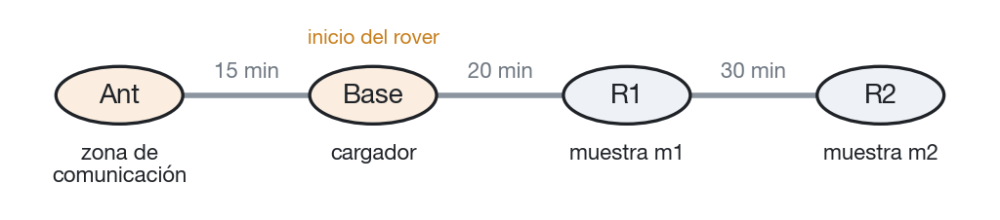
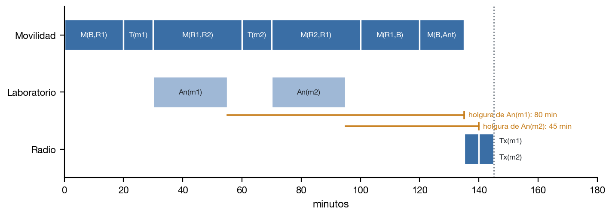

# C2 — Planificación clásica

*Elementos de Inteligencia Artificial · Ciencia de Datos · Curso 2026-2027*

*Las figuras, el dominio del rover y los experimentos de esta nota son de elaboración propia. El marco teórico sigue el
capítulo 11 de Russell, S. y Norvig, P., "Artificial Intelligence: A Modern Approach", 4.ª edición, Pearson, 2020. Los
archivos PDDL del ejemplo están en la carpeta [resources/](resources/) de esta conferencia.*

---

Hasta ahora tenemos dos maneras de mirar un problema. En la C1 el estado era una caja cerrada y lo único que podíamos
hacer era explorar desde afuera, con una heurística que alguien tenía que inventar. En la nota 2a abrimos la caja: el
estado pasó a ser un conjunto de variables con valores, y con eso aparecieron la deducción y las heurísticas que sirven
para cualquier problema. Hoy vamos a dar un paso más en la misma dirección, y lo vamos a hacer con el problema que los
va a acompañar todo el Proyecto 1: el rover.

Pensemos primero en algo más cotidiano. Un sábado a la mañana hay que ir al banco, pasar por la farmacia, comprar pan y
estar de vuelta antes del almuerzo, y el banco cierra temprano. Nadie hace eso al azar: uno piensa qué hacer primero,
qué conviene dejar para el final, qué cosas se pueden hacer de paso. Eso es planificar, y lo hacemos todo el tiempo.

El rover tiene el mismo problema, con otras tareas. Arranca el día en su base, tiene que recoger dos muestras de roca
en sitios distintos, analizarlas y transmitir los resultados, y la antena solo tiene cobertura en una zona del mapa.
Nadie le dice por dónde empezar. ¿Va a buscar las dos muestras y después transmite, o transmite la primera en cuanto
la tiene? ¿Analiza por el camino o espera a llegar?

Si intentamos resolverlo con lo que ya sabemos, las dos herramientas se quedan cortas. No es un problema de rutas como
los de la C1, aunque tiene varias rutas adentro: lo que hay que decidir es **qué hacer y en qué orden**. Y tampoco es un
CSP como los de la nota 2a, porque un CSP necesita saber de antemano cuántas variables tiene, y aquí no sabemos cuántas
decisiones va a tener la respuesta: el plan puede tener cinco acciones o cincuenta.

En esta nota vamos a ver una representación justamente para esto.

Esta nota es más corta que la 2a. Cubre lo que hace falta para el apartado de planificación del Proyecto 1 y deja
señalado el resto, para que puedan ampliar consultando la bibliografía.

---

## 1. Por qué no basta con búsqueda ni con CSP

Repasemos las dos representaciones que ya tenemos.

- **Búsqueda (C1).** El estado es una caja negra. Para cada problema hay que programar a mano qué acciones existen,
  qué producen y qué heurística usar. Funciona, pero cada problema nuevo empieza de cero, y la heurística depende de la
  inventiva de quien modela.
- **CSP (nota 2a).** El estado tiene estructura, y eso da heurísticas generales. Pero un CSP tiene un número fijo de
  variables, y la pregunta "¿qué hago?" no lo tiene: no sabemos cuántas acciones va a necesitar el rover.

La planificación clásica toma lo mejor de cada una. Como en búsqueda, la solución es una **secuencia de acciones**. Como
en CSP, el estado y las acciones tienen **estructura explícita**, escrita en un lenguaje que el algoritmo puede leer.
Y eso permite que el mismo planificador, sin cambiar una línea, resuelva el rover, la logística de un puerto o el
montaje de una pieza: basta con describirle el problema.

---

## 2. La representación: estados, acciones y objetivos

### Estados como conjuntos de hechos

Un estado se describe como un **conjunto de hechos** verdaderos: proposiciones atómicas sin variables, como
$En(Base)$ o $MuestraEn(m_1, R_1)$. Todo lo que no figura en el conjunto se considera falso; esto es la **suposición de
mundo cerrado**, y vamos a volver sobre ella en la sección 7. Tampoco hay funciones ni cantidades numéricas: solo hechos
que se cumplen o no.

Para el rover usamos el mundo de la figura 1: cuatro lugares conectados en línea —la zona de comunicación, la base,
la roca $R_1$ y la roca $R_2$—, una muestra en cada roca, y el rover en la base.



El estado inicial es:

$$
En(Base) \land MuestraEn(m_1, R_1) \land MuestraEn(m_2, R_2) \land ZonaCom(Ant) \land Conectado(Base, R_1) \land \dots
$$

donde los puntos suspensivos son los otros cinco hechos $Conectado$: hay uno por cada sentido de cada tramo, seis en
total. $ZonaCom$ y
$Conectado$ son hechos **estáticos**: ninguna acción los cambia.

El **objetivo** es una conjunción de hechos que tienen que cumplirse al final, sin decir nada del resto:
$Transmitida(m_1) \land Transmitida(m_2)$. Cualquier estado que contenga esos dos hechos es un estado meta, esté donde
esté el rover.

### Acciones: precondiciones y efectos

Una acción se describe con un **esquema** que tiene tres partes: sus **parámetros**, su **precondición** —los hechos
que tienen que ser verdaderos para poder ejecutarla— y su **efecto**, que se divide en hechos que **añade** y hechos
que **borra**. Las cuatro acciones del rover:

| Acción | Precondición | Añade | Borra |
|---|---|---|---|
| $Mover(x, y)$ | $En(x) \land Conectado(x, y)$ | $En(y)$ | $En(x)$ |
| $Tomar(m, x)$ | $En(x) \land MuestraEn(m, x)$ | $Tiene(m)$ | $MuestraEn(m, x)$ |
| $Analizar(m)$ | $Tiene(m)$ | $Analizada(m)$ | — |
| $Transmitir(m, x)$ | $Analizada(m) \land En(x) \land ZonaCom(x)$ | $Transmitida(m)$ | — |

Una acción es **aplicable** en un estado $s$ si su precondición está contenida en $s$, y el resultado de aplicarla es

$$
RESULT(s, a) = (s \setminus BORRA(a)) \cup AÑADE(a).
$$

Es decir: se quitan los hechos que borra, se ponen los que añade, y **todo lo demás queda igual**. Esta última parte
parece trivial y no lo es: resuelve de un plumazo el llamado *problema del marco* —decir qué *no* cambia al actuar—, que
en otras representaciones exige escribir un axioma por cada hecho y cada acción. Lo vamos a ver en la sección 5.

Un **plan** es una secuencia de acciones, cada una aplicable en el estado que deja la anterior, que termina en un
estado que satisface el objetivo. Para el rover, el plan más corto tiene 11 acciones:

| Paso | Acción | Paso | Acción |
|---|---|---|---|
| 1 | $Mover(Base, R_1)$ | 7 | $Mover(Base, Ant)$ |
| 2 | $Mover(R_1, R_2)$ | 8 | $Analizar(m_1)$ |
| 3 | $Tomar(m_2, R_2)$ | 9 | $Transmitir(m_1, Ant)$ |
| 4 | $Mover(R_2, R_1)$ | 10 | $Analizar(m_2)$ |
| 5 | $Tomar(m_1, R_1)$ | 11 | $Transmitir(m_2, Ant)$ |
| 6 | $Mover(R_1, Base)$ | | |

Hay otros planes de la misma longitud —se puede tomar $m_1$ a la ida y analizar en cualquier momento después de
tomar—; lo que ningún plan corto hace es ir a transmitir entre una muestra y otra, porque eso obliga a cruzar el mapa
dos veces.

### STRIPS y PDDL

Esta forma de describir el mundo se llama **STRIPS**, por el planificador de 1971 que la introdujo. Su versión
estandarizada es **PDDL** (*Planning Domain Definition Language*), el lenguaje en que se escriben las entradas de
prácticamente todos los planificadores actuales. PDDL separa dos archivos:

- el **dominio**, que describe los tipos de objetos, los predicados y los esquemas de acción: lo que vale para
  *cualquier* misión del rover;
- el **problema**, que describe una instancia concreta: qué objetos hay, el estado inicial y el objetivo.

El dominio del rover en PDDL:

```lisp
(define (domain rover)
  (:requirements :strips :typing)
  (:types lugar muestra)
  (:predicates (en ?x - lugar)
               (conectado ?x ?y - lugar)
               (muestra-en ?m - muestra ?x - lugar)
               (tiene ?m - muestra)
               (analizada ?m - muestra)
               (transmitida ?m - muestra)
               (zona-com ?x - lugar))

  (:action mover
    :parameters (?desde ?hasta - lugar)
    :precondition (and (en ?desde) (conectado ?desde ?hasta))
    :effect (and (en ?hasta) (not (en ?desde))))

  (:action tomar
    :parameters (?m - muestra ?x - lugar)
    :precondition (and (en ?x) (muestra-en ?m ?x))
    :effect (and (tiene ?m) (not (muestra-en ?m ?x))))

  (:action analizar
    :parameters (?m - muestra)
    :precondition (tiene ?m)
    :effect (analizada ?m))

  (:action transmitir
    :parameters (?m - muestra ?x - lugar)
    :precondition (and (analizada ?m) (en ?x) (zona-com ?x))
    :effect (transmitida ?m)))
```

Y el problema de la figura 1:

```lisp
(define (problem mision-1)
  (:domain rover)
  (:objects base r1 r2 ant - lugar
            m1 m2 - muestra)
  (:init (en base)
         (conectado base r1) (conectado r1 base)
         (conectado r1 r2)   (conectado r2 r1)
         (conectado base ant) (conectado ant base)
         (muestra-en m1 r1) (muestra-en m2 r2)
         (zona-com ant))
  (:goal (and (transmitida m1) (transmitida m2))))
```

Los dos archivos están en [resources/](resources/). Con el planificador `pyperplan` (se instala con
`pip install pyperplan`), la orden `pyperplan -s astar -H hmax rover-dominio.pddl rover-problema.pddl` devuelve un plan
de 11 acciones. Vale la pena hacerlo: es la forma más rápida de ver que el modelo dice lo que uno cree que dice.

**Modelar mal se nota en el plan.** Si a $Transmitir$ se le olvida la precondición $ZonaCom(x)$, el planificador no se
queja: devuelve un plan que transmite desde la roca, que es más corto y que en el mundo real no funciona. El
planificador es fiel al modelo, no al mundo; los planes absurdos son el mejor detector de errores de modelado que hay.

**Precondiciones negativas.** En STRIPS las precondiciones solo pueden pedir que algo sea verdadero. A veces hace falta
lo contrario: por ejemplo, que el rover solo pueda tomar una muestra si no lleva ya otra. PDDL lo permite con el
requisito `:negative-preconditions` y la condición `(not (lleva-muestra))`, que tiene sentido gracias a la suposición de
mundo cerrado: lo que no figura en el estado es falso. Pero no todos los planificadores lo admiten (`pyperplan`, por
ejemplo, no), y las heurísticas de la sección 4 se definen para precondiciones positivas. La solución habitual es un
**predicado dual**: en lugar de pedir `(not (lleva-muestra))`, se añade el hecho `(brazo-libre)`, que $Tomar$ borra y
la acción de soltar la muestra vuelve a añadir. El modelo es el mismo y queda en STRIPS puro.

---

## 3. Planificar es buscar

Con esta representación, un problema de planificación **es** un problema de búsqueda de la C1: los estados son
conjuntos de hechos, las acciones son las instancias de los esquemas, $RESULT$ es la fórmula de arriba y la prueba de
meta es comprobar que el objetivo está contenido en el estado. Hay dos direcciones naturales.

### Búsqueda hacia adelante (progresión)

Se parte del estado inicial y se aplican acciones aplicables hasta encontrar un estado meta. En el rover, desde el
inicio solo hay dos acciones aplicables, $Mover(Base, R_1)$ y $Mover(Base, Ant)$, porque las demás tienen
precondiciones que no se cumplen. Es la dirección más intuitiva, y con buenas heurísticas es la que usan los
planificadores más eficaces.

### Búsqueda hacia atrás (regresión)

Se parte del objetivo y se pregunta qué acción podría haberlo producido. Una acción $a$ es **relevante** para un
objetivo $g$ si añade al menos uno de sus hechos y **no borra ninguno**. La **regresión** de $g$ a través de $a$ es lo
que tendría que cumplirse antes de ejecutar $a$:

$$
g' = (g \setminus AÑADE(a)) \cup PRECOND(a).
$$

En el rover, con $g = \{Transmitida(m_1), Transmitida(m_2)\}$:

1. $Transmitir(m_2, Ant)$ es relevante: añade $Transmitida(m_2)$ y no borra nada. Se quita $Transmitida(m_2)$ del
   objetivo y se añade su precondición, $\{Analizada(m_2), En(Ant), ZonaCom(Ant)\}$. Queda
   $g' = \{Transmitida(m_1), Analizada(m_2), En(Ant), ZonaCom(Ant)\}$.
2. Sobre $g'$, $Transmitir(m_1, Ant)$ es relevante: añade $Transmitida(m_1)$. Se quita $Transmitida(m_1)$ y se añade
   $\{Analizada(m_1), En(Ant), ZonaCom(Ant)\}$; los dos últimos ya estaban. Queda
   $g'' = \{Analizada(m_1), Analizada(m_2), En(Ant), ZonaCom(Ant)\}$.
3. Sobre $g''$, para conseguir $En(Ant)$, $Mover(Base, Ant)$ es relevante. Se quita $En(Ant)$ y se añade
   $\{En(Base), Conectado(Base, Ant)\}$. Queda
   $g''' = \{Analizada(m_1), Analizada(m_2), En(Base), Conectado(Base, Ant), ZonaCom(Ant)\}$.

En cambio, $Mover(Ant, Base)$ **no** es relevante en el paso 3 aunque añada $En(Base)$: borra $En(Ant)$, que es parte
del objetivo actual. La regresión tiene una ventaja: solo considera acciones que contribuyen al objetivo, y el factor
de ramificación suele ser menor. Su desventaja es que trabaja con *descripciones parciales* de estados, que pueden ser
imposibles —por ejemplo, $\{En(Base), En(Ant)\}$— sin que el algoritmo lo sepa, y que es más difícil diseñarle buenas
heurísticas. Por eso hoy domina la búsqueda hacia adelante.

¿Cómo sabría un planificador que $\{En(Base), En(Ant)\}$ es imposible? Nada en el modelo lo dice, pero se puede
**deducir de las acciones**. El estado inicial tiene un solo hecho $En$, y toda acción que añade un $En$ borra otro, así
que en cualquier estado alcanzable hay exactamente un hecho $En$ verdadero. A una propiedad así, que se cumple en todo
estado alcanzable, se le llama **invariante** del dominio, y a los hechos que nunca pueden ser verdaderos a la vez,
**mutuamente excluyentes** (*mutex*). Los planificadores modernos calculan estos invariantes automáticamente antes de
buscar. Les sirven para descartar descripciones imposibles en la regresión, y también para reescribir el problema con
menos variables: los cuatro hechos $En(x)$ se convierten en una sola variable, $Pos \in \{Base, R_1, R_2, Ant\}$, que
es exactamente la formulación como CSP de la sección 5.

### El problema: el factor de ramificación

En el rover de juguete todo esto es inmediato. En problemas reales, no. Russell y Norvig dan un ejemplo de logística
aérea con 10 aeropuertos, 50 aviones y 200 paquetes: en cada estado hay, en promedio, unas 2 000 acciones aplicables
—cualquier avión puede volar a cualquier otro aeropuerto, cualquier paquete puede cargarse en cualquier avión que esté
en su aeropuerto—, y el plan obvio tiene 41 pasos. El árbol de búsqueda hasta esa profundidad tiene del orden de
$2000^{41}$ nodos. **Sin una buena heurística, planificar es inviable.** Y como queremos un planificador que sirva para
cualquier dominio, la heurística no puede escribirla a mano quien modela: tiene que salir sola de la representación.

---

## 4. Heurísticas independientes del dominio: relajar el problema

En la C1 vimos que las dos heurísticas del 8-puzzle se obtienen **relajando** el problema: quitando restricciones hasta
que sea fácil de resolver, y usando el costo de la solución relajada como estimación. Quitar restricciones solo puede
abaratar la solución, así que la estimación nunca sobreestima. Allí esa relajación la hacía una persona mirando las
reglas del juego. La gran ventaja de STRIPS es que las reglas están escritas en un formato que el algoritmo puede leer,
así que **la relajación la puede hacer el propio planificador**, para cualquier dominio, sin intervención humana.

Hay tres formas clásicas de relajar un problema de planificación.

### Ignorar las precondiciones

Si toda acción se puede ejecutar en cualquier estado, cada hecho del objetivo se consigue en un solo paso. La
heurística es, aproximadamente, el **número de hechos del objetivo que faltan**. En el rover, $h = 2$: una
$Transmitir$ por muestra.

Es el equivalente exacto de $h_1$ del 8-puzzle: si una ficha pudiera moverse a cualquier casilla, bastaría un
movimiento por ficha mal colocada. Y comparte su defecto: es barata pero muy poco informativa, porque ignora que para
transmitir hay que llegar a la antena, y para eso tener algo que transmitir. Hay un detalle más: cuando una acción
consigue varios hechos del objetivo a la vez, contar hechos sobreestima, y calcular el mínimo exacto de acciones es un
problema de cobertura de conjuntos, NP-difícil. En la práctica se usa una aproximación voraz.

### Ignorar los efectos de borrado

Esta es la relajación importante. Se quitan de todas las acciones los hechos que **borran**, y se conservan
precondiciones y hechos que añaden. En el problema relajado nada se vuelve falso nunca: el rover que va de la base a
$R_1$ sigue también en la base. Es como si dejara una copia de sí mismo en cada lugar por el que pasa.

¿Por qué es buena idea? Porque el problema relajado es **monótono**: cada acción solo agrega hechos, así que nunca
conviene deshacer nada, y las precondiciones que ya se lograron siguen logradas. Eso lo vuelve mucho más fácil de
analizar. El costo del plan óptimo relajado se llama $h^+$, y es **admisible**: cualquier plan real sigue siendo un
plan del problema relajado (tener hechos de más nunca impide aplicar una acción), así que el óptimo relajado no puede
ser más largo que el óptimo real.

En el rover, el plan relajado óptimo tiene 9 acciones: tres movimientos —$Mover(Base, R_1)$, $Mover(R_1, R_2)$ y
$Mover(Base, Ant)$, este último posible porque $En(Base)$ nunca se borró—, dos $Tomar$, dos $Analizar$ y dos
$Transmitir$. La diferencia con el plan real, que tiene 11, son los dos movimientos de vuelta, que en el problema
relajado no hacen falta. $h^+ = 9 \le 11 = h^*$.

Hay un problema: calcular $h^+$ exactamente sigue siendo NP-difícil. Pero se puede **aproximar** muy bien, y en
tiempo polinomial, con la idea siguiente. Se calcula un costo para cada hecho, empezando por los del estado inicial,
que cuestan 0, y se itera hasta que nada cambie:

- el costo de una acción es 1 más el costo de **conseguir sus precondiciones**;
- el costo de un hecho es el mínimo de los costos de las acciones que lo añaden.

La pregunta es cómo combinar los costos de varias precondiciones. Hay dos respuestas, y dan dos heurísticas:

- **$h_{max}$**: tomar el **máximo**. Supone, con optimismo, que conseguir la precondición más cara ya trae gratis las
  demás. Es admisible, pero suele quedarse muy corta.
- **$h_{add}$**: tomar la **suma**. Supone que cada precondición se consigue por separado, sin compartir nada. Es mucho
  más informativa, pero puede contar dos veces el mismo trabajo, y **no es admisible**.

El objetivo también es un conjunto de hechos, así que su costo se calcula igual: $h_{max}$ toma el máximo de los costos
de los hechos del objetivo, y $h_{add}$ los suma. Ese es el valor de la heurística en el estado.

**Traza paso a paso en el rover.** Los hechos estáticos y los del estado inicial cuestan 0. En la tabla, cada fila
depende solo de filas anteriores.

| Hecho | Acción que lo consigue más barato | Costo con $h_{max}$ | Costo con $h_{add}$ |
|---|---|---|---|
| $En(Base)$, $MuestraEn(\cdot)$, $ZonaCom(Ant)$ | — (estado inicial) | 0 | 0 |
| $En(R_1)$ | $Mover(Base, R_1)$ | $1 + 0 = 1$ | $1 + 0 = 1$ |
| $En(Ant)$ | $Mover(Base, Ant)$ | $1 + 0 = 1$ | $1 + 0 = 1$ |
| $En(R_2)$ | $Mover(R_1, R_2)$ | $1 + 1 = 2$ | $1 + 1 = 2$ |
| $Tiene(m_1)$ | $Tomar(m_1, R_1)$ | $1 + \max(1, 0) = 2$ | $1 + (1 + 0) = 2$ |
| $Tiene(m_2)$ | $Tomar(m_2, R_2)$ | $1 + \max(2, 0) = 3$ | $1 + (2 + 0) = 3$ |
| $Analizada(m_1)$ | $Analizar(m_1)$ | $1 + 2 = 3$ | $1 + 2 = 3$ |
| $Analizada(m_2)$ | $Analizar(m_2)$ | $1 + 3 = 4$ | $1 + 3 = 4$ |
| $Transmitida(m_1)$ | $Transmitir(m_1, Ant)$ | $1 + \max(3, 1, 0) = 4$ | $1 + (3 + 1 + 0) = 5$ |
| $Transmitida(m_2)$ | $Transmitir(m_2, Ant)$ | $1 + \max(4, 1, 0) = 5$ | $1 + (4 + 1 + 0) = 6$ |
| **Objetivo** | | $\max(4, 5) = \mathbf{5}$ | $5 + 6 = \mathbf{11}$ |

$h_{max} = 5$ se queda lejos de 11: solo "ve" la cadena más larga, la de $m_2$. $h_{add} = 11$ coincide aquí con el
costo real, pero por casualidad: cuenta **dos veces** el movimiento $Mover(Base, R_1)$ —una dentro de cada muestra— y
dos veces $Mover(Base, Ant)$, y ese exceso compensa justo los dos movimientos de vuelta que el problema relajado ignora.
Basta con cambiar un poco el problema para que la compensación se rompa: si las dos muestras estuvieran en $R_1$, el
plan óptimo tendría 9 acciones y $h_{add}$ daría 10. **Sobreestima**, y A\* con $h_{add}$ pierde la garantía de
optimalidad (es el ejercicio 3).

El planificador FF, uno de los más influyentes, usa una tercera opción, $h_{FF}$: construye explícitamente un plan
relajado —sin contar dos veces las acciones compartidas— y usa su longitud. En el rover da 9, el valor de $h^+$. No es
admisible en general, pero es muy informativa y evita el doble conteo de $h_{add}$.

**Si las acciones no cuestan lo mismo.** Hasta aquí cada acción costaba 1, y la heurística estimaba *cuántas acciones*
faltan. En el Proyecto 1 moverse por roca no cuesta lo mismo que moverse por llano, y lo que interesa es el costo total.
Todo lo anterior sigue valiendo si se cambia el 1 por el costo de la acción, $c(a)$:

$$
\text{costo}(a) = c(a) + \text{costo de sus precondiciones}, \qquad
\text{costo}(p) = \min_{a \text{ que añade } p} \text{costo}(a),
$$

combinando las precondiciones con el máximo ($h_{max}$) o con la suma ($h_{add}$), igual que antes. Si en el rover los
costos son los minutos de viaje de la figura 1, $En(R_1)$ cuesta 20 y $En(R_2)$ cuesta $30 + 20 = 50$. $h^+$ pasa a
ser el costo mínimo de un plan relajado, no su longitud, y $h_{max}$ y $h^+$ siguen siendo admisibles. En PDDL los
costos se declaran con el requisito `:action-costs`: cada acción incluye `(increase (total-cost) 20)` en su efecto, y
el problema pide `(:metric minimize (total-cost))`. `pyperplan` no admite costos, pero Fast Downward sí.

### Descomponer en submetas

La tercera relajación supone que los hechos del objetivo son **independientes**: se resuelve cada uno por separado y
se combinan los costos. En el rover, conseguir solo $Transmitida(m_1)$ cuesta 6 acciones, y solo $Transmitida(m_2)$,
8. Si se toma el **máximo**, $h = 8$, que es admisible: el plan completo tiene que resolver al menos la submeta más
cara. Si se toma la **suma**, $h = 14$, que sobreestima, porque ignora que las dos submetas comparten el viaje. Es el
mismo dilema entre $h_{max}$ y $h_{add}$ a otra escala: **el máximo es seguro pero se queda corto, la suma es
informativa pero puede pasarse**.

### Comparación

| Heurística | Valor en el rover | ¿Admisible? |
|---|---|---|
| Ignorar precondiciones | 2 | sí (en este caso) |
| $h_{max}$ | 5 | sí |
| Submetas, máximo | 8 | sí |
| $h^+$ (plan relajado óptimo) y $h_{FF}$ | 9 | $h^+$ sí; $h_{FF}$ en general no |
| **Costo real $h^*$** | **11** | — |
| $h_{add}$ | 11 (10 frente a 9 si las dos muestras están en $R_1$) | no |
| Submetas, suma | 14 | no |

La tabla ordena lo que ya sabíamos de la C1: cuanto más se relaja, más barata y más pobre es la heurística; cuanto
menos se relaja, más informativa y más cara de calcular.

### ¿Cuánto importa en la práctica?

Para verlo con números, usamos una misión más grande (archivo `rover-problema-grande.pddl`): ocho lugares, cinco
muestras en cuatro rocas y una sola zona de comunicación. El plan óptimo tiene 25 acciones. Estos son los resultados de
`pyperplan` 2.1 con distintas combinaciones de búsqueda y heurística:

| Búsqueda | Heurística | Nodos expandidos | Longitud del plan | Tiempo |
|---|---|---|---|---|
| Anchura | ninguna | 7 969 – 7 983 | 25 | 0,21 – 0,24 s |
| A\* | ninguna ($h = 0$) | 7 727 – 7 756 | 25 | 0,33 – 0,47 s |
| A\* | $h_{max}$ | 5 161 | 25 | 3,8 – 4,4 s |
| A\* | LM-cut | 121 – 124 | 25 | 0,75 – 0,77 s |
| A\* | $h_{add}$ | 162 – 173 | **37** | 0,10 – 0,11 s |
| Voraz | $h_{add}$ | 58 – 61 | **48 – 50** | 0,04 s |
| Voraz | $h_{FF}$ | 26 – 30 | 25 – 26 | 0,02 – 0,03 s |

Los valores son el mínimo y el máximo de diez corridas por configuración. Los algoritmos son deterministas, pero
`pyperplan` desempata los nodos según el orden interno de Python, que cambia de una ejecución a otra, y eso mueve un
poco los números. Es una sola instancia, así que no es un experimento en el sentido del Proyecto 1. Aun así se ven tres
cosas:

- **Una heurística admisible pero débil puede salir más cara que no usar ninguna.** $h_{max}$ ahorra un tercio de los
  nodos, pero cada nodo cuesta calcularla, y el tiempo total es unas doce veces mayor que el de A\* sin heurística.
  LM-cut es otra heurística admisible, más elaborada (se basa en *hitos*, hechos que todo plan tiene que conseguir),
  que expande sesenta veces menos nodos.
- **Una heurística no admisible cuesta optimalidad.** A\* con $h_{add}$ es rápido y devuelve siempre un plan de 37
  acciones, casi el 50 % más largo que el óptimo. Con búsqueda voraz, entre 48 y 50.
- **La combinación práctica suele ser voraz con $h_{FF}$**: óptima o casi (25 o 26 acciones, según la corrida) y con
  una fracción minúscula del trabajo. Es, esencialmente, lo que hacen los planificadores modernos cuando no se exige optimalidad.

La conclusión es la de la C1, ahora con cifras: **garantías, calidad y costo no se pueden tener todos a la vez**, y
elegir es una decisión de ingeniería.

---

## 5. Planificar como CSP y como SAT

Al final de la nota 2a dijimos que un CSP no sirve para planificar porque no sabemos cuántas acciones tendrá el plan.
Hay una salida simple: **fijar el horizonte**. Si decidimos que el plan tiene exactamente $T$ pasos, el número de
decisiones es fijo y el problema se convierte en un CSP. Si no tiene solución, se prueba con $T + 1$.

### El rover como CSP con horizonte $T$

Una formulación posible, con una copia de cada variable por instante $t = 0, 1, \dots, T$:

- $Pos_t \in \{Base, R_1, R_2, Ant\}$: dónde está el rover en el instante $t$.
- $Est(m)_t \in \{\text{en roca}, \text{tomada}, \text{analizada}, \text{transmitida}\}$ para cada muestra: en qué
  punto de su proceso está.
- $Acc_t$, para $t < T$: qué acción se ejecuta entre $t$ y $t + 1$; su dominio son las 12 acciones instanciadas del
  rover más una acción *nada*.

Las restricciones traducen la tabla de acciones. Por ejemplo, para cada $t$:

- Si $Acc_t = Mover(x, y)$, entonces $Pos_t = x$ y $Pos_{t+1} = y$ (precondición y efecto).
- Si $Acc_t = Tomar(m, x)$, entonces $Pos_t = x$, $Est(m)_t = \text{en roca}$ y $Est(m)_{t+1} = \text{tomada}$.
- Si $Acc_t$ no es un $Mover$, entonces $Pos_{t+1} = Pos_t$ (**lo que no cambia, no cambia**).

Y el estado inicial y el objetivo son restricciones unarias: $Pos_0 = Base$, $Est(m)_0 = \text{en roca}$,
$Est(m)_T = \text{transmitida}$. Con $T = 11$ el problema tiene 47 variables y es satisfacible; con $T = 10$ no lo es,
y un solver de CSP lo demuestra propagando, sin probar planes uno por uno.

Obsérvese la tercera restricción. En STRIPS era gratis —todo lo que una acción no toca queda igual—, pero en un CSP hay
que escribirla: es el **problema del marco** del que hablamos en la sección 2.

### El rover como SAT

La misma idea con variables booleanas da la **planificación como satisfacibilidad** (SATPlan). Hay una variable
proposicional por cada hecho y cada instante, $En(Ant)^t$, y por cada acción y cada instante, $Mover(Base, Ant)^t$. Las
fórmulas dicen que una acción implica sus precondiciones en $t$ y sus efectos en $t + 1$, que no se ejecutan dos acciones
incompatibles a la vez, y, para cada hecho, un **axioma de estado sucesor** que dice exactamente cuándo es verdadero en
el instante siguiente:

$$
En(Ant)^{t+1} \iff Mover(Base, Ant)^t \lor \big(En(Ant)^t \land \lnot Mover(Ant, Base)^t\big).
$$

Se lee: el rover está en la antena después del paso $t$ si acaba de llegar, o si ya estaba y no se fue. Se le entrega
la fórmula a un resolvedor de SAT para $T = 1, 2, 3, \dots$ hasta que sea satisfacible, y el plan se lee de las
variables de acción que quedaron verdaderas.

¿Por qué molestarse, si ya teníamos la búsqueda heurística? Porque los resolvedores de SAT y de CSP modernos son
extraordinariamente eficientes —en buena parte gracias al **aprendizaje de restricciones** de la nota 2a— y en ciertos
dominios, sobre todo los muy restringidos, esta vía gana. Y porque cierra el círculo de la C2: **planificar con
horizonte fijo es un CSP**. Las dos notas hablan del mismo tipo de problema con dos representaciones distintas, y
elegir entre ellas es, otra vez, una decisión de modelado.

---

## 6. Tiempo y recursos: del plan al cronograma

La planificación clásica decide *qué* acciones y en *qué orden*, pero sus acciones son instantáneas y no consumen nada.
El rover real tarda en moverse, gasta batería y tiene instrumentos que pueden trabajar a la vez. El enfoque más común
—y el que sugiere el Proyecto 1— es **planificar primero y programar después**: el planificador decide la secuencia, y
luego un problema de **programación de tareas** (*scheduling*) le asigna tiempos respetando duraciones y recursos. Esa
segunda parte es exactamente el problema del ensamblaje del automóvil de la nota 2a.

### De orden total a orden parcial

El plan de la sección 2 es una secuencia, pero no todas sus acciones dependen unas de otras. $Analizar(m_1)$ solo
necesita que $m_1$ haya sido tomada: no tiene por qué esperar a que el rover llegue a la antena. Lo que el plan impone
de verdad son **vínculos causales**: la acción $a$ produce un hecho que la acción $b$ necesita, así que $a$ va antes que
$b$. A eso se le suman los **recursos**: dos acciones que usan el mismo recurso exclusivo no pueden solaparse.

Supongamos que el rover tiene tres recursos independientes: la **movilidad** (moverse y tomar muestras, que exige estar
quieto con el brazo), el **laboratorio** (analizar) y la **radio** (transmitir). Las duraciones: los viajes, las de la
figura 1; tomar una muestra, 10 minutos; analizarla, 25; transmitir, 5.

### Camino crítico

Con las precedencias y los recursos, se calcula para cada acción su **inicio más temprano** (*ES*): el máximo, entre
sus predecesoras, de inicio más duración. El fin del proyecto es el mayor fin más temprano. Después, recorriendo al
revés, se calcula el **inicio más tardío** (*LS*): cuánto se puede retrasar una acción sin retrasar el final. La
diferencia $LS - ES$ es la **holgura**. Las acciones con holgura cero forman el **camino crítico**: cualquier retraso en
ellas retrasa toda la misión.

| Acción | Duración | ES | Fin temprano | LS | Holgura |
|---|---|---|---|---|---|
| $Mover(Base, R_1)$ | 20 | 0 | 20 | 0 | 0 |
| $Tomar(m_1)$ | 10 | 20 | 30 | 20 | 0 |
| $Mover(R_1, R_2)$ | 30 | 30 | 60 | 30 | 0 |
| $Tomar(m_2)$ | 10 | 60 | 70 | 60 | 0 |
| $Mover(R_2, R_1)$ | 30 | 70 | 100 | 70 | 0 |
| $Mover(R_1, Base)$ | 20 | 100 | 120 | 100 | 0 |
| $Mover(Base, Ant)$ | 15 | 120 | 135 | 120 | 0 |
| $Analizar(m_1)$ | 25 | 30 | 55 | 110 | **80** |
| $Analizar(m_2)$ | 25 | 70 | 95 | 115 | **45** |
| $Transmitir(m_1)$ | 5 | 135 | 140 | 135 | 0 |
| $Transmitir(m_2)$ | 5 | 140 | 145 | 140 | 0 |

(Aquí tomamos la muestra $m_1$ a la ida, que es otro de los planes óptimos, porque así el análisis de $m_1$ puede
empezar antes.) La misión dura 145 minutos (figura 2). El camino crítico es toda la cadena de la movilidad más las dos
transmisiones; los análisis van en paralelo con el viaje y tienen mucha holgura.



La holgura no es solo un dato: es **margen de maniobra**. Si el laboratorio no pudiera funcionar mientras el rover se
mueve —si fuera parte del mismo recurso que la movilidad—, los dos análisis tendrían que ir en serie con los viajes y
la misión pasaría a durar 195 minutos. Y si la batería no alcanza para todo el recorrido, la holgura dice qué acciones
se pueden correr sin costo en el tiempo total; es el ejercicio 5.

### Recursos numéricos en el modelo

La batería es una cantidad, y STRIPS no tiene cantidades. Hay tres formas de tratarla, en orden creciente de
complejidad:

- **Discretizarla** en niveles como hechos, $Bateria(alta)$, $Bateria(media)$, $Bateria(baja)$, y hacer que las acciones
  pasen de un nivel a otro. Funciona con cualquier planificador STRIPS, pero es tosco y multiplica los estados.
- **Dejarla para la fase de programación**: el planificador decide la secuencia ignorando la batería, y el cronograma
  comprueba el consumo e inserta recargas donde haga falta. Es lo más simple, y a menudo basta.
- **Usar las extensiones de PDDL 2.1**: variables numéricas (`(decrease (bateria) 20)` como efecto, `(>= (bateria) 20)`
  como precondición) y acciones con duración. Menos planificadores las soportan, y los que lo hacen son más lentos.

Para el Proyecto 1, cualquiera de las tres es defendible si se justifica. Quien elija el apartado de CSP en lugar del de
planificación está resolviendo directamente esta sección: fija las acciones que hay que hacer y deja que el solver
decida su orden, sus tiempos y su consumo.

---

## 7. Los límites de la planificación clásica

**Complejidad.** Decidir si un problema STRIPS tiene solución es PSPACE-completo en general (Bylander, 1994): más
difícil que NP. Hay casos más fáciles —si ninguna acción tiene precondiciones negativas ni efectos de borrado, se
vuelve polinomial, que es justamente por qué la relajación de la sección 4 es tratable—, pero no hay que esperar milagros: las heurísticas hacen
que los casos típicos se resuelvan bien, no que el peor caso desaparezca.

**Las suposiciones del modelo.** La planificación clásica asume que:

- el mundo es **totalmente observable**: el rover sabe exactamente dónde está y qué tiene;
- las acciones son **deterministas**: $Mover(Base, R_1)$ siempre deja al rover en $R_1$;
- el mundo es **estático**: solo cambia cuando el rover actúa;
- vale la **suposición de mundo cerrado**: lo que no se sabe verdadero es falso;
- las acciones son **instantáneas** y los objetivos son de todo o nada.

Ninguna se cumple del todo en un rover real. El terreno puede hacer fallar un movimiento, una roca puede no tener la
muestra que se esperaba, un sensor puede equivocarse, la cobertura puede cortarse. Qué se hace cuando fallan:

- **Replanificar**: ejecutar el plan, vigilar que el mundo se comporte como el modelo predice y, cuando no, volver a
  planificar desde el estado observado. Es sencillo y funciona sorprendentemente bien cuando las sorpresas son raras.
- **Planificar con contingencias**: planes con ramas del tipo "si la muestra está, tomarla; si no, ir a la otra roca".
- **Modelar la incertidumbre**: acciones con resultados probabilísticos y creencias en lugar de estados. Es otra
  familia de modelos (procesos de decisión de Markov), fuera del alcance de este curso.

Esta última observación es un puente hacia la segunda mitad del curso. Todo lo que hemos visto hasta aquí asume que
tenemos un **modelo correcto** del mundo y que el problema es encontrar una buena solución dentro de él. En la segunda
mitad, el modelo mismo es lo que hay que construir a partir de datos imperfectos, y ninguna de estas suposiciones se
cumple.

---

## 8. Qué llevarse de esta nota

1. **Planificar es decidir qué hacer y en qué orden**, sin saber cuántas acciones hará falta. Se representa con hechos,
   acciones con precondición y efectos, y un objetivo; en la práctica, en PDDL, separando dominio y problema.
2. **Un problema de planificación es un problema de búsqueda**, hacia adelante o hacia atrás, y sin heurística es
   inviable por el factor de ramificación.
3. **La heurística no se inventa: se deriva.** Ignorar precondiciones, ignorar borrados o descomponer en submetas son
   relajaciones que el planificador calcula solo, para cualquier dominio. Es la relajación del 8-puzzle de la C1,
   automatizada.
4. **Máximo o suma es el dilema de siempre.** $h_{max}$ es admisible y pobre; $h_{add}$ es informativa y sobreestima;
   una heurística débil puede salir más cara que no usar ninguna. No hay opción que gane en todo.

---

## 9. Preguntas frecuentes

**¿En qué se diferencia de lo que ya hacía el módulo de búsqueda del Proyecto 1?** La búsqueda del módulo A encuentra
una ruta entre dos celdas: el estado es la posición. La planificación decide la secuencia de alto nivel —a qué punto de
interés ir, cuándo analizar, cuándo transmitir, cuándo recargar— y cada $Mover$ del plan se resuelve después con la
búsqueda del módulo A. Son dos niveles del mismo problema, y el enunciado pide integrarlos así.

**¿Tengo que implementar un planificador?** No. Se pueden usar planificadores existentes. `pyperplan` sirve para
empezar: está en Python y se lee fácil, pero solo admite STRIPS con tipos, sin precondiciones negativas ni costos de
acción. Si el modelo necesita costos distintos por terreno, o el problema crece, conviene Fast Downward. Lo que se evalúa es el modelo y que sepan explicar qué
búsqueda y qué heurística usa el planificador y por qué.

**¿Por qué los hechos no pueden tener números?** En STRIPS no pueden, porque la representación está pensada para que el
espacio de estados sea finito y las relajaciones sean fáciles de calcular. PDDL 2.1 añade números a cambio de perder
parte de esas propiedades. La sección 6 describe tres maneras de tratar la batería.

**Si $h_{add}$ no es admisible, ¿por qué se usa tanto?** Porque en la mayoría de las aplicaciones un plan bueno
encontrado rápido vale más que el óptimo encontrado tarde, y $h_{add}$ o $h_{FF}$ guían mucho mejor la búsqueda. Si se
necesita optimalidad, se usa una heurística admisible y se acepta el costo. Es el mismo compromiso que el A\*
ponderado de la C1.

**¿Planificación o CSP para el Proyecto 1?** Cualquiera de los dos, a elección. La planificación es natural si lo
difícil es *qué* hacer (qué muestras vale la pena buscar, cuándo hace falta recargar). El CSP es natural si las
acciones están bastante claras y lo difícil es *cuándo* y *con qué recursos* hacerlas (ventanas de comunicación,
batería, plazo). Pensarlo con su propio entorno es exactamente el ejercicio 7.

---

## 10. Ejercicios

Intenten resolverlos por su cuenta. El 7 conecta con el Proyecto 1.

**1.** Añada al dominio del rover una acción $Recargar(x)$, que solo se puede hacer en un lugar con cargador y que deja
la batería llena, usando hechos $Bateria(baja)$ y $Bateria(llena)$. Escriba su precondición y sus efectos en la tabla de
la sección 2 y en PDDL. Después, suponga que alguien olvida la precondición $En(x)$ en $Transmitir$: ¿qué plan
devolvería el planificador para el problema de la figura 1, y de qué longitud?

**2.** Haga la regresión del objetivo $\{Transmitida(m_1), En(Base)\}$ a través de $Transmitir(m_1, Ant)$. ¿Qué
descripción de estado obtiene? ¿Qué tiene de raro, y por qué el algoritmo de regresión no lo detecta por sí solo?

**3.** Modifique el problema de la figura 1 para que las dos muestras estén en $R_1$. *(a)* Encuentre un plan óptimo y
diga su longitud. *(b)* Calcule $h_{max}$ y $h_{add}$ en el estado inicial con la tabla de la sección 4. *(c)* ¿Qué
concluye sobre la admisibilidad de $h_{add}$? ¿Qué acciones cuenta dos veces?

**4.** Demuestre que $h^+$ (el costo del plan óptimo del problema sin efectos de borrado) es admisible. Luego demuestre
que $h_{max} \le h^+$. *(Sugerencia para la segunda: el plan relajado óptimo tiene que contener una cadena de acciones
que consiga el hecho del objetivo más caro según $h_{max}$.)*

**5.** El rover tiene una batería de 120 unidades y empieza con la carga completa. Las duraciones de las acciones son
las de la sección 6; lo que se añade ahora es el **consumo de batería**: moverse gasta 1 unidad por minuto de viaje,
tomar una muestra gasta 5 unidades, analizarla 10 y transmitir 10. En la base se puede recargar hasta el máximo, y
recargar dura 30 minutos. *(a)* ¿El plan de la sección 6 es ejecutable? Si no, diga en qué acción se agota la batería. *(b)* Proponga
una corrección que no cambie las acciones de movimiento, usando la tabla de holguras. *(c)* ¿Cuánto dura la misión
corregida?

**6.** En la formulación como SAT de la sección 5, escriba el axioma de estado sucesor de $Tiene(m_1)^{t+1}$ y el de
$En(R_1)^{t+1}$. ¿Cuántas variables proposicionales de hechos y de acciones tiene la fórmula para el rover con
horizonte $T = 11$?

**7.** *(Hacia el Proyecto 1.)* Tome la misión de la figura 1 con la batería del ejercicio 5 y formúlela de
tres maneras: como problema de búsqueda de la C1, como CSP de la nota 2a y como problema de planificación de esta nota.
Para cada una, diga qué es un estado o una variable, qué información se pierde y qué heurística o propagación usaría.
¿Cuál elegiría si hubiera diez muestras y tres zonas de comunicación?

**8.** En la tabla de resultados de la sección 4, A\* con $h_{max}$ expande menos nodos que A\* sin heurística pero
tarda unas doce veces más. Explique por qué. ¿Qué tendría que pasar con el tamaño del problema para que $h_{max}$ empezara a
compensar? ¿Por qué A\* con $h_{add}$ devuelve un plan más largo que el óptimo, si A\* es óptimo?

<!-- ---

## 11. Soluciones

**1.** $Recargar(x)$: precondición $En(x) \land Cargador(x) \land Bateria(baja)$; añade $Bateria(llena)$; borra
$Bateria(baja)$. Hay que añadir el hecho estático $Cargador(Base)$ al estado inicial. En PDDL:

```lisp
(:action recargar
  :parameters (?x - lugar)
  :precondition (and (en ?x) (cargador ?x) (bateria-baja))
  :effect (and (bateria-llena) (not (bateria-baja))))
```

Si se olvida $En(x)$ en $Transmitir$, la precondición queda $Analizada(m) \land ZonaCom(x)$, que con $x = Ant$ se
cumple esté donde esté el rover. El planificador devuelve un plan de 8 acciones que nunca va a la antena: ir a $R_1$,
tomar $m_1$, ir a $R_2$, tomar $m_2$, analizar las dos y transmitir las dos desde $R_2$ (con `pyperplan` se puede
comprobar). Se ahorran los tres movimientos de vuelta. Es un plan correcto *para el
modelo* e imposible en el mundo, y la pista es que es más corto de lo esperable.

**2.** $Transmitir(m_1, Ant)$ es relevante porque añade $Transmitida(m_1)$ y no borra nada. La regresión es
$(\{Transmitida(m_1), En(Base)\} \setminus \{Transmitida(m_1)\}) \cup \{Analizada(m_1), En(Ant), ZonaCom(Ant)\}
= \{En(Base), Analizada(m_1), En(Ant), ZonaCom(Ant)\}$. El rover tendría que estar en dos lugares a la vez: no es una
descripción de ningún estado alcanzable. El algoritmo no lo sabe porque nada en la representación dice que $En(x)$ y
$En(y)$ sean incompatibles; esa es una propiedad que se deduce de las acciones (todo $Mover$ que añade un $En$ borra
otro), no algo escrito. Los planificadores hacia atrás necesitan calcular estas incompatibilidades (*mutex*) para podar;
es una de las razones por las que la búsqueda hacia adelante es más usada. Además, el objetivo en sí es sospechoso: pide
terminar en la base después de transmitir, así que la última acción no puede ser $Transmitir$; la regresión útil es
por $Mover(Ant, Base)$.

**3.** *(a)* 9 acciones: $Mover(Base, R_1)$, $Tomar(m_1, R_1)$, $Tomar(m_2, R_1)$, $Mover(R_1, Base)$,
$Mover(Base, Ant)$, dos $Analizar$ y dos $Transmitir$. *(b)* $En(R_1) = 1$, $En(Ant) = 1$, $Tiene(m_i) = 2$,
$Analizada(m_i) = 3$ para las dos muestras. Con $h_{max}$, $Transmitida(m_i) = 1 + \max(3, 1) = 4$ y el objetivo vale
$\max(4, 4) = 4$. Con $h_{add}$, $Transmitida(m_i) = 1 + 3 + 1 = 5$ y el objetivo vale $5 + 5 = 10$. *(c)* $h_{add} =
10 > 9 = h^*$: no es admisible. Cuenta dos veces $Mover(Base, R_1)$ (dentro del costo de $Tiene(m_1)$ y de
$Tiene(m_2)$) y dos veces $Mover(Base, Ant)$ (dentro de cada $Transmitida$); el plan relajado sin doble conteo tiene
8 acciones, que es $h^+$.

**4.** *$h^+$ es admisible.* Sea $\pi$ un plan real óptimo desde el estado $s$. En el problema relajado, cada estado
alcanzado por un prefijo de $\pi$ contiene al estado real correspondiente (solo se han añadido hechos, nunca borrado),
así que cada precondición que se cumplía en el problema real se sigue cumpliendo: $\pi$ es también un plan relajado.
El óptimo relajado es entonces a lo sumo $|\pi| = h^*(s)$. *$h_{max} \le h^+$.* Por inducción sobre la iteración en
que cada hecho recibe su costo: el costo $h_{max}(p)$ de un hecho es la longitud de la cadena más larga de acciones que
hace falta para conseguirlo si cada acción espera solo a su precondición más cara. Cualquier plan relajado que consiga
$p$ contiene una acción que lo añade, y antes, acciones que consiguen cada una de sus precondiciones, en particular la
más cara; siguiendo esa cadena hacia atrás hay al menos $h_{max}(p)$ acciones distintas en el plan. Tomando el hecho del
objetivo de mayor costo, todo plan relajado tiene al menos $h_{max}$ acciones, y el óptimo también.

**5.** *(a)* Consumo acumulado siguiendo el cronograma: $Mover(Base, R_1)$ 20; $Tomar(m_1)$ 25; $Analizar(m_1)$ 35;
$Mover(R_1, R_2)$ 65; $Tomar(m_2)$ 70; $Analizar(m_2)$ 80; $Mover(R_2, R_1)$ 110; $Mover(R_1, Base)$ necesitaría 20
más y llegaría a 130. **La batería se agota durante $Mover(R_1, Base)$**, sin llegar al cargador. *(b)* $Analizar(m_2)$
tiene 45 minutos de holgura y no tiene por qué hacerse en el camino: si se hace después de recargar en la base, el
consumo hasta llegar a la base es $20 + 5 + 10 + 30 + 5 + 30 + 20 = 120$, justo la capacidad. Se recarga, y lo que
queda —$Analizar(m_2)$ 10, $Mover(Base, Ant)$ 15, dos $Transmitir$ 20— suma 45, muy por debajo de 120. *(c)* El rover
llega a la base en el minuto 120, recarga hasta el 150, viaja a la antena del 150 al 165 mientras el laboratorio
analiza $m_2$ del 150 al 175; $Transmitir(m_1)$ ocupa del 165 al 170, y $Transmitir(m_2)$ tiene que esperar al análisis:
del 175 al 180. La misión dura 180 minutos, y ahora $Analizar(m_2)$ está en el camino crítico. Hay otras correcciones
válidas; lo importante es ver que la holgura dice qué se puede mover sin costo y que el recurso, al moverlo, cambia el
camino crítico.

**6.** $Tiene(m_1)^{t+1} \iff Tomar(m_1, R_1)^t \lor Tiene(m_1)^t$: ninguna acción borra $Tiene$. Para
$En(R_1)$, las acciones que lo añaden son $Mover(Base, R_1)$ y $Mover(R_2, R_1)$, y las que lo borran $Mover(R_1, Base)$
y $Mover(R_1, R_2)$:
$En(R_1)^{t+1} \iff Mover(Base, R_1)^t \lor Mover(R_2, R_1)^t \lor \big(En(R_1)^t \land \lnot Mover(R_1, Base)^t
\land \lnot Mover(R_1, R_2)^t\big)$.
Hechos no estáticos: 4 $En$, 2 $MuestraEn$, 2 $Tiene$, 2 $Analizada$, 2 $Transmitida$: 12, en 12 instantes (0 a 11),
son 144 variables. Acciones instanciadas: 6 $Mover$, 2 $Tomar$, 2 $Analizar$ y, si se instancia $Transmitir$ solo en
la zona de comunicación, 2 $Transmitir$: 12, en 11 instantes, 132 variables. En total, 276. Los hechos estáticos no
necesitan variables, porque valen lo mismo en todos los instantes.

**7.** Respuesta abierta; lo esencial de cada formulación. *Búsqueda:* el estado es la tupla (lugar, estado de cada
muestra, batería); las acciones, las del dominio; la heurística hay que inventarla a mano (por ejemplo, la distancia a
la roca más lejana con muestra pendiente más la vuelta a la antena, derivada relajando el orden). Se pierde la
estructura: el algoritmo no sabe que la batería y las muestras son independientes. *CSP:* variables de orden y de
tiempo para cada visita, batería en cada punto, restricciones de precedencia, de recursos y de plazo; se propaga con
cotas y $AllDifferent$. Se pierde la capacidad de decidir *qué* acciones hacer: el conjunto de visitas tiene que estar
fijado. *Planificación:* el dominio de la sección 2 con $Recargar$ y niveles de batería; heurística $h_{FF}$
automática. Se pierde, en STRIPS, la precisión numérica de la batería. Con diez muestras y tres zonas, el orden de
visitas es un problema combinatorio grande: planificación (que decide qué y en qué orden con heurísticas automáticas)
o, si todas las muestras son obligatorias, un CSP de orden y tiempo, posiblemente con metaheurísticas (C3) para el
orden. Lo que se espera es la justificación, no una respuesta única.

**8.** Cada nodo expandido con $h_{max}$ exige recalcular los costos de todos los hechos, que es mucho más caro que no
calcular nada; si la heurística solo ahorra un tercio de los nodos, no compensa ese costo por nodo. Para que compense,
el ahorro en nodos tiene que crecer más rápido que el costo de calcularla: en problemas más grandes, donde la búsqueda
ciega explota exponencialmente, la proporción de nodos ahorrados suele crecer y el costo por nodo solo crece
polinomialmente. A\* garantiza optimalidad **solo con heurísticas admisibles**; $h_{add}$ sobreestima, así que A\*
puede descartar el camino óptimo porque su $f$ parece peor de lo que es, y termina devolviendo otro. Es el mismo caso
que $h = 2 \cdot h_{SLD}$ en la C1, pero sin la cota de calidad que da el A\* ponderado. -->

---

## Lectura opcional

Estos temas se pueden ampliar en Russell y Norvig, capítulo 11.

- **Grafos de planificación y GraphPlan** (sección 11.2.4). Una estructura por niveles que alterna hechos y acciones, y
  marca qué pares son incompatibles (*mutex*). Sirve a la vez para calcular heurísticas —es de donde sale $h_{FF}$— y
  para extraer planes directamente.
- **Planificación de orden parcial** (sección 11.2.4). En lugar de buscar en el espacio de estados, busca en el espacio
  de *planes*: un plan es un grafo de acciones con solo las precedencias imprescindibles, y el algoritmo lo va
  completando mientras resuelve los conflictos (*amenazas*) entre acciones. Produce directamente el orden parcial de la
  sección 6, en el que $Analizar(m_1)$ y $Analizar(m_2)$ no necesitan un orden entre sí: cada uno solo depende de su
  $Tomar$.
- **Planificación jerárquica, HTN** (sección 11.4). En lugar de acciones primitivas, tareas de alto nivel que se
  refinan en subtareas: "recoger muestra" se descompone en ir, tomar y analizar. Es como planifican muchos sistemas
  reales, porque permite escribir el conocimiento experto sobre cómo se hacen las cosas.
- **Planificación con incertidumbre** (sección 11.5). Planes sin sensores, planes con contingencias y replanificación en
  línea: lo que se hace cuando las suposiciones de la sección 7 no se cumplen.

---

## Referencias

Russell, S. y Norvig, P. *Artificial Intelligence: A Modern Approach*, 4.ª edición, 2020. Capítulo 11: 11.1
(definición y PDDL), 11.2 (búsqueda hacia adelante y hacia atrás, SATPlan), 11.3 (heurísticas), 11.6 (tiempo,
programación de tareas y recursos) y 11.7 (análisis y complejidad).

Bylander, T. "The computational complexity of propositional STRIPS planning", *Artificial Intelligence* 69, 1994
(la complejidad de la sección 7).

Para quien quiera las fuentes de las heurísticas de la sección 4: Bonet, B. y Geffner, H. "Planning as heuristic
search", *Artificial Intelligence* 129, 2001 ($h_{max}$ y $h_{add}$); Hoffmann, J. y Nebel, B. "The FF planning
system: Fast plan generation through heuristic search", *Journal of Artificial Intelligence Research* 14, 2001
($h_{FF}$). Y para el tratamiento completo del tema, Ghallab, M., Nau, D. y Traverso, P. *Automated Planning: Theory
and Practice*, Morgan Kaufmann, 2004.

<div class="nota-ia" style="margin-top:2.5em;padding-top:.5em;border-top:1px solid #e3e6eb;font-size:7.5pt;color:#8a8f98;line-height:1.35;">
Nota sobre la elaboración de este texto: elaborado con asistencia de inteligencia artificial, con los modelos de Anthropic Claude Opus 5 (identificador <code>claude-opus-5</code>), en septiembre de 2026, y Claude Opus 5.5 (identificador <code>claude-opus-5-5</code>), entre octubre y noviembre de 2026, a partir del esquema, las fuentes y las indicaciones de la profesora de la asignatura.
</div>
