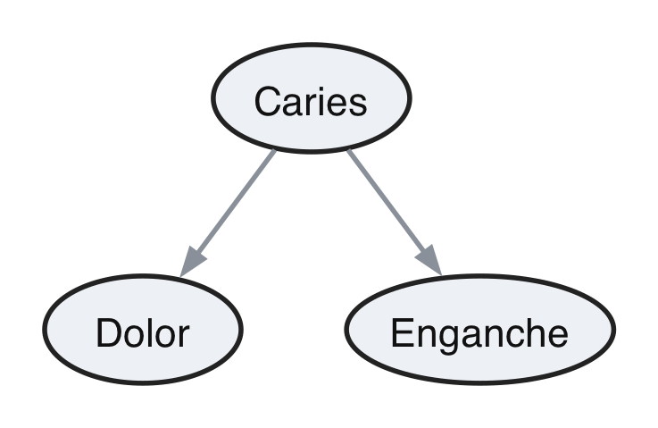
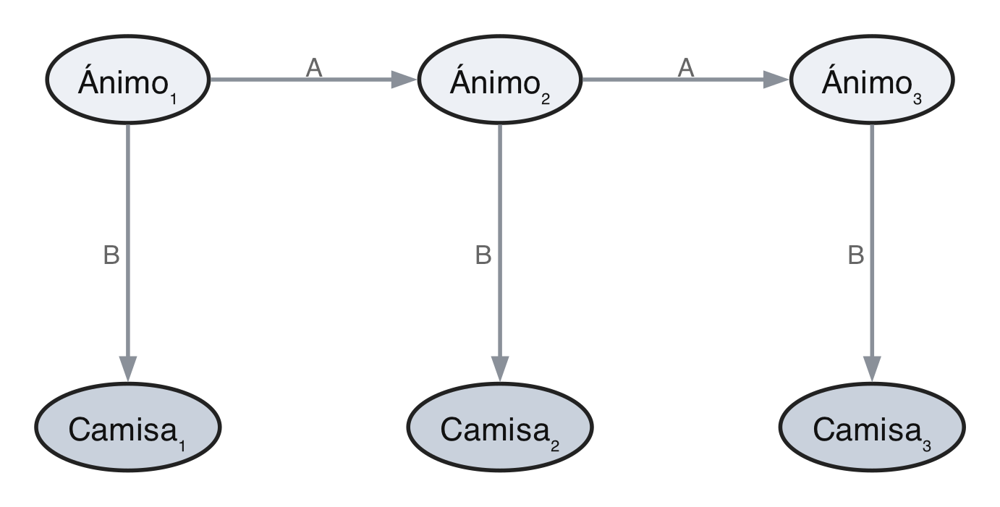
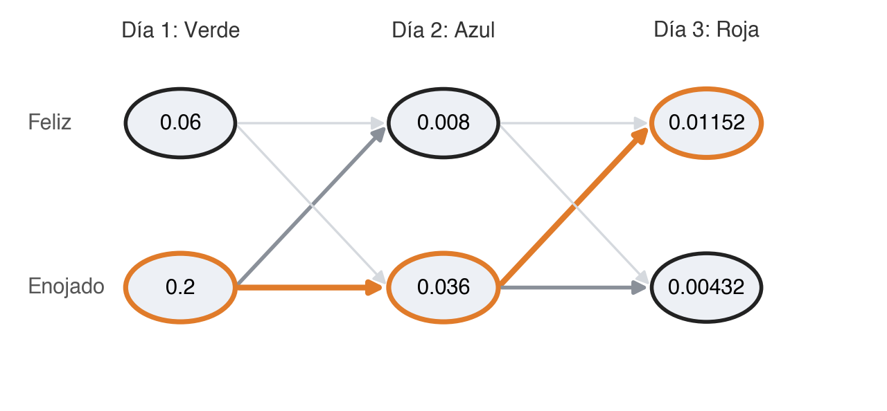
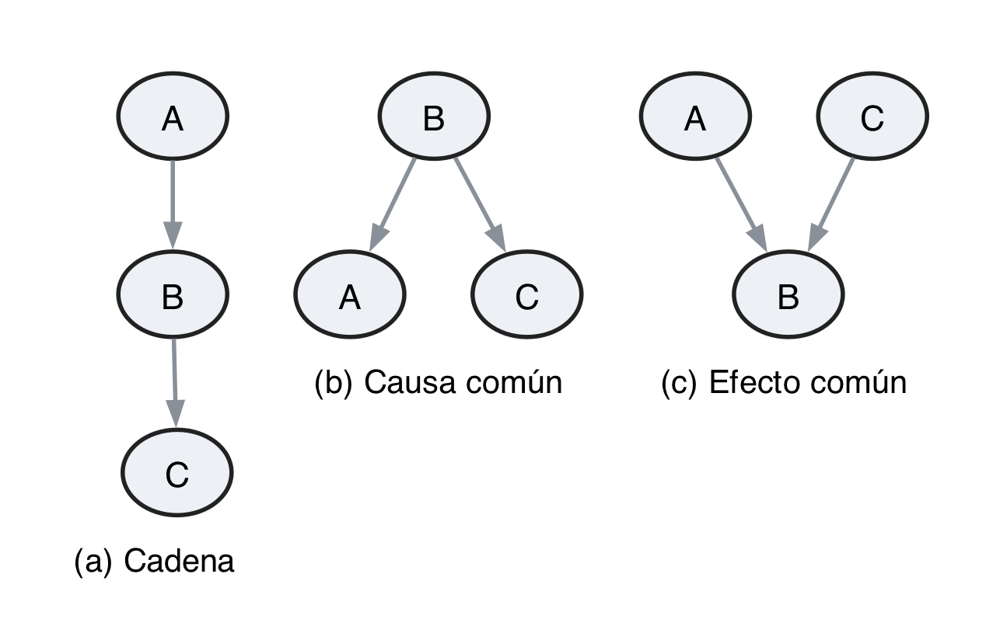
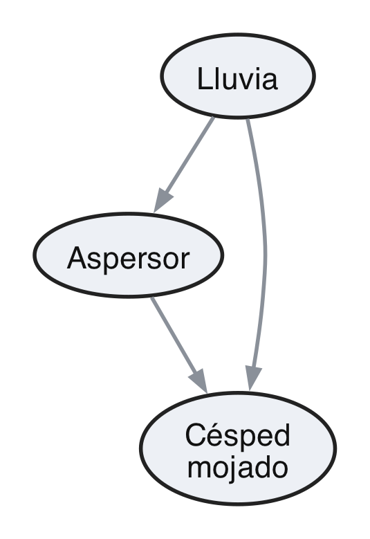
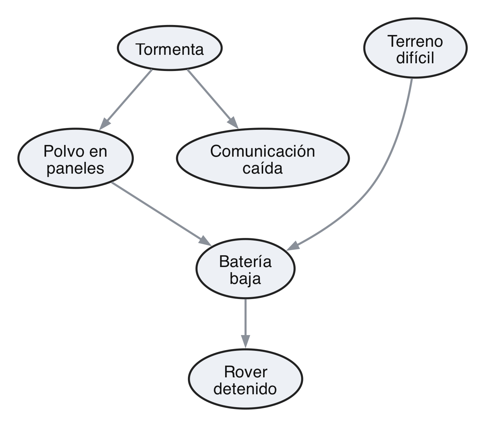

# C4 — Modelos estadísticos de aprendizaje

*Elementos de Inteligencia Artificial · Ciencia de Datos · Curso 2026-2027*

*Las figuras de esta nota son de elaboración propia. Los ejemplos del dentista y de los caramelos siguen los capítulos
12 y 20 de Russell, S. y Norvig, P., "Artificial Intelligence: A Modern Approach", 4.ª edición, Pearson, 2020; la red
del aspersor es una versión simplificada de la del capítulo 13; el ejemplo del diagnóstico de una enfermedad rara sigue
el capítulo 6 de Mitchell, T., "Machine Learning", 1997. Todas las cuentas se han rehecho y comprobado para esta nota.*

---

En la C2 dimos un paso que cambió el panorama: dejamos de tratar el estado como una caja negra y lo abrimos en
variables, dominios y restricciones. Eso permitió deducir antes de buscar, descartar pronto y usar heurísticas que
salen de la forma del problema. Pero todo lo que hicimos en las tres primeras conferencias tiene un supuesto que nunca
dijimos en voz alta: **el agente sabe cómo está el mundo**. El rover del Proyecto 1 sabe exactamente cuánta batería le
queda, en qué celda está y si el terreno es transitable.

Un rover real no sabe nada de eso con certeza. El sensor de batería tiene ruido, la cámara no siempre distingue arena
firme de arena blanda, y la comunicación con la base a veces se cae sin que sepamos por qué. Lo mismo le pasa a un médico
frente a un paciente, a un banco frente a una solicitud de crédito o a un filtro frente a un correo sospechoso. En
todos esos casos el agente tiene que decidir **sin saber**, a partir de evidencia parcial y poco fiable.

Esta nota trata de cómo razonar en esas condiciones. La herramienta es la teoría de probabilidades, y la mayor parte
del repaso la conocen de otras asignaturas. Lo nuevo es el problema que aparece en cuanto se intenta usarla en serio: la
descripción probabilística completa de un mundo con $n$ variables necesita del orden de $2^n$ números. Es el mismo
muro que la búsqueda de la C1 encontraba con los estados atómicos. Y la salida va a ser la misma de la C2: **mirar
dentro del problema y aprovechar que no todo depende de todo**. En la C2 eso se llamaba factorizar el estado; aquí se
llama factorizar la distribución, y la herramienta que lo hace son los **modelos gráficos probabilísticos**.

> **Objetivos de esta nota.** Al terminarla deberían poder:
>
> 1. explicar por qué la lógica no basta en dominios inciertos y qué significa una probabilidad como grado de creencia;
> 2. usar la regla de Bayes para actualizar creencias, y distinguir la predicción bayesiana, MAP y de máxima
>    verosimilitud;
> 3. reconocer una independencia condicional y calcular cuánto reduce el número de parámetros de un modelo;
> 4. formular un problema como Naive Bayes, como HMM o como red bayesiana, y decir qué supuesto hace cada uno;
> 5. resolver a mano filtrado y secuencia más probable en un HMM pequeño, y una inferencia por enumeración en una red;
> 6. leer en el grafo de una red qué variables son independientes dada cierta evidencia.

---

## 1. Por qué la lógica no alcanza

Intentemos escribir una regla para el diagnóstico dental:

$$Dolor \Rightarrow Caries$$

La regla es falsa: no todos los pacientes con dolor de muelas tienen caries; algunos tienen un absceso o un problema de
encías. Para arreglarla tendríamos que escribir $Dolor \Rightarrow Caries \lor Absceso \lor Encías \lor \dots$, con una
lista casi ilimitada de causas. Invertirla tampoco sirve: $Caries \Rightarrow Dolor$ es falsa, porque no toda caries
duele. La única forma de salvar una regla así es hacerla exhaustiva, y eso falla por tres razones:

1. **Pereza** (*laziness*): listar todos los antecedentes y consecuentes necesarios para una regla sin excepciones es
   demasiado trabajo, y la regla resultante sería inmanejable.
2. **Ignorancia teórica:** la medicina no tiene una teoría completa del dominio.
3. **Ignorancia práctica:** aunque conociéramos todas las reglas, de un paciente concreto no tenemos todas las pruebas.

Lo que el agente puede tener es un **grado de creencia**, y la herramienta para manejar grados de creencia es la
probabilidad. Conviene aclarar algo que suele confundir: el paciente *tiene* o *no tiene* caries; no hay nada aleatorio
en su boca. Decir que la probabilidad de caries es 0.6 es una afirmación sobre **lo que sabemos**, no sobre el mundo.
Si mañana llega el resultado de una radiografía, la probabilidad cambia, y no porque haya cambiado la muela, sino porque
cambió nuestro estado de conocimiento.

---

## 2. Lo que hace falta de probabilidad

De la teoría de probabilidades vamos a usar muy poco, y conviene tenerlo a la vista con un ejemplo concreto. El dominio
del dentista tiene tres variables booleanas: $Caries$, $Dolor$ y $Enganche$ (la sonda metálica del dentista se engancha
en la muela). Toda la información probabilística sobre el dominio cabe en la **distribución conjunta**: la probabilidad
de cada una de las $2^3 = 8$ combinaciones de valores.

| | $dolor$, $enganche$ | $dolor$, $\neg enganche$ | $\neg dolor$, $enganche$ | $\neg dolor$, $\neg enganche$ |
|---|---|---|---|---|
| $caries$ | 0.108 | 0.012 | 0.072 | 0.008 |
| $\neg caries$ | 0.016 | 0.064 | 0.144 | 0.576 |

Con la conjunta se puede responder cualquier pregunta. Hacen falta cinco reglas.

**Marginalización.** La probabilidad de una variable se obtiene sumando las combinaciones en que aparece:
$P(caries) = 0.108 + 0.012 + 0.072 + 0.008 = 0.2$. En general, $P(A) = \sum_b P(A, B = b)$.

**Probabilidad condicional.** Cuánto creemos en $A$ una vez que sabemos $B$:

$$P(A \mid B) = \frac{P(A, B)}{P(B)}$$

Si el paciente tiene dolor, $P(dolor) = 0.108 + 0.012 + 0.016 + 0.064 = 0.2$ y
$P(caries \mid dolor) = (0.108 + 0.012) / 0.2 = 0.6$. Saber que hay dolor triplica la creencia en la caries.

**Regla del producto.** Es la misma definición, despejada: $P(A, B) = P(A \mid B)\, P(B) = P(B \mid A)\, P(A)$.

**Regla de Bayes.** Igualando los dos lados de la regla del producto:

$$P(A \mid B) = \frac{P(B \mid A)\, P(A)}{P(B)}$$

Su utilidad práctica es que permite ir **de la causa al efecto y volver**. Un médico conoce bien $P(síntoma \mid
enfermedad)$, que es estable y se puede medir; lo que necesita es $P(enfermedad \mid síntoma)$, y la regla de Bayes la
calcula.

**Independencia condicional.** $A$ y $B$ son **independientes** si saber una no cambia la creencia en la otra:
$P(A, B) = P(A)\, P(B)$. En el dentista, $Dolor$ y $Enganche$ **no** son independientes: si hay dolor, es más
probable que haya caries, y entonces es más probable que la sonda se enganche. Pero las dos dependen de la caries, no
la una de la otra. Si ya sabemos si hay caries, el dolor no dice nada nuevo sobre el enganche. Eso es la
**independencia condicional**: $A$ y $B$ son independientes dado $C$ si

$$P(A, B \mid C) = P(A \mid C)\, P(B \mid C)$$

Comprobémoslo en la tabla. Entre los pacientes con caries ($P = 0.2$):

$$P(dolor \mid caries) = \frac{0.12}{0.2} = 0.6, \qquad P(enganche \mid caries) = \frac{0.18}{0.2} = 0.9, \qquad
P(dolor, enganche \mid caries) = \frac{0.108}{0.2} = 0.54 = 0.6 \times 0.9$$

Y lo mismo entre los que no tienen caries: $0.1 \times 0.2 = 0.02 = 0.016 / 0.8$. La independencia condicional es la
noción central de esta nota: todo lo que sigue consiste en encontrarla y aprovecharla.

**En código.** Con la conjunta guardada como un arreglo de NumPy, marginalizar es sumar sobre ejes y condicionar es
quedarse con una rebanada y normalizarla. El fragmento comprueba las cuentas anteriores:

```python
import numpy as np

# Conjunta P(Caries, Dolor, Enganche); índice 0 = sí, 1 = no en cada eje
P = np.array([[[0.108, 0.012],    # caries, dolor:     enganche / no enganche
               [0.072, 0.008]],   # caries, no dolor
              [[0.016, 0.064],    # no caries, dolor
               [0.144, 0.576]]])  # no caries, no dolor
assert np.isclose(P.sum(), 1)

p_caries = P[0].sum()                        # marginalizar Dolor y Enganche
p_dolor = P[:, 0, :].sum()
p_caries_dado_dolor = P[0, 0, :].sum() / p_dolor
print(f"P(caries) = {p_caries:.3f}, P(caries | dolor) = {p_caries_dado_dolor:.3f}")

# Independencia condicional: P(D, E | C) == P(D | C) P(E | C) para cada valor de C
for c, nombre in enumerate(["caries", "no caries"]):
    cond = P[c] / P[c].sum()                 # tabla P(Dolor, Enganche | C = c)
    producto = np.outer(cond.sum(axis=1), cond.sum(axis=0))
    print(nombre, "independientes dado C:", np.allclose(cond, producto))

# ...pero no a secas
conj_DE = P.sum(axis=0)                      # P(Dolor, Enganche)
print("independientes sin condicionar:",
      np.allclose(conj_DE, np.outer(conj_DE.sum(axis=1), conj_DE.sum(axis=0))))
```

Imprime $P(caries) = 0.2$ y $P(caries \mid dolor) = 0.6$; las dos comprobaciones de independencia dado $C$ dan
`True`, y la independencia sin condicionar da `False`. Fíjense en el costo: el arreglo tiene $2^n$ casillas, y eso es
lo que no escala.

**El problema.** La tabla del dentista tiene 8 casillas, pero como suman 1 basta con dar 7 números. Con $n$ variables
booleanas hacen falta $2^n - 1$. Con 30 síntomas son más de mil millones de números que nadie puede estimar ni guardar,
y responder una pregunta por marginalización exige sumar sobre todos ellos. La conjunta completa es, para la
incertidumbre, lo que el estado atómico era para la búsqueda: correcta, general e inservible en cuanto el problema
crece.

> **Para ampliar.** Russell y Norvig, secciones 12.2 a 12.5: notación, inferencia con la distribución conjunta
> completa, independencia y regla de Bayes, con este mismo ejemplo.

---

## 3. Aprender es actualizar creencias

La regla de Bayes tiene una lectura que la convierte en un método de aprendizaje. Llamemos $h$ a una **hipótesis**
sobre el mundo y $D$ a los **datos** observados:

$$P(h \mid D) = \frac{P(D \mid h)\, P(h)}{P(D)}$$

El **prior** $P(h)$ es lo que creíamos antes de ver los datos; la **verosimilitud**, qué tan bien explica cada hipótesis lo
observado, $P(D \mid h)$; el **posterior** $P(h \mid D)$, lo que creemos después; la **evidencia** $P(D) = \sum_h P(D \mid h)\, P(h)$ solo normaliza. Desde este punto de vista, **aprender es
pasar del prior al posterior**: cada dato sube o baja la credibilidad de cada hipótesis, sin descartar ninguna de golpe
por un único caso raro.

Si hay que quedarse con una sola hipótesis, la natural es la más probable, la hipótesis **máxima a posteriori**:

$$h_{MAP} = \arg\max_h P(D \mid h)\, P(h)$$

($P(D)$ no depende de $h$ y se puede ignorar). Si además todas las hipótesis son igual de probables a priori, queda la
hipótesis de **máxima verosimilitud**, $h_{ML} = \arg\max_h P(D \mid h)$, que es la que está detrás de casi todos los
métodos de ajuste que conocen de Machine Learning.

### Ejemplo: una enfermedad rara

Una prueba de laboratorio detecta una enfermedad que tiene el 0.8 % de la población. Si la enfermedad está presente, la
prueba da positivo el 98 % de las veces; si no está, da negativo el 97 % de las veces. Un paciente da positivo. ¿Está
enfermo?

$$P(\oplus \mid enf)\, P(enf) = 0.98 \times 0.008 = 0.0078 \qquad
P(\oplus \mid \neg enf)\, P(\neg enf) = 0.03 \times 0.992 = 0.0298$$

La hipótesis MAP es **no está enfermo**. Normalizando, $P(enf \mid \oplus) = 0.0078 / 0.0376 \approx 0.21$. La prueba
multiplicó por 26 la probabilidad de enfermedad, pero como la enfermedad es rara, la mayoría de los positivos son
falsos positivos. Es el error de razonamiento más común con probabilidades —olvidar el prior— y va a reaparecer en la
C7 cuando haya que elegir métricas para clases desbalanceadas.

### Ejemplo: los caramelos

Un fabricante vende caramelos de cereza y de lima en cinco tipos de bolsa, idénticas por fuera. Las hipótesis son los
tipos de bolsa y los datos, los sabores que van saliendo:

| Bolsa | $h_1$ | $h_2$ | $h_3$ | $h_4$ | $h_5$ |
|---|---|---|---|---|---|
| Composición | 100 % cereza | 75 % cereza | 50 % cereza | 25 % cereza | 100 % lima |
| $P(lima \mid h)$ | 0 | 0.25 | 0.5 | 0.75 | 1 |
| Prior $P(h)$ | 0.1 | 0.2 | 0.4 | 0.2 | 0.1 |

Abrimos una bolsa y sale un caramelo de lima. La evidencia es
$P(lima) = 0 \cdot 0.1 + 0.25 \cdot 0.2 + 0.5 \cdot 0.4 + 0.75 \cdot 0.2 + 1 \cdot 0.1 = 0.5$, y cada posterior es
$P(lima \mid h)\, P(h) / 0.5$; por ejemplo, $P(h_4 \mid lima) = 0.75 \cdot 0.2 / 0.5 = 0.3$. Con cada caramelo nuevo,
el posterior anterior hace de prior:

| Observado | $h_1$ | $h_2$ | $h_3$ | $h_4$ | $h_5$ |
|---|---|---|---|---|---|
| nada (prior) | 0.100 | 0.200 | 0.400 | 0.200 | 0.100 |
| 1 lima | 0 | 0.100 | 0.400 | 0.300 | 0.200 |
| 2 limas | 0 | 0.038 | 0.308 | 0.346 | 0.308 |
| 3 limas | 0 | 0.013 | 0.211 | 0.355 | 0.421 |

La creencia se va desplazando hacia las bolsas con más lima. Si la bolsa es de verdad $h_5$, con suficientes caramelos
su posterior tiende a 1 sea cual sea el prior (siempre que no fuera cero).

**Tres formas de predecir.** Tras dos caramelos de lima, ¿qué probabilidad hay de que el tercero sea de lima?

- **Bayesiana:** promediar lo que predice cada hipótesis, ponderado por su posterior:
  $0.25 \cdot 0.038 + 0.5 \cdot 0.308 + 0.75 \cdot 0.346 + 1 \cdot 0.308 \approx 0.731$.
- **MAP:** usar solo la hipótesis más probable, $h_4$, y predecir 0.75.
- **ML:** usar la hipótesis que mejor explica dos limas, $h_5$, y predecir 1. Después de solo dos caramelos estaríamos
  completamente seguros, lo que es evidentemente exagerado.

Con muchos datos las tres coinciden; con pocos, el prior importa y la predicción bayesiana es la más prudente. Es la
misma tensión entre ajustarse a los datos y no sobreajustarse que va a ser el tema de la C5.

**La primera factorización.** Para hacer estas cuentas usamos sin decirlo un supuesto: **los caramelos son
independientes entre sí dado el tipo de bolsa**. Por eso $P(lima, lima \mid h) = P(lima \mid h)^2$. No son
independientes a secas —ver una lima hace más probable la siguiente, porque cambia lo que creemos sobre la bolsa—, pero
sí lo son una vez conocida la bolsa. Es exactamente la relación entre dolor, enganche y caries.

> **Para ampliar.** Russell y Norvig, sección 20.1, desarrollan los caramelos con una figura de cómo evolucionan los
> posteriores a lo largo de diez observaciones.

---

## 4. Factorizar: la jugada de la C2 bajo incertidumbre

> **Antes de seguir.** Al final de la sección 2 la tabla conjunta del dentista se nos volvía inmanejable en cuanto
> crecía el número de síntomas. ¿Cómo podríamos evitar ese crecimiento exponencial sin renunciar a la probabilidad?
> Piénsenlo con los caramelos: ¿qué nos permitió hacer las cuentas sin escribir nunca una tabla con todas las
> combinaciones de sabores? ¿Qué pasaría si supusiéramos lo mismo de los síntomas: que, una vez sabido si hay caries,
> no se dicen nada el uno sobre el otro?

Volvamos al dentista con lo que acabamos de ver. Si $Dolor$ y $Enganche$ son independientes dado $Caries$, la regla
del producto permite escribir la conjunta así:

$$P(Caries, Dolor, Enganche) = P(Caries)\, P(Dolor \mid Caries)\, P(Enganche \mid Caries)$$

Ya no hace falta la tabla de 7 números: bastan $P(caries) = 0.2$, $P(dolor \mid caries) = 0.6$,
$P(dolor \mid \neg caries) = 0.1$, $P(enganche \mid caries) = 0.9$ y $P(enganche \mid \neg caries) = 0.2$. Son 5, y
reproducen la tabla exactamente: por ejemplo, $0.2 \cdot 0.6 \cdot 0.9 = 0.108$. La figura 1 dibuja esta
factorización: una flecha de cada causa a cada efecto, y ninguna entre efectos.



Para diagnosticar a un paciente con dolor y enganche no hace falta la conjunta:

$$P(caries \mid dolor, enganche) \propto 0.2 \cdot 0.6 \cdot 0.9 = 0.108, \qquad
P(\neg caries \mid dolor, enganche) \propto 0.8 \cdot 0.1 \cdot 0.2 = 0.016$$

Normalizando, $P(caries \mid dolor, enganche) = 0.108 / 0.124 \approx 0.871$.

Este modelo —una causa con $n$ efectos condicionalmente independientes— se llama **Naive Bayes**:

$$P(C \mid x_1, \dots, x_n) \propto P(C) \prod_{i=1}^{n} P(x_i \mid C)$$

Con 3 variables el ahorro (de 7 a 5 números) es anecdótico. Con una clase y 20 síntomas booleanos, la conjunta necesita
$2^{21} - 1$, más de dos millones; Naive Bayes necesita $1 + 2 \cdot 20 = 41$. Y cada uno de esos 41 números se
**aprende contando**: $P(x_i \mid C)$ es la fracción de casos de la clase $C$ en que aparece $x_i$. Es el clasificador
más simple que existe y, aunque el supuesto de independencia casi nunca se cumple del todo, funciona sorprendentemente
bien en clasificación de texto, filtros de spam y diagnóstico.

Ésta es la tesis de la nota. En la C2, un CSP era manejable porque las restricciones no ligaban todas las variables con
todas: la estructura del grafo de restricciones decidía el costo. Aquí, una distribución es manejable porque no todas
las variables dependen directamente de todas: **la estructura de las independencias decide el costo**. Las dos
secciones que siguen son dos formas de explotar esa estructura: una para datos que llegan en secuencia y otra para
cualquier red de dependencias.

> **Para ampliar.** Russell y Norvig, sección 12.6, aplican Naive Bayes a clasificar noticias por tema.

---

## 5. Modelos ocultos de Markov

Muchos datos llegan **en secuencia**: una señal de voz, un texto, las lecturas de un sensor, la evolución de un
paciente. Lo que nos interesa casi nunca se observa directamente —qué palabra se pronunció, en qué estado está el
motor, cómo avanza la enfermedad— y lo que se observa depende de eso que no vemos. Un **modelo oculto de Markov**
(*hidden Markov model*, HMM) tiene dos tipos de variables en cada instante $t$:

- un **estado oculto** $X_t$, que no se observa, y
- una **observación** $Y_t$, que depende del estado.

Sin supuestos, el estado de hoy podría depender de toda la historia, y la conjunta de una secuencia de longitud $T$
sería otra tabla exponencial. El HMM introduce tres supuestos que la factorizan:

1. **Hipótesis de Markov:** el estado de hoy depende solo del de ayer, $P(X_t \mid X_{1:t-1}) = P(X_t \mid X_{t-1})$.
   El futuro es independiente del pasado dado el presente.
2. **Hipótesis del sensor:** la observación de hoy depende solo del estado de hoy, $P(Y_t \mid X_{1:t}, Y_{1:t-1}) =
   P(Y_t \mid X_t)$.
3. **Estacionariedad:** esas probabilidades no cambian con el tiempo.

Con ellos la conjunta queda

$$P(X_{1:T}, Y_{1:T}) = P(X_1) \prod_{t=2}^{T} P(X_t \mid X_{t-1}) \prod_{t=1}^{T} P(Y_t \mid X_t)$$

y el modelo entero cabe en tres tablas: la **distribución inicial** $\pi_i = P(X_1 = i)$, la **matriz de transición**
$A_{ij} = P(X_t = j \mid X_{t-1} = i)$ y la **matriz de emisión** $B_{jk} = P(Y_t = k \mid X_t = j)$. Con $K$ estados y
$M$ observaciones posibles son $K - 1 + K(K-1) + K(M-1)$ números, independientemente de lo larga que sea la secuencia.

### Ejemplo: el ánimo del profesor

Un profesor está cada día **feliz** o **enojado**, pero sus estudiantes no lo pueden ver. Lo que ven es el color de su
camisa —roja, azul o verde—, que depende de su ánimo. Su ánimo, a su vez, tiende a mantenerse de un día para otro
(figura 2).



| $A$: de \ a | Feliz | Enojado |
|---|---|---|
| **Feliz** | 0.7 | 0.3 |
| **Enojado** | 0.4 | 0.6 |

| $B$ | Roja | Azul | Verde |
|---|---|---|---|
| **Feliz** | 0.8 | 0.1 | 0.1 |
| **Enojado** | 0.2 | 0.3 | 0.5 |

Distribución inicial: $\pi_{Feliz} = 0.6$, $\pi_{Enojado} = 0.4$.

Durante tres días los estudiantes ven **verde, azul, roja**. La probabilidad de una secuencia concreta de ánimos junto
con esas camisas es un producto de factores de las tablas. Para enojado, enojado, feliz:

$$\pi_E \cdot B_E(\text{verde}) \cdot A_{EE} \cdot B_E(\text{azul}) \cdot A_{EF} \cdot B_F(\text{roja})
= 0.4 \cdot 0.5 \cdot 0.6 \cdot 0.3 \cdot 0.4 \cdot 0.8 = 0.01152$$

### Las preguntas que se le hacen a un HMM

- **Filtrado:** ¿en qué estado estamos ahora, dado todo lo observado? $P(X_t \mid Y_{1:t})$. Es lo que necesita el
  rover para saber dónde está.
- **Predicción:** ¿en qué estado estaremos dentro de $k$ pasos? $P(X_{t+k} \mid Y_{1:t})$.
- **Suavizado:** ¿en qué estado estábamos en un instante pasado, usando también lo observado después?
  $P(X_k \mid Y_{1:t})$ con $k < t$.
- **Secuencia más probable:** ¿qué secuencia de estados explica mejor las observaciones?
  $\arg\max_{x_{1:t}} P(x_{1:t} \mid Y_{1:t})$. Es la pregunta del reconocimiento de voz: qué palabras explican mejor
  el sonido.
- **Aprendizaje:** estimar $\pi$, $A$ y $B$ a partir de secuencias observadas.

La forma ingenua de responder cualquiera de ellas es enumerar las $K^T$ secuencias de estados. Con 2 estados y 3 días
son 8; con 2 estados y 100 días, unas $10^{30}$. La factorización permite algo mucho mejor.

> **Antes de seguir.** Para saber cómo está el profesor el día 3, ¿hace falta recordar cada camino posible por los días
> 1 y 2? Piensen en lo que dice la hipótesis de Markov: si ya supiéramos con qué probabilidad está feliz o enojado el
> día 2 (habiendo visto las dos primeras camisas), ¿qué más necesitaríamos del pasado?

### Filtrado: el algoritmo forward

Sea $\alpha_t(j) = P(Y_{1:t}, X_t = j)$: la probabilidad de lo observado hasta hoy, terminando en el estado $j$. Por la
hipótesis de Markov, para llegar a $j$ hoy basta saber dónde pudimos estar ayer:

$$\alpha_1(j) = \pi_j\, B_j(y_1), \qquad \alpha_t(j) = B_j(y_t) \sum_i \alpha_{t-1}(i)\, A_{ij}$$

Cada paso cuesta $O(K^2)$, y la secuencia entera $O(T K^2)$: **lineal** en su longitud. En el ejemplo:

| Día | Camisa | $\alpha_t(F)$ | $\alpha_t(E)$ |
|---|---|---|---|
| 1 | verde | $0.6 \cdot 0.1 = 0.0600$ | $0.4 \cdot 0.5 = 0.2000$ |
| 2 | azul | $(0.06 \cdot 0.7 + 0.2 \cdot 0.4) \cdot 0.1 = 0.0122$ | $(0.06 \cdot 0.3 + 0.2 \cdot 0.6) \cdot 0.3 = 0.0414$ |
| 3 | roja | $(0.0122 \cdot 0.7 + 0.0414 \cdot 0.4) \cdot 0.8 = 0.02008$ | $(0.0122 \cdot 0.3 + 0.0414 \cdot 0.6) \cdot 0.2 = 0.00570$ |

La suma de la última fila es la probabilidad de las observaciones, $P(verde, azul, roja) = 0.02578$, y normalizando se
obtiene el filtrado: $P(X_3 = Feliz \mid verde, azul, roja) = 0.02008 / 0.02578 \approx 0.78$. Para **predecir** el
día 4 basta un paso más de la matriz de transición, sin observación:
$0.78 \cdot 0.7 + 0.22 \cdot 0.4 \approx 0.63$ de que siga feliz.

### La secuencia más probable: el algoritmo de Viterbi

Viterbi es el mismo cálculo cambiando la suma por un máximo, y guardando de qué estado viene cada máximo:

$$\delta_t(j) = B_j(y_t) \max_i \delta_{t-1}(i)\, A_{ij}$$

La figura 3 muestra el resultado en el ejemplo. En el día 3 el máximo es $\delta_3(F) = 0.01152$; siguiendo hacia atrás
las flechas elegidas se obtiene **enojado, enojado, feliz**, la misma secuencia cuya probabilidad calculamos arriba. No
hizo falta mirar las otras siete.



La figura debería resultarles familiar. Si a cada flecha y cada nodo le asignamos como costo $-\log$ de su
probabilidad, maximizar un producto de probabilidades es **minimizar una suma de costos**, y Viterbi es encontrar el
camino más barato en un grafo por capas. Es un problema de búsqueda de la C1, resuelto por programación dinámica porque
el grafo no tiene ciclos. La estructura temporal del HMM es lo que lo hace posible.

**En código.** Forward y Viterbi caben en unas pocas líneas de NumPy. La única diferencia entre los dos es la línea
que combina el día anterior: un producto matricial (suma) en uno, un máximo con `argmax` en el otro.

```python
import numpy as np

estados = ["Feliz", "Enojado"]
camisas = {"roja": 0, "azul": 1, "verde": 2}
pi = np.array([0.6, 0.4])
A = np.array([[0.7, 0.3],          # A[i, j] = P(X_t = j | X_{t-1} = i)
              [0.4, 0.6]])
B = np.array([[0.8, 0.1, 0.1],     # B[j, k] = P(Y_t = k | X_t = j)
              [0.2, 0.3, 0.5]])
obs = [camisas[c] for c in ["verde", "azul", "roja"]]

def forward(obs):
    alfa = pi * B[:, obs[0]]
    for y in obs[1:]:
        alfa = (alfa @ A) * B[:, y]          # suma sobre el estado de ayer
    return alfa

def viterbi(obs):
    delta = pi * B[:, obs[0]]
    punteros = []
    for y in obs[1:]:
        candidatos = delta[:, None] * A      # candidatos[i, j]: venir de i y estar en j
        punteros.append(candidatos.argmax(axis=0))
        delta = candidatos.max(axis=0) * B[:, y]
    camino = [int(delta.argmax())]
    for p in reversed(punteros):             # seguir las flechas hacia atrás
        camino.insert(0, int(p[camino[0]]))
    return [estados[i] for i in camino], delta.max()

alfa = forward(obs)
print(f"P(observaciones) = {alfa.sum():.5f}")
print("filtrado P(X_3 | obs) =", np.round(alfa / alfa.sum(), 3))
print("predicción P(X_4 | obs) =", np.round(alfa / alfa.sum() @ A, 3))
print("Viterbi:", viterbi(obs))
```

La salida reproduce la tabla y la figura: $P(\text{observaciones}) = 0.02578$, filtrado $(0.779, 0.221)$,
predicción del día 4 $(0.634, 0.366)$ y la secuencia enojado, enojado, feliz con probabilidad $0.01152$. Con
secuencias largas los productos se vuelven tan pequeños que la computadora los redondea a cero; en la práctica se
normaliza $\alpha_t$ en cada paso o se trabaja con logaritmos, que es además la forma de costos de la C1.

Los mismos razonamientos dan el suavizado (combinando una pasada hacia adelante y otra hacia atrás) y el aprendizaje de
los parámetros cuando los estados no se observan nunca (el algoritmo de Baum-Welch, un caso del algoritmo EM). No los
vamos a desarrollar; lo importante es que todos son lineales en $T$ por la misma razón.

**Dónde se usan.** Reconocimiento de voz, etiquetado gramatical de textos, búsqueda de genes en secuencias de ADN,
detección de fraude en secuencias de transacciones y localización de robots a partir de sensores ruidosos. Cuando el
estado es continuo —la posición de un vehículo— la misma idea con distribuciones gaussianas es el **filtro de
Kalman**.

> **Para ampliar.** Russell y Norvig, capítulo 14: hipótesis de Markov y del sensor (14.1), filtrado, suavizado y
> Viterbi (14.2), la forma matricial de los HMM (14.3) y los filtros de Kalman (14.4). Su ejemplo es un guardia que
> deduce si llueve viendo si el director llega con paraguas.

---

## 6. Redes bayesianas

Naive Bayes y los HMM explotan estructuras fijas: una causa con muchos efectos, o una cadena en el tiempo. Una **red
bayesiana** permite declarar **cualquier** estructura de dependencias. Es un grafo dirigido y acíclico en el que:

- cada nodo es una variable;
- una flecha $X \to Y$ indica que $X$ influye directamente en $Y$ ($X$ es **padre** de $Y$);
- cada nodo lleva una **tabla de probabilidad condicional** $P(X_i \mid Padres(X_i))$.

La red representa la conjunta como el producto de esas tablas:

$$P(X_1, \dots, X_n) = \prod_{i=1}^{n} P(X_i \mid Padres(X_i))$$

Si cada variable booleana tiene como mucho $k$ padres, la red necesita a lo sumo $n \cdot 2^k$ números en lugar de
$2^n - 1$. Naive Bayes es la red en que la clase es el único padre de todo; un HMM es la red de la figura 2, repetida
en el tiempo. Lo que se gana con la generalidad es poder describir cualquier dominio con sus causas reales, cada una
con una tabla local pequeña que un experto puede llenar o que se puede estimar a partir de datos.

### Leer independencias en el grafo

El grafo no es solo un dibujo: dice qué independencias se cumplen. Todo se reduce a tres patrones (figura 4).



| Patrón | ¿$A$ y $C$ independientes? | ¿Y dado $B$? | Ejemplo |
|---|---|---|---|
| (a) Cadena $A \to B \to C$ | No | **Sí** | Lluvia → suelo mojado → resbaladizo: si sé que el suelo está mojado, la lluvia no dice más sobre si resbala. |
| (b) Causa común $A \leftarrow B \to C$ | No | **Sí** | Dolor ← caries → enganche: es el dentista. |
| (c) Efecto común $A \to B \leftarrow C$ | **Sí** | **No** | Lluvia → césped mojado ← aspersor: el ejemplo que sigue. |

Los dos primeros se comportan como se espera: conocer la variable del medio **corta** el paso de información. El
tercero es al revés, y es el menos intuitivo: dos causas independientes **pasan a depender** cuando se observa su
efecto común (o un descendiente de él). Combinando estos tres patrones se puede decidir, para cualquier par de
variables de cualquier red, si son independientes dado un conjunto de observaciones; el criterio se llama
**d-separación**.

Una consecuencia útil: cada variable es independiente de todas las demás dados sus padres, sus hijos y los otros padres
de sus hijos. Ese conjunto se llama **manto de Markov** (*Markov blanket*), y es todo lo que hace falta mirar para
actualizar una variable.

### Ejemplo: lluvia, aspersor y césped mojado

Por la mañana el césped puede estar mojado porque llovió o porque se encendió el aspersor automático, que tiene un
sensor y rara vez se enciende si llueve (figura 5).



| $P(lluvia)$ | | $Lluvia$ | $P(aspersor \mid Lluvia)$ | | $Aspersor$ | $Lluvia$ | $P(mojado \mid A, L)$ |
|---|---|---|---|---|---|---|---|
| 0.2 | | sí | 0.01 | | sí | sí | 0.99 |
| | | no | 0.40 | | sí | no | 0.90 |
| | | | | | no | sí | 0.80 |
| | | | | | no | no | 0.00 |

La conjunta es $P(L, A, M) = P(L)\, P(A \mid L)\, P(M \mid A, L)$. Vemos el césped mojado: ¿llovió? Sumamos sobre la
variable que no observamos, el aspersor:

$$P(lluvia, mojado) = 0.2 \cdot 0.01 \cdot 0.99 + 0.2 \cdot 0.99 \cdot 0.8 = 0.1604 \qquad
P(\neg lluvia, mojado) = 0.8 \cdot 0.4 \cdot 0.9 + 0.8 \cdot 0.6 \cdot 0 = 0.288$$

$$P(lluvia \mid mojado) = \frac{0.1604}{0.1604 + 0.288} \approx 0.36$$

El césped mojado subió la creencia en la lluvia del 20 % al 36 %.

> **Antes de seguir.** Ahora miramos y vemos que el aspersor estaba encendido. Antes de hacer la cuenta, apuesten: ¿la
> probabilidad de que haya llovido sube, baja o se queda igual? El aspersor no causa la lluvia, así que ¿por qué
> cambiaría algo?

La cuenta, con **el aspersor encendido**:

$$P(lluvia \mid mojado, aspersor) = \frac{0.2 \cdot 0.01 \cdot 0.99}{0.2 \cdot 0.01 \cdot 0.99 + 0.8 \cdot 0.4 \cdot 0.9}
= \frac{0.00198}{0.28998} \approx 0.007$$

La lluvia cae casi a cero: el aspersor ya **explica** el césped mojado. Es el patrón de efecto común en acción, y tiene
nombre propio, ***explaining away***. Es un razonamiento que las personas hacen sin esfuerzo y que ni Naive Bayes ni
un HMM pueden representar, porque ninguno de los dos tiene dos causas compitiendo por un mismo efecto.

**En código.** La inferencia por enumeración es literalmente la definición: recorrer todas las combinaciones de
valores, quedarse con las compatibles con la evidencia y sumar el producto que dicta la red.

```python
from itertools import product

p_lluvia = 0.2
p_aspersor = {True: 0.01, False: 0.40}                  # P(aspersor | Lluvia)
p_mojado = {(True, True): 0.99, (True, False): 0.90,    # P(mojado | Aspersor, Lluvia)
            (False, True): 0.80, (False, False): 0.00}

def conjunta(l, a, m):
    """P(L, A, M) = P(L) P(A | L) P(M | A, L): el producto que dicta la red."""
    pl = p_lluvia if l else 1 - p_lluvia
    pa = p_aspersor[l] if a else 1 - p_aspersor[l]
    pm = p_mojado[(a, l)] if m else 1 - p_mojado[(a, l)]
    return pl * pa * pm

def p_lluvia_dado(**evidencia):
    """Inferencia por enumeración: sumar la conjunta sobre lo que no se observa."""
    num = den = 0.0
    for l, a, m in product([True, False], repeat=3):
        valores = {"lluvia": l, "aspersor": a, "mojado": m}
        if all(valores[k] == v for k, v in evidencia.items()):
            p = conjunta(l, a, m)
            den += p
            num += p if l else 0.0
    return num / den

print(f"P(lluvia | mojado)           = {p_lluvia_dado(mojado=True):.3f}")
print(f"P(lluvia | mojado, aspersor) = {p_lluvia_dado(mojado=True, aspersor=True):.4f}")
```

Imprime 0.358 y 0.0068. El bucle recorre las $2^n$ combinaciones: es correcto para cualquier red, y por eso mismo
no escala. Bibliotecas como `pgmpy` implementan algoritmos que aprovechan la estructura en lugar de enumerar.

### El costo de la inferencia

Responder una pregunta en una red, como acabamos de hacer, es sumar sobre las variables no observadas. Hacerlo a lo
bruto es exponencial, y en el peor caso no hay escapatoria: la inferencia exacta en redes bayesianas generales es
NP-difícil. Pero aquí reaparece la lección de la C2. Allí, un CSP cuyo grafo de restricciones es un árbol se resolvía
en tiempo lineal; aquí, en las redes con forma de árbol (**poliárboles**, donde entre dos nodos hay a lo sumo un
camino) la inferencia exacta también es **lineal** en el tamaño de la red. Para las redes grandes y muy conectadas se
usan métodos aproximados por muestreo. Una vez más, la estructura decide el costo.

> **Para ampliar.** Russell y Norvig, capítulo 13: semántica de las redes y lectura de independencias (13.2),
> inferencia exacta y su complejidad (13.3) e inferencia aproximada por muestreo (13.4), donde aparece la red del
> aspersor completa, con una variable más.

---

## 7. Qué llevarse de esta nota

1. **La probabilidad mide lo que sabemos, no lo que es.** Es la forma de razonar cuando la lógica no alcanza por
   pereza, ignorancia teórica o ignorancia práctica.
2. **Aprender es actualizar creencias.** La regla de Bayes convierte un prior en un posterior a la luz de los datos.
   MAP y ML se quedan con una hipótesis; la predicción bayesiana las promedia todas. Con pocos datos, el prior importa.
3. **La conjunta completa es inmanejable; la independencia condicional la rescata.** Es la misma situación de la C1 con
   los estados atómicos y la misma salida de la C2: mirar la estructura y aprovechar que no todo depende de todo.
4. **Tres modelos, una idea.** Naive Bayes supone efectos independientes dada la causa; un HMM, un estado oculto que
   evoluciona por la hipótesis de Markov; una red bayesiana permite cualquier estructura dirigida y acíclica. Los tres
   factorizan la conjunta en tablas locales pequeñas.
5. **La estructura decide el costo.** El forward y Viterbi son lineales en la longitud de la secuencia; la inferencia
   en poliárboles es lineal en el tamaño de la red; en redes generales es NP-difícil.

**Hacia la C5 y la C6.** Cada modelo de esta nota hace un supuesto que no se demuestra: que los síntomas son
independientes dada la enfermedad, que el ánimo de hoy solo depende del de ayer, que el grafo tiene estas flechas y no
otras. Esos supuestos son lo que permite aprender con pocos datos, y a la vez son una apuesta sobre el mundo. En la C5
le vamos a poner nombre —**sesgo inductivo**— y vamos a ver un teorema que dice que sin una apuesta así no se puede
aprender nada. Y la C6 va a mostrar el costo de no tener estructura: el crecimiento de $2^n$ que vimos en la sección 2
es la misma **maldición de la dimensionalidad** que aparece cuando un conjunto de datos tiene demasiados atributos.

---

## 8. Para qué les sirve en el Proyecto 2

- **Un baseline honesto.** Naive Bayes se entrena en segundos, no tiene casi hiperparámetros y da probabilidades. Es un
  buen punto de comparación mínimo: si un modelo complejo no le gana con claridad, hay que preguntarse por qué.
- **Pensar en el prior.** El ejemplo de la enfermedad rara es el de cualquier problema con clases desbalanceadas:
  fraude, fallas de maquinaria, enfermedades. Antes de elegir métricas (CP4), calculen qué significa un positivo en su
  dominio con su tasa base real.
- **Dibujar las dependencias.** Antes de modelar, un grafo aproximado de qué variable influye en cuál ayuda a detectar
  atributos redundantes, variables que son consecuencia del objetivo y no causa —una fuente típica de fuga de
  información—, y qué supuesto de independencia hace cada modelo que van a probar.
- **Datos en secuencia.** Si sus datos son series temporales o secuencias, la hipótesis de Markov es una pregunta que
  hay que hacerse explícitamente, y cómo partir los datos para evaluar va a depender de la respuesta (C7).

**En código: Naive Bayes como baseline.** El fragmento compara Naive Bayes con el baseline más tonto posible, que
predice siempre la clase mayoritaria, en un conjunto de datos que trae scikit-learn (diagnóstico de tumores de mama;
ahí la clase 1 es "benigno").

```python
from sklearn.datasets import load_breast_cancer
from sklearn.dummy import DummyClassifier
from sklearn.naive_bayes import GaussianNB
from sklearn.model_selection import StratifiedKFold, cross_validate

X, y = load_breast_cancer(return_X_y=True)
cv = StratifiedKFold(n_splits=5, shuffle=True, random_state=0)
metricas = ["balanced_accuracy", "average_precision"]
modelos = {"clase mayoritaria": DummyClassifier(strategy="most_frequent"),
           "Naive Bayes": GaussianNB()}

for nombre, modelo in modelos.items():
    r = cross_validate(modelo, X, y, cv=cv, scoring=metricas)
    for m in metricas:
        v = r["test_" + m]
        print(f"{nombre:18s} {m:18s} {v.mean():.3f} ± {v.std():.3f}")
```

| Modelo | Exactitud balanceada | Precisión promedio |
|---|---|---|
| Siempre la clase mayoritaria | 0.500 ± 0.000 | 0.627 ± 0.004 |
| Naive Bayes gaussiano | 0.928 ± 0.028 | 0.993 ± 0.004 |

Tres decisiones de diseño que conviene imitar en el Proyecto 2:

- **Particiones estratificadas y con semilla fija**, para que cada pliegue conserve la proporción de clases y el
  resultado se pueda reproducir.
- **Métricas que no se dejan engañar por la tasa base.** La exactitud simple del clasificador trivial sería 0.627, la
  proporción de la clase mayoritaria, y parecería un modelo. La exactitud balanceada promedia el acierto de cada clase
  y le da 0.5, lo que corresponde a no saber nada; la precisión promedio resume el compromiso entre falsos positivos y
  falsos negativos. Cuál usar lo decide el costo del error en su dominio (CP4).
- **Media y desviación entre pliegues**, no un solo número: sin la variabilidad no se puede decir si un modelo le gana
  a otro (C7).

GaussianNB supone además que cada atributo sigue una normal dentro de cada clase, otro supuesto que conviene revisar en
sus datos.

---

## 9. Preguntas frecuentes

**¿Las probabilidades de una red las inventa alguien o salen de los datos?** Las dos cosas. En dominios con poca
información las da un experto; con datos suficientes se estiman, en el caso más simple contando frecuencias, como en
Naive Bayes. Si alguna variable nunca se observa, como los estados de un HMM, se usa el algoritmo EM.

**Si el supuesto de Naive Bayes casi nunca es cierto, ¿por qué funciona?** Porque para clasificar solo hace falta que
la clase correcta quede con la probabilidad **más alta**, no que las probabilidades sean exactas. Los errores del
supuesto suelen deformar los números sin cambiar cuál gana. Por eso conviene no tomarse al pie de la letra las
probabilidades que da.

**¿Las flechas de una red bayesiana son causales?** No necesariamente: una red solo afirma independencias, y la misma
distribución se puede representar con flechas en otro orden. Pero las redes que siguen la dirección causal suelen ser
más compactas y más fáciles de llenar, porque un experto sabe estimar $P(efecto \mid causa)$. El razonamiento causal en
sentido estricto es un tema propio (Russell y Norvig, sección 13.5).

**¿Los HMM siguen usándose, con las redes neuronales recurrentes y los transformers?** En reconocimiento de voz y
lenguaje han sido desplazados en buena medida. Pero siguen siendo la herramienta natural cuando hay pocos datos, cuando
hace falta interpretar los estados, o cuando el modelo tiene que estar justificado, como en bioinformática o en
localización de robots. Y las ideas de esta nota —estado oculto, filtrado, la hipótesis de Markov— están en la base de
los modelos secuenciales modernos.

**¿Tengo que implementar todo esto?** No. Los fragmentos de esta nota usan solo NumPy y scikit-learn para que se vea
la mecánica, pero existen implementaciones de calidad: `sklearn.naive_bayes` para Naive Bayes,
`hmmlearn` para HMM y `pgmpy` para redes bayesianas. Lo que se espera es que sepan qué supuesto hace cada modelo y qué
pregunta le están haciendo.

---

## 10. Ejercicios

Intenten resolverlos por su cuenta. Los ejercicios 4 a 6 son cálculos a mano como los de las secciones 5 y 6; el 8
conecta con el Proyecto 2.

**1.** Con la tabla del dentista de la sección 2, calcule *(a)* $P(caries \mid enganche)$ y *(b)*
$P(caries \mid \neg dolor)$. *(c)* Compruebe que $Dolor$ y $Enganche$ no son independientes, aunque sí lo sean dada
$Caries$. Explique con sus palabras por qué.

**2.** Un sistema de detección de fraude marca como sospechosa el 90 % de las transacciones fraudulentas y el 5 % de
las legítimas. *(a)* Si el 1 % de las transacciones son fraudulentas, ¿qué probabilidad hay de que una transacción
marcada sea realmente un fraude? *(b)* ¿Y si fueran el 10 %? *(c)* ¿Qué le dice esto sobre usar la tasa de aciertos
para evaluar un detector?

**3.** En el problema de los caramelos, salen lima, lima y **cereza**. *(a)* Calcule los posteriores de las cinco
hipótesis. *(b)* ¿Cuál es la hipótesis MAP? ¿Y la de máxima verosimilitud? ¿Por qué no coinciden? *(c)* ¿Qué
probabilidad da la predicción bayesiana a que el siguiente sea de lima?

**4.** La figura 6 es una red bayesiana sobre el rover; todas las variables son booleanas.



*(a)* Escriba la conjunta como producto de condicionales. *(b)* ¿Cuántos números hacen falta para especificar la red?
¿Y para la conjunta completa? *(c)* Diga si son independientes, y por qué, usando los patrones de la figura 4:
$Tormenta$ y $Terreno$; $Tormenta$ y $Terreno$ dado $Detenido$; $Comunicación$ y $Batería$; $Comunicación$ y $Batería$
dada $Tormenta$; $Polvo$ y $Detenido$ dada $Batería$. *(d)* ¿Cuál es el manto de Markov de $Batería$? ¿Y el de $Polvo$?

**5.** En la red de la figura 6, sea $P(\text{tormenta}) = 0.1$, $P(\text{caída} \mid \text{tormenta}) = 0.8$,
$P(\text{caída} \mid \neg \text{tormenta}) = 0.05$, $P(\text{polvo} \mid \text{tormenta}) = 0.7$ y
$P(\text{polvo} \mid \neg \text{tormenta}) = 0.1$, donde "caída" significa que la comunicación está caída. Se cae la comunicación. *(a)* ¿Qué probabilidad hay de que haya tormenta? *(b)*
¿Y de que haya polvo en los paneles? Compárela con la probabilidad de polvo antes de saber nada. ¿Por qué cambió, si no
hay ninguna flecha entre comunicación y polvo?

**6.** Con el HMM del profesor, los estudiantes ven **roja, verde**. *(a)* Aplique el algoritmo forward y calcule la
probabilidad de que el profesor esté enojado el segundo día. *(b)* Aplique Viterbi y encuentre la secuencia más
probable. *(c)* Compruebe el resultado enumerando las cuatro secuencias.

**7.** Un filtro de spam se entrena con 10 correos: 4 spam y 6 no spam. La palabra "gratis" aparece en 3 de los spam y
en 1 de los no spam; "reunión", en 0 de los spam y en 3 de los no spam; "oferta", en 2 de los spam y en 1 de los no
spam. Llega un correo que contiene "gratis" y "reunión" pero no "oferta". *(a)* Clasifíquelo con Naive Bayes estimando
las probabilidades por frecuencias. ¿Qué problema aparece? *(b)* Repita el cálculo con **suavizado de Laplace**: sumar 1
a cada recuento y 2 a cada total. *(c)* ¿Por qué el suavizado es una forma de prior?

**8.** *(Hacia el Proyecto 2.)* Sobre el conjunto de datos que eligió para el Proyecto 2: *(a)* dibuje un grafo
aproximado de qué atributos influyen en cuáles y en la variable objetivo; *(b)* identifique un par de atributos que
probablemente **no** sean independientes dado el objetivo, y diga qué consecuencia tiene eso para Naive Bayes; *(c)*
¿hay algún atributo que sea más consecuencia que causa del objetivo? ¿Qué pasaría si lo usara para predecir?

<!-- ---

## 11. Soluciones

**1.** *(a)* $P(enganche) = 0.108 + 0.072 + 0.016 + 0.144 = 0.34$ y $P(caries, enganche) = 0.108 + 0.072 = 0.18$, así
que $P(caries \mid enganche) = 0.18 / 0.34 \approx 0.53$. *(b)* $P(\neg dolor) = 0.8$ y
$P(caries, \neg dolor) = 0.072 + 0.008 = 0.08$, así que $P(caries \mid \neg dolor) = 0.1$. *(c)*
$P(dolor, enganche) = 0.108 + 0.016 = 0.124$, mientras que $P(dolor)\, P(enganche) = 0.2 \cdot 0.34 = 0.068$: no son
independientes. Dada la caries sí lo son (sección 2). La explicación es el patrón de causa común: el dolor hace más
probable la caries, y la caries hace más probable el enganche; pero si la caries ya se conoce, ese camino está cortado.

**2.** *(a)* $0.9 \cdot 0.01 = 0.009$ frente a $0.05 \cdot 0.99 = 0.0495$, así que
$P(fraude \mid marcada) = 0.009 / 0.0585 \approx 0.15$: casi seis de cada siete alertas son falsas. *(b)*
$0.09 / (0.09 + 0.045) \approx 0.67$. *(c)* Con un 1 % de fraudes, un detector que nunca marca nada acierta el 99 % de
las veces y no sirve para nada. La tasa de aciertos depende de la tasa base; hay que mirar precisión y exhaustividad
por clase, y elegir según el costo de cada tipo de error (C7, CP4).

**3.** *(a)* Partiendo de los posteriores tras dos limas (0, 0.038, 0.308, 0.346, 0.308) y multiplicando por
$P(cereza \mid h) = 1, 0.75, 0.5, 0.25, 0$: $0.0288$, $0.1538$, $0.0865$ y $0$ para $h_2$ a $h_5$, que suman $0.269$.
Normalizando: $h_1 = 0$, $h_2 \approx 0.107$, $h_3 \approx 0.571$, $h_4 \approx 0.321$, $h_5 = 0$. La cereza descartó
por completo $h_5$, como la primera lima había descartado $h_1$. *(b)* $h_{MAP} = h_3$. Las verosimilitudes de
lima, lima, cereza son $0.25^2 \cdot 0.75 \approx 0.047$, $0.5^3 = 0.125$, $0.75^2 \cdot 0.25 \approx 0.141$ y 0, así
que $h_{ML} = h_4$. No coinciden porque el prior favorece a $h_3$ (0.4 frente a 0.2) y con solo tres datos esa ventaja
pesa más que la pequeña diferencia de verosimilitud. *(c)*
$0.25 \cdot 0.107 + 0.5 \cdot 0.571 + 0.75 \cdot 0.321 \approx 0.55$.

**4.** *(a)* $P(T, R, P, C, B, D) = P(T)\, P(R)\, P(P \mid T)\, P(C \mid T)\, P(B \mid P, R)\, P(D \mid B)$. *(b)* Una
tabla por nodo: $T$ y $R$ sin padres, 1 número cada una; $P$, $C$ y $D$ con un padre, 2 cada una; $B$ con dos padres, 4.
Total 12, frente a $2^6 - 1 = 63$. *(c)* $Tormenta$ y $Terreno$ son independientes: el único camino entre ellas pasa
por $Batería$, que es un efecto común, y no está observada ni ella ni un descendiente. Dado $Detenido$ dejan de serlo:
$Detenido$ es descendiente del efecto común, y observarlo activa el camino (si el rover se detuvo y no hubo tormenta,
gana probabilidad el terreno difícil). $Comunicación$ y $Batería$ no son independientes: están unidas por
$Comunicación \leftarrow Tormenta \to Polvo \to Batería$. Dada $Tormenta$ sí lo son, porque se corta la causa común.
$Polvo$ y $Detenido$ dada $Batería$ son independientes: es una cadena cortada en el medio. *(d)* Manto de $Batería$:
padres $Polvo$ y $Terreno$, hijo $Detenido$ (que no tiene otros padres): $\{Polvo, Terreno, Detenido\}$. Manto de
$Polvo$: padre $Tormenta$, hijo $Batería$ y el otro padre de $Batería$, $Terreno$: $\{Tormenta, Batería, Terreno\}$.

**5.** *(a)* $0.1 \cdot 0.8 = 0.08$ frente a $0.9 \cdot 0.05 = 0.045$:
$P(tormenta \mid caída) = 0.08 / 0.125 = 0.64$. *(b)* Antes de saber nada,
$P(polvo) = 0.1 \cdot 0.7 + 0.9 \cdot 0.1 = 0.16$. Después,
$P(polvo \mid caída) = 0.64 \cdot 0.7 + 0.36 \cdot 0.1 \approx 0.48$: se triplicó. No hay flecha entre ellas, pero sí un
camino a través de la causa común: la caída de la comunicación hace más probable la tormenta, y la tormenta hace más
probable el polvo. Es el patrón (b) con la causa sin observar.

**6.** *(a)* $\alpha_1(F) = 0.6 \cdot 0.8 = 0.48$, $\alpha_1(E) = 0.4 \cdot 0.2 = 0.08$.
$\alpha_2(F) = (0.48 \cdot 0.7 + 0.08 \cdot 0.4) \cdot 0.1 = 0.0368$ y
$\alpha_2(E) = (0.48 \cdot 0.3 + 0.08 \cdot 0.6) \cdot 0.5 = 0.096$. La probabilidad de las observaciones es 0.1328 y
$P(X_2 = E \mid roja, verde) = 0.096 / 0.1328 \approx 0.72$. *(b)* $\delta_1 = (0.48, 0.08)$.
$\delta_2(F) = \max(0.48 \cdot 0.7, 0.08 \cdot 0.4) \cdot 0.1 = 0.0336$, desde F;
$\delta_2(E) = \max(0.48 \cdot 0.3, 0.08 \cdot 0.6) \cdot 0.5 = 0.072$, desde F. Gana $\delta_2(E)$ y la secuencia es
**feliz, enojado**. *(c)* FF: $0.48 \cdot 0.7 \cdot 0.1 = 0.0336$; FE: $0.48 \cdot 0.3 \cdot 0.5 = 0.072$;
EF: $0.08 \cdot 0.4 \cdot 0.1 = 0.0032$; EE: $0.08 \cdot 0.6 \cdot 0.5 = 0.024$. La mayor es FE, y las cuatro suman
0.1328, como en *(a)*.

**7.** *(a)* Para spam: $P(spam) = 0.4$, $P(gratis \mid spam) = 3/4$, $P(reunión \mid spam) = 0/4$,
$P(\neg oferta \mid spam) = 2/4$; el producto es 0. Para no spam: $0.6 \cdot 1/6 \cdot 3/6 \cdot 5/6 \approx 0.042$. El
correo es "no spam" con probabilidad 1. El problema es que **un solo recuento cero anula toda la evidencia**: como
ningún spam del entrenamiento contenía "reunión", el modelo concluye que es imposible, por fuertes que sean las demás
señales. *(b)* Spam: $0.4 \cdot 4/6 \cdot 1/6 \cdot 3/6 \approx 0.0222$. No spam:
$0.6 \cdot 2/8 \cdot 4/8 \cdot 6/8 \approx 0.0563$. Normalizando, $P(spam) \approx 0.28$: sigue ganando "no spam", pero
ahora porque "reunión" es mucho más frecuente en el correo legítimo, no porque el spam se haya vuelto imposible. *(c)*
Sumar recuentos ficticios equivale a suponer, antes de ver los datos, que cada palabra tiene cierta probabilidad de
aparecer en cada clase. Con muchos datos ese prior se diluye; con pocos, evita conclusiones extremas, igual que en los
caramelos.

**8.** No hay una única respuesta. Lo que se espera: un grafo pequeño y razonado, no exhaustivo; un par de atributos
redundantes o con una causa común distinta del objetivo (por ejemplo, dos mediciones del mismo fenómeno), con la
observación de que Naive Bayes contará esa evidencia dos veces y dará probabilidades demasiado extremas; y, si existe,
un atributo que se registra *después* o *a causa* del objetivo —un tratamiento que solo se da a los enfermos, una
marca que se pone a las transacciones ya investigadas—, que daría un rendimiento excelente en la evaluación y no
serviría en producción. Esa fuga de información es uno de los errores que se revisan en la CP4. -->

---

## Referencias

Russell, S. y Norvig, P. *Artificial Intelligence: A Modern Approach*, 4.ª edición, 2020. Capítulo 12: 12.1
(incertidumbre), 12.2 a 12.5 (notación, inferencia con la conjunta, independencia y regla de Bayes) y 12.6 (Naive
Bayes). Capítulo 13: 13.2 (semántica de las redes bayesianas e independencias), 13.3 (inferencia exacta y su
complejidad) y 13.4 (inferencia aproximada). Capítulo 14: 14.1 a 14.3 (procesos de Markov, filtrado, suavizado,
Viterbi y HMM) y 14.5 (redes bayesianas dinámicas). Capítulo 20: 20.1 (aprendizaje bayesiano, MAP y máxima
verosimilitud) y 20.3 (algoritmo EM y aprendizaje de HMM).

Mitchell, T. *Machine Learning*, McGraw-Hill, 1997. Capítulo 6, de donde sale el ejemplo de la enfermedad rara.

Koller, D., Friedman, N., Getoor, L. y Taskar, B. "Graphical Models in a Nutshell", en Getoor, L. y Taskar, B. (eds.),
*Introduction to Statistical Relational Learning*, MIT Press, 2007. Una introducción breve a los modelos gráficos.

<div class="nota-ia" style="margin-top:2.5em;padding-top:.5em;border-top:1px solid #e3e6eb;font-size:7.5pt;color:#8a8f98;line-height:1.35;">
Nota sobre la elaboración de este texto: elaborado con asistencia de inteligencia artificial, con el modelo de Anthropic Claude Opus 5.5 (identificador <code>claude-opus-5-5</code>), en octubre de 2026, a partir del esquema, las fuentes y las indicaciones de la profesora de la asignatura.
</div>
