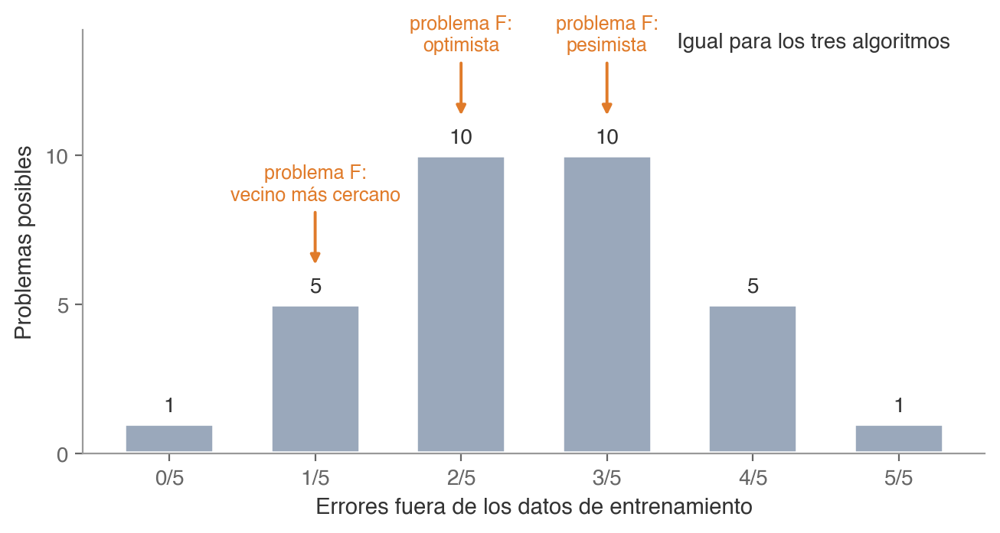
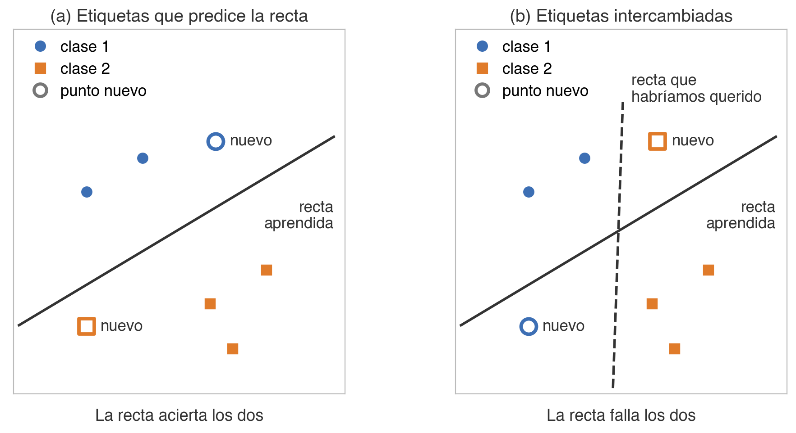
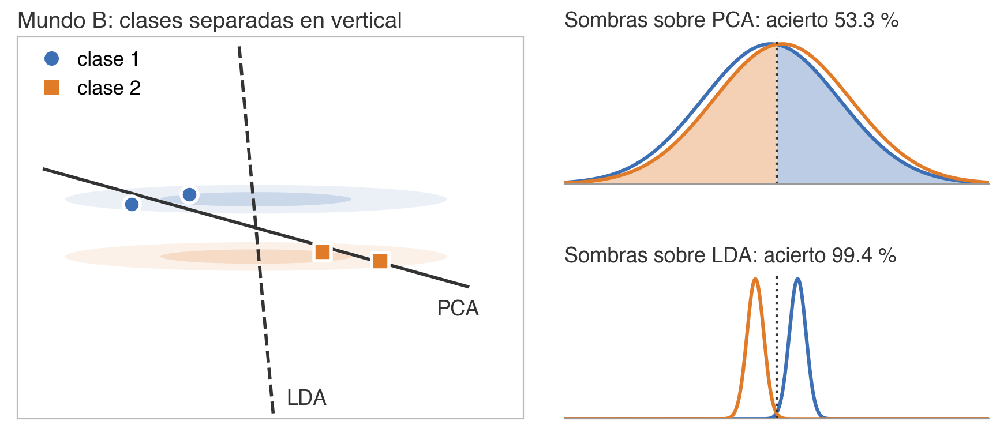

# C5 — Límites teóricos: no free lunch y el patito feo

*Elementos de Inteligencia Artificial · Ciencia de Datos · Curso 2026-2027*

*Las figuras de esta nota son de elaboración propia, salvo la figura 2, reproducida de Duda et al. Los dos teoremas siguen la sección 9.2 de Duda, R., Hart, P. y
Stork, D., "Pattern Classification", 2.ª edición, Wiley, 2001, que es donde hay que ir a buscar sus demostraciones; el
experimento de la sección 1 parte de su Ejemplo 1 y el de la vista de la sección 4 es suyo. La sección 5
sigue los capítulos 1, 4 y 5 de Abu-Mostafa, Y., Magdon-Ismail, M. y Lin, H., "Learning from Data", 2012. Todas las
cuentas y la salida del código se han rehecho y comprobado para esta nota.*

---

Llevamos cuatro conferencias comparando algoritmos. En la C1, A\* con una heurística contra búsqueda voraz; en la C2,
MRV contra un orden fijo; en la C3, unas metaheurísticas contra otras; en la C4, Naive Bayes contra un clasificador que siempre dice lo mismo. Y cada vez que alguien
preguntó "¿cuál es mejor?", la respuesta fue la misma: **depende del problema**.

Es una respuesta que suena a evasiva. Uno sospecha que, con suficiente esfuerzo, debería existir un algoritmo que sea
bueno en todo, y que "depende" solo significa que todavía no lo encontramos. Las tablas de resultados de las
competencias de aprendizaje automático refuerzan esa sospecha: siempre hay un primero.

Esta conferencia contesta esa pregunta, y la respuesta no es una opinión sino un teorema. Hay dos, en realidad, y los
dos dicen algo incómodo:

- el **teorema No Free Lunch**: si no se supone nada sobre el problema, ningún algoritmo de aprendizaje es mejor que
  otro, ni siquiera mejor que adivinar al azar;
- el **teorema del patito feo**: si no se supone nada sobre el problema, no hay ninguna forma privilegiada de decir que
  dos objetos se parecen, ni ninguna representación de los datos mejor que otra.

Lejos de ser una mala noticia, los dos teoremas explican por qué el aprendizaje funciona cuando funciona: porque los
algoritmos **sí** suponen cosas sobre el mundo. A esas suposiciones se les llama **sesgo inductivo**, y van a resultar
ser exactamente lo que veníamos llamando heurísticas, vecindades y supuestos de independencia.

> **Objetivos de esta nota.** Al terminarla deberían poder:
>
> 1. enunciar el teorema No Free Lunch y explicar qué afirma y qué **no** afirma;
> 2. definir el sesgo inductivo e identificarlo en los algoritmos del curso y en los modelos que usan;
> 3. enunciar el teorema del patito feo y explicar por qué la representación de los datos nunca es neutral;
> 4. explicar qué hace posible el aprendizaje a pesar de los dos teoremas, y qué errores de procedimiento lo rompen
>    (sobreajuste, sesgo de muestreo, *data snooping*);
> 5. aplicar todo lo anterior para juzgar afirmaciones del tipo "el algoritmo A es mejor que el B".

---

## 1. Un experimento: aprender sin suponer nada

Empecemos con un problema tan pequeño que se puede mirar entero. Cada objeto se describe con tres atributos binarios,
así que hay solo $2^3 = 8$ objetos posibles. Hay que clasificarlos en $+1$ o $-1$. Nos dan tres ejemplos etiquetados,
el conjunto de entrenamiento $D$, y tenemos que predecir los otros cinco:

| $x$ | 000 | 001 | 010 | 011 | 100 | 101 | 110 | 111 |
|---|---|---|---|---|---|---|---|---|
| En $D$ | $+1$ | $-1$ | $+1$ | ? | ? | ? | ? | ? |
| Verdad $F$ | $+1$ | $-1$ | $+1$ | $-1$ | $+1$ | $-1$ | $+1$ | $+1$ |

La última fila es la función objetivo $F$ que **nosotros** sabemos pero el algoritmo no. Probemos tres algoritmos, los
tres razonables:

- **Optimista:** responde $+1$ salvo en lo que aprendió de $D$.
- **Pesimista:** responde $-1$ salvo en lo que aprendió de $D$.
- **Vecino más cercano:** responde la etiqueta del ejemplo de $D$ más parecido, contando en cuántos atributos difieren
  (si hay empate entre vecinos que no coinciden, $+1$).

Fuera de $D$ quedan cinco objetos. El optimista se equivoca en 2 de ellos (en 011 y en 101), el pesimista en 3, y el
vecino más cercano solo en 1. Para este problema, el vecino más cercano es claramente el mejor.

> **Antes de seguir.** ¿Podemos concluir que el vecino más cercano es mejor algoritmo que los otros dos? Fíjense en
> qué sabe el algoritmo de los cinco objetos que no vio. Si la tabla de la verdad hubiera sido otra, compatible con los
> mismos tres ejemplos, ¿seguiría ganando?

El problema es que $F$ es solo **una** de las funciones compatibles con lo que vimos. Los tres ejemplos de $D$ no dicen
nada sobre los otros cinco objetos: cada uno puede ser $+1$ o $-1$, así que hay $2^5 = 32$ funciones objetivo posibles
que coinciden con $D$. Si no tenemos ningún motivo para preferir una, lo honesto es mirar cómo le va a cada algoritmo
en **todas**. El programa siguiente lo hace. No hace falta seguir cada línea: lo importante es la salida, que muestra
cuántos errores comete cada algoritmo en cada uno de los 32 problemas posibles.

```python
from itertools import product
import numpy as np

# Las 8 entradas posibles con 3 atributos binarios
X = ["".join(b) for b in product("01", repeat=3)]
# Conjunto de entrenamiento D: las tres primeras entradas, con sus etiquetas
D = {"000": +1, "001": -1, "010": +1}
fuera = [x for x in X if x not in D]                  # las 5 entradas que no vimos

def optimista(x):  return D.get(x, +1)                # +1 salvo lo aprendido
def pesimista(x):  return D.get(x, -1)                # -1 salvo lo aprendido
def vecino(x):                                        # 1-NN con distancia de Hamming
    if x in D: return D[x]
    dist = {z: sum(a != b for a, b in zip(x, z)) for z in D}
    m = min(dist.values())
    votos = sum(D[z] for z in D if dist[z] == m)
    return +1 if votos >= 0 else -1                   # empate: +1

algoritmos = {"optimista": optimista,
              "pesimista": pesimista,
              "vecino más cercano": vecino}

# Todas las funciones objetivo compatibles con D:
# una por cada forma de etiquetar las 5 entradas no vistas
objetivos = [dict(zip(fuera, etiquetas))
             for etiquetas in product([+1, -1], repeat=len(fuera))]
print(len(objetivos), "funciones objetivo compatibles con D")

for nombre, h in algoritmos.items():
    errores = [np.mean([h(x) != F[x] for x in fuera]) for F in objetivos]
    reparto = np.bincount((np.array(errores) * 5).round().astype(int))
    print(f"{nombre:20s} error medio fuera de D = {np.mean(errores):.3f}   "
          f"distribución = {reparto}")
```

```
32 funciones objetivo compatibles con D
optimista            error medio fuera de D = 0.500   distribución = [ 1  5 10 10  5  1]
pesimista            error medio fuera de D = 0.500   distribución = [ 1  5 10 10  5  1]
vecino más cercano   error medio fuera de D = 0.500   distribución = [ 1  5 10 10  5  1]
```

Los tres algoritmos se equivocan, en promedio, en la mitad de los objetos que no vieron: exactamente lo mismo que
tirar una moneda. Y no solo coincide el promedio: el reparto completo es idéntico (figura 1). Cada algoritmo acierta
todo en 1 de los 32 problemas, falla todo en otro, y en el medio se reparten igual. Lo que cambia de un algoritmo a otro
es **en qué problemas** le va bien; nuestro $F$ resultó ser uno de los que favorecen al vecino más cercano.



No hay truco en la elección de los algoritmos. Cualquier regla determinista asigna una etiqueta fija a cada uno de los
cinco objetos no vistos, y para cada objeto la mitad de los 32 problemas le da la razón y la otra mitad no. El
argumento no depende de los algoritmos, ni de cuántos atributos haya, ni de cuántos ejemplos nos den.

---

## 2. El teorema No Free Lunch

El experimento es un caso particular de un resultado general, el **teorema No Free Lunch** (NFL), de David Wolpert.
Para enunciarlo hace falta precisar qué error se mide. Si un objeto está en $D$, casi cualquier algoritmo potente
—un árbol de decisión sin podar, el vecino más cercano— lo va a acertar, porque lo memorizó. Lo que distingue a los
algoritmos es el **error fuera del conjunto de entrenamiento** (*off-training-set error*): el error en los objetos que
el algoritmo no vio. Es lo que medimos en la sección 1.

Duda et al. lo enuncian así:

> **Teorema 9.1 (No Free Lunch)** *Para dos algoritmos de aprendizaje cualesquiera $P_1(h|\mathcal{D})$ y
> $P_2(h|\mathcal{D})$, se cumple lo siguiente, independientemente de la distribución de muestreo $P(\mathbf{x})$ y del
> número $n$ de puntos de entrenamiento:*
>
> 1. *Promediando uniformemente sobre todas las funciones objetivo $F$, $\mathcal{E}_1(E|F,n) - \mathcal{E}_2(E|F,n) = 0$;*
> 2. *Para cualquier conjunto de entrenamiento fijo $\mathcal{D}$, promediando uniformemente sobre $F$,
>    $\mathcal{E}_1(E|F,\mathcal{D}) - \mathcal{E}_2(E|F,\mathcal{D}) = 0$;*
> 3. *Promediando uniformemente sobre todas las distribuciones a priori $P(F)$, $\mathcal{E}_1(E|n) - \mathcal{E}_2(E|n) = 0$;*
> 4. *Para cualquier conjunto de entrenamiento fijo $\mathcal{D}$, promediando uniformemente sobre $P(F)$,
>    $\mathcal{E}_1(E|\mathcal{D}) - \mathcal{E}_2(E|\mathcal{D}) = 0$.*
>
> — Duda, R., Hart, P. y Stork, D., *Pattern Classification*, 2.ª ed., Wiley, 2001, sección 9.2.1. Traducción propia.

**La notación.** Duda et al. describen un algoritmo de aprendizaje por $P_k(h|\mathcal{D})$, la probabilidad de que el
algoritmo $k$ produzca la hipótesis $h$ cuando se entrena con el conjunto $\mathcal{D}$ (que en esta nota venimos
llamando $D$). Para un algoritmo determinista, como los tres de la sección 1, esa probabilidad vale 1 para una sola
hipótesis. $\mathcal{E}_k(E|F,n)$ es el error esperado **fuera del conjunto de entrenamiento** del algoritmo $k$ cuando
la función objetivo es $F$ y hay $n$ ejemplos (su ecuación 2); $\mathcal{E}_k(E|F,\mathcal{D})$ es lo mismo con el
conjunto de entrenamiento fijo. Las partes 3 y 4 cambian el promedio uniforme sobre las funciones objetivo por un
promedio sobre todas las distribuciones a priori $P(F)$ posibles.

La parte 2 es exactamente lo que comprobamos con el código de la sección 1: un $\mathcal{D}$ fijo, las 32 funciones
objetivo compatibles con él y el mismo error medio para los tres algoritmos.

Hay una forma más gráfica de decirlo, que Duda et al. llaman una **ley de conservación** (figura 2). Si un algoritmo es mejor que
el promedio en un conjunto de problemas, tiene que ser peor que el promedio en otro, en la misma cantidad. No se puede
ganar en todos lados. Ni siquiera se puede ganar en algunos problemas y empatar en el resto. Todo lo que puede hacer
quien diseña un algoritmo es **elegir dónde gana**: cambiar rendimiento en problemas que no espera encontrar por
rendimiento en los que sí.

![**Figura 2.** La ley de conservación del NFL. Cada cuadrado representa *todos los problemas* compatibles con los datos de entrenamiento —no es el espacio de atributos—. Un $+$ indica que el algoritmo generaliza mejor que el promedio en esos problemas, un $-$ que lo hace peor y un $0$ que rinde igual que el promedio; el tamaño del símbolo indica por cuánto. La fila de arriba muestra rendimientos posibles: (a) muy bueno en pocos problemas a cambio de ser algo peor en todos los demás; (b) excelente en muchos problemas a cambio de ser muy malo en muchos otros. La de abajo, imposibles: (d) bueno en todos los problemas; (e) mejor en algunos y promedio en todos los demás. Fuente: reproducida de Duda et al. (2001), figura 9.1.](resources/duda_fig9_1.png)

> **Dónde está la demostración.** Duda et al., sección 9.2.1: el enunciado formal es el Teorema 9.1, con las
> ecuaciones 1 a 4, y el Ejemplo 1 es el experimento de nuestra sección 1 (en él aparecen los errores 0.4 y 0.6 del
> optimista y el pesimista). El libro no da la demostración completa: deja las partes 3 y 4 del teorema como problemas
> 2 a 5 del capítulo y remite a Wolpert, D., "The relationship between PAC, the statistical physics framework, the
> Bayesian framework, and the VC framework", en *The Mathematics of Generalization*, Addison-Wesley, 1995. Russell y
> Norvig lo mencionan en las notas bibliográficas del capítulo 19.

### Qué afirma y qué no afirma

El NFL es uno de los teoremas peor citados del área. Conviene tener claras sus lecturas equivocadas.

- **No dice que dé igual qué algoritmo usar.** Dice que da igual *si todos los problemas posibles son igual de
  probables*. Los problemas reales no lo son: los precios de las casas no cambian al azar entre dos casas vecinas, y
  las imágenes de gatos no son ruido. En un problema concreto, con estructura, los algoritmos rinden muy distinto, y
  elegir bien importa muchísimo.
- **No dice que el aprendizaje sea imposible.** Dice que es imposible **sin suposiciones**. Con ellas es perfectamente
  posible, y la sección 5 recuerda cómo.
- **No dice que los benchmarks no sirvan.** Dice que un benchmark informa sobre **la clase de problemas que
  representa**, y solo sobre ella. Ganar en 30 conjuntos de imágenes dice mucho sobre imágenes y nada sobre series
  financieras.
- **Sí dice** que toda afirmación "el algoritmo A es mejor que el B" es, en el fondo, una afirmación sobre los
  problemas a los que se aplica. Y que cualquier algoritmo, por popular y bien fundamentado que sea, tiene problemas
  en los que le va mal: aquellos en que sus suposiciones no coinciden con el mundo.

### El mismo teorema en optimización

Hay una versión del NFL para optimización, de Wolpert y Macready (1997), que dice lo mismo sobre las metaheurísticas
de la C3: promediando sobre todas las funciones objetivo posibles, todos los algoritmos de búsqueda que evalúan la
función como una caja negra tienen el mismo rendimiento. El recocido simulado no es mejor que la búsqueda aleatoria
**en general**; es mejor en los problemas cuyo paisaje tiene la estructura que el recocido aprovecha. Es el mismo
resultado en dos campos: una metaheurística no es mejor que otra en abstracto, sino **para una clase de
problemas**.

---

## 3. Sesgo inductivo: por qué aun así se puede aprender

Si el NFL es cierto, ¿por qué el vecino más cercano funciona tan bien en tantos problemas reales? Porque supone algo:
que **objetos parecidos tienen etiquetas parecidas**. Cuando el mundo es así, gana; cuando no lo es, pierde. En el
experimento de la sección 1, $F$ era un problema en el que esa suposición se cumplía bastante; en otro de los 32 se
cumplía al revés, y ahí el vecino más cercano era el peor de los tres.

A la suposición que un algoritmo hace para ir más allá de los datos se le llama **sesgo inductivo**. Todo algoritmo que
generaliza tiene uno: si no prefiriera unas funciones sobre otras, no tendría ninguna razón para predecir $+1$ en vez
de $-1$ en un objeto que no vio. Duda et al. lo expresan diciendo que el rendimiento de un algoritmo depende de lo bien
**alineado** que esté lo que el algoritmo tiende a producir con lo que el problema realmente es. El sesgo no es un
defecto que haya que eliminar: es lo único que permite aprender. El trabajo es elegir uno que coincida con el problema.

**Relectura del curso.** Con esta idea, buena parte de lo que vimos se puede releer como sesgos inductivos o, en
optimización, como su equivalente: suposiciones sobre la clase de problemas.

| Dónde | Técnica | Qué supone sobre el problema |
|---|---|---|
| C1 | Distancia en línea recta como heurística en Rumanía | Que las carreteras no se desvían mucho de la línea recta. |
| C1 | Distancia Manhattan en el 8-puzzle | Que mover cada ficha por separado es una buena aproximación del costo real. |
| 2b | Ignorar precondiciones o borrados | Que el problema relajado se parece al real lo suficiente para guiar la búsqueda. |
| C3 | Una vecindad para la búsqueda local | Que las buenas soluciones están cerca de otras buenas soluciones: que el paisaje no es aleatorio. |
| C4 | Naive Bayes | Que los atributos son independientes dada la clase. |
| C4 | HMM | Que el futuro depende del pasado solo a través del presente. |
| Machine Learning | Regresión lineal | Que la salida varía linealmente con los atributos. |
| Machine Learning | Regularización | Que las funciones suaves, con coeficientes pequeños, son más probables. |

Ninguna de esas suposiciones es "verdadera" en general. Cada una funciona en la clase de problemas para la que se
diseñó, y el NFL garantiza que en alguna otra clase falla.

### Dos ejemplos con algoritmos de verdad

El experimento de la sección 1 usa algoritmos de juguete a propósito, para poder mirar todos los problemas posibles.
Pero el mismo fenómeno aparece con los algoritmos que usan a diario.

**Un clasificador lineal y dos puntos que no vimos.** Se entrena una máquina de vectores de soporte lineal con cinco
puntos, dos de una clase y tres de otra, y separa los cinco sin errores (figura 3). Ahora aparecen dos puntos nuevos.
Si tienen las etiquetas que la recta predice, la recta acierta los dos. Si tienen las etiquetas intercambiadas, falla
los dos, y otra recta, igual de compatible con los cinco puntos de entrenamiento, los habría acertado. Los datos de
entrenamiento son idénticos en los dos casos: nada en ellos permite saber cuál de los dos mundos es el real. Es el
experimento de la sección 1 en dos dimensiones.



**PCA contra LDA.** El análisis de componentes principales (PCA) y el análisis discriminante lineal (LDA) hacen lo
mismo con los datos: eligen una **dirección**, una recta que pasa por el centro de los datos, y clasifican mirando solo
esa recta. Lo único que distingue a los dos métodos es **cómo eligen la dirección**, y la intuición dice que LDA
debería ganar siempre, porque usa las etiquetas y PCA no. Veamos que no es así con un ejemplo de solo cuatro puntos de
entrenamiento, dos por clase:

- clase 1: $(-2.6,\ 0.5)$ y $(-1.4,\ 0.7)$;
- clase 2: $(1.4,\ -0.5)$ y $(2.6,\ -0.7)$.

**Cómo se clasifica con una dirección.** Primero se **proyecta** cada punto sobre la recta: se lo lleva hasta ella por
el camino más corto, en perpendicular, como la sombra que dejaría con una luz que cae perpendicular a la recta
(figura 4a). Después de proyectar, cada punto queda reducido a **un solo número**: su posición sobre la recta (figura
4b). Con los puntos de entrenamiento proyectados se calcula la **media** de cada clase sobre la recta, y a un punto
nuevo se le asigna la clase cuya media le quede más cerca. En la figura, el punto nuevo $(1.5,\ 1.8)$ se proyecta en
$0.96$, más cerca de la media de la clase 2 ($2.09$) que de la de la clase 1 ($-2.09$): se le asigna la clase 2. Como
el **corte** está a mitad de camino entre las dos medias, asignar la clase es simplemente mirar de qué lado del corte
cae el punto.


**Cada método elige una dirección distinta.**

- **PCA** ignora las etiquetas y busca la dirección en la que los cuatro puntos están más dispersos. En horizontal van
  de $-2.6$ a $2.6$; en vertical, solo de $-0.7$ a $0.7$. Elige una dirección **casi horizontal**: la línea continua.
- **LDA** usa las etiquetas y busca la dirección en que las dos clases quedan lejos entre sí y cada clase queda
  apretada. Los dos puntos de la clase 1 difieren sobre todo en horizontal ($-2.6$ frente a $-1.4$) y casi coinciden en
  vertical ($0.5$ y $0.7$); con la clase 2 pasa lo mismo. LDA interpreta entonces que la variación horizontal es ruido
  dentro de cada clase, y elige una dirección **casi vertical**: la línea discontinua.

**Las dos direcciones separan perfectamente el entrenamiento.** Proyectados sobre la dirección de PCA, los puntos de
la clase 1 quedan en $-2.64$ y $-1.54$ y los de la clase 2 en $1.48$ y $2.69$; sobre la de LDA, la clase 1 queda en
$0.74$ y $0.83$ y la clase 2 en $-0.63$ y $-0.94$. En los dos casos las clases quedan a lados opuestos del centro. Mirando solo los cuatro puntos, no hay nada que permita decir cuál de las dos es mejor.

**Lo que decide es cómo son las clases en realidad.** Cuatro puntos son solo una muestra. Las elipses de las figuras 5 y 6
representan la distribución real de cada clase, que el algoritmo no ve, y las figuras muestran
dos posibilidades. En las
dos, los cuatro puntos de entrenamiento son una muestra perfectamente plausible.

Para saber cuánto acierta cada método en cada mundo hay que imaginar que se proyectan sobre su recta **todos** los
puntos de cada clase, no solo los cuatro de entrenamiento. Cada clase deja entonces una **sombra** sobre la recta: la
forma en que se reparten sus proyecciones. Es lo que dibuja la parte derecha de las figuras 5 y 6. Si las dos sombras
quedan separadas, casi todos los puntos caen del lado correcto del corte; si quedan una encima de otra, cada punto cae
de un lado o del otro casi al azar. El acierto es la fracción de puntos que cae del lado correcto, y las zonas
coloreadas son lo que cae del lado equivocado.

- **Mundo A.** Cada clase está muy estirada en vertical, y lo que realmente separa las clases es la posición
  horizontal: la variación vertical es el ruido. LDA eligió justo la dirección del ruido: sobre su recta la sombra de cada
  clase es larga, porque las clases son altas, y las dos sombras quedan casi una encima de otra. Acierta el **54.9 %**
  de los casos nuevos, casi como tirar una moneda. Sobre la recta de PCA, en cambio, las sombras son cortas y están
  separadas, y acierta prácticamente todos: el **100.0 %**.
- **Mundo B.** Al revés: cada clase está estirada en horizontal y lo que las separa es la altura. Ahora el ruido es la
  variación horizontal, y es PCA quien mira el ruido: sus dos sombras se solapan y acierta el **53.3 %**. Las de LDA
  quedan separadas, y acierta el **99.4 %**.

**Cada método hace una suposición sobre dónde está el ruido.** LDA supone que la variación que ve dentro de cada clase
es representativa de la real, algo muy poco fiable con dos ejemplos por clase. PCA supone que la dirección en que los
datos varían más es la que lleva la información. Con los mismos datos, cada suposición gana en uno de los dos mundos, y
con cuatro puntos no hay forma de saber en cuál estamos. Es el NFL con dos algoritmos que se usan a diario.

![**Figura 5.** Mundo A. A la izquierda, los cuatro puntos de entrenamiento, las direcciones de PCA (línea continua) y LDA (discontinua) y la distribución real de cada clase, dibujada como elipses de una y dos desviaciones típicas. A la derecha, las sombras: cómo se reparten sobre cada recta las proyecciones de todos los puntos de cada clase. La línea punteada es el corte, y las zonas coloreadas, la parte de cada clase que cae del lado equivocado. Los aciertos son exactos, calculados a partir de las distribuciones reales.](resources/pca_lda_A.png)



No es un caso de laboratorio. Martínez y Kak (2001) lo encontraron con caras reales: cuando el conjunto de
entrenamiento era pequeño, PCA superaba a LDA. Que un método use más información no lo hace mejor en todos los
problemas.

### La navaja de Occam: una preferencia, no una ley

El sesgo inductivo más famoso es la **navaja de Occam**: entre las hipótesis que explican los datos, preferir la más
simple. En aprendizaje se traduce en preferir modelos con menos parámetros, árboles más podados, coeficientes más
pequeños. ¿Está justificado?

El NFL contesta que no **en general**: promediando sobre todos los problemas, los modelos simples no son mejores que
los complejos. Evitar el sobreajuste es, en sí mismo, una preferencia, y hay problemas en los que perjudica. Que Occam
funcione tan a menudo dice algo sobre **los problemas que solemos enfrentar**, no sobre el aprendizaje. Duda et al.
proponen dos explicaciones: que tendemos a elegir —y a notar— los problemas que nuestros métodos simples resuelven, y
que en la práctica dejamos de buscar en cuanto una solución es suficientemente buena. Russell y Norvig, por su parte,
reconstruyen la historia de la idea desde Ockham y Hume, y la conectan directamente con el NFL.

> **Antes de seguir.** Piensen en el modelo que van a usar en el Proyecto 2. ¿Qué tendría que ser cierto sobre sus
> datos para que funcione bien? ¿Y qué tipo de datos lo haría fracasar?

> **Para ampliar.** Duda et al., sección 9.2.5 (*Overfitting avoidance and Occam's razor*); Russell y Norvig, sección
> 19.2 y notas bibliográficas del capítulo 19.

---

## 4. El teorema del patito feo

El NFL habla de algoritmos. El segundo teorema habla de algo anterior a cualquier algoritmo: de cómo se describen los
objetos y de qué significa que dos se parezcan.

Casi todo el aprendizaje automático depende de una noción de parecido. El vecino más cercano y $k$-medias usan una
distancia; un árbol de decisión agrupa los objetos que coinciden en ciertos atributos; incluso la suposición del
vecino más cercano de la sección 3 —objetos parecidos, etiquetas parecidas— necesita decir qué es "parecido". La
pregunta natural es si hay una forma **objetiva** de medirlo.

### Un ejemplo: la vista

Describamos a las personas con dos atributos: $f_1$ = ciega del ojo derecho y $f_2$ = ciega del ojo izquierdo. Si
medimos el parecido por el número de atributos en que dos personas difieren:

| Codificación 1: (ciega der., ciega izq.) | Solo derecho | Solo izquierdo | Ninguno | Ambos |
|---|---|---|---|---|
| Vector | (1, 0) | (0, 1) | (0, 0) | (1, 1) |
| Distancia a "solo derecho" | 0 | **2** | 1 | 1 |

La persona ciega solo del ojo derecho resulta ser la **más distinta** de la persona ciega solo del ojo izquierdo; más
parecida a alguien totalmente ciego que a ella. Para muchos propósitos eso es absurdo: las dos pueden manejar con
ciertas condiciones, y la persona totalmente ciega no. Pero la codificación no tiene nada de malo. Podríamos haber
elegido otra igual de legítima, $f_1$ = ciega del ojo derecho y $f_2$ = los dos ojos están igual:

| Codificación 2: (ciega der., ojos iguales) | Solo derecho | Solo izquierdo | Ninguno | Ambos |
|---|---|---|---|---|
| Vector | (1, 0) | (0, 0) | (0, 1) | (1, 1) |
| Distancia a "solo derecho" | 0 | **1** | 2 | 1 |

Las dos codificaciones describen exactamente a las mismas cuatro personas, sin perder información, y dan respuestas
opuestas a quién se parece a quién. Sin saber **para qué** se van a usar los datos, no hay ningún motivo para preferir
una.

### Contar lo que dos objetos tienen en común

Podría pensarse que el problema es medir el parecido por atributos, que dependen de la codificación, y que lo correcto
sería contar **todas** las propiedades que dos objetos comparten. Una propiedad (un **predicado**) es cualquier
afirmación que unos objetos cumplen y otros no: "es ciega del ojo derecho", "es ciega de al menos un ojo", "es ciega de
exactamente un ojo"... Con $d$ objetos distintos, cada subconjunto de ellos es el conjunto de los que cumplen algún
predicado, así que hay $2^d$ predicados posibles.

¿Cuántos comparten dos objetos distintos $x_i$ y $x_j$? Exactamente los predicados que los incluyen a los dos, y para
armar uno basta decidir qué hacer con los otros $d - 2$ objetos: incluirlo o no. Son $2^{d-2}$. **El mismo número para
cualquier par.** Con las cuatro personas del ejemplo:

```python
from itertools import combinations

def predicados(objetos):
    """Todos los predicados posibles: cada subconjunto de objetos es el conjunto de los que cumplen uno."""
    return [set(c) for r in range(len(objetos) + 1) for c in combinations(objetos, r)]

objetos = ["x1", "x2", "x3", "x4"]
P = predicados(objetos)
print(len(P), "predicados")
for a, b in combinations(objetos, 2):
    compartidos = sum(1 for p in P if a in p and b in p)
    print(f"{a} y {b} comparten {compartidos} predicados")
```

El programa encuentra 16 predicados, y cada uno de los seis pares comparte exactamente 4, que es $2^{4-2}$.

Duda et al. lo enuncian así:

> **Teorema 9.2 (patito feo)** *Si usamos un conjunto finito de predicados que nos permite distinguir cualquier par
> de patrones considerados, el número de predicados que comparten dos patrones cualesquiera de ese tipo es constante e
> independiente de qué patrones se elijan. Además, si la semejanza entre patrones se basa en el número total de
> predicados que comparten, entonces dos patrones cualesquiera son "igual de semejantes".*
>
> — Duda, R., Hart, P. y Stork, D., *Pattern Classification*, 2.ª ed., Wiley, 2001, sección 9.2.2. Traducción propia.

Duda et al. llaman *patrones* a lo que en esta nota venimos llamando objetos.

El nombre viene del cuento: un patito feo se parece a un cisne exactamente tanto como dos cisnes entre sí. Sin una
elección previa de qué propiedades importan, no hay forma de decir que no.

> **Dónde está la demostración.** Duda et al., sección 9.2.2: el ejemplo de la vista, el conteo de predicados
> (ecuaciones 5 y 6) y el enunciado como Teorema 9.2. Esta vez el libro sí da la demostración completa, que es
> precisamente el conteo de la ecuación 6. La demostración original es de Watanabe, S., *Pattern Recognition: Human
> and Mechanical*, Wiley, 1985.

### Consecuencia: la representación no es neutral

El patito feo es al parecido lo que el NFL es a los algoritmos: **no hay un conjunto de atributos privilegiado ni una
medida de parecido privilegiada** independientes del problema. Toda forma de describir los datos ya es una suposición
sobre qué importa. Y como el resultado vale para cualquier discretización, vale también para atributos continuos.

No es una curiosidad filosófica; se ve en cualquier conjunto de datos. El conjunto `wine` de scikit-learn describe 178
vinos con 13 mediciones químicas. Algunas van de 0.5 a 1.7 (el tono) y otras de 278 a 1 680 (la prolina). Si se
aplica el vecino más cercano a los números tal cual, la distancia la decide casi entera la prolina, que es la que tiene
números grandes; si se estandariza cada atributo, todas pesan lo mismo:

```python
from sklearn.datasets import load_wine
from sklearn.model_selection import StratifiedKFold, cross_val_score
from sklearn.neighbors import KNeighborsClassifier
from sklearn.pipeline import make_pipeline
from sklearn.preprocessing import StandardScaler

X, y = load_wine(return_X_y=True)                 # 13 atributos químicos de 178 vinos
cv = StratifiedKFold(n_splits=5, shuffle=True, random_state=0)

for nombre, modelo in [("k-NN, atributos tal cual", KNeighborsClassifier(n_neighbors=5)),
                       ("k-NN, atributos estandarizados",
                        make_pipeline(StandardScaler(), KNeighborsClassifier(n_neighbors=5)))]:
    acc = cross_val_score(modelo, X, y, cv=cv)
    print(f"{nombre:32s} exactitud = {acc.mean():.3f} ± {acc.std():.3f}")
```

| Representación | Exactitud (validación cruzada, 5 pliegues) |
|---|---|
| Atributos tal cual | 0.663 ± 0.036 |
| Atributos estandarizados | 0.961 ± 0.013 |

Mismo algoritmo, mismos vinos, mismos datos: lo único que cambió es qué se considera "parecido". Ninguna de las dos
representaciones es la correcta en abstracto. La estandarización supone que todos los atributos importan por igual,
lo que aquí resulta mucho más cercano a la verdad que suponer que importa casi solo la prolina. Obsérvese además que el
`StandardScaler` está **dentro** del `pipeline`: así se ajusta solo con los datos de entrenamiento de cada pliegue,
algo sobre lo que volveremos en la sección 5.

Lo mismo pasa con cualquier transformación de una tabla de datos, no solo con el escalado. Si una variable categórica
con los valores rojo, verde y azul se codifica como los números 1, 2 y 3, el rojo queda a distancia 1 del verde y a
distancia 2 del azul: la codificación inventó que el verde está "entre" los otros dos. Si se codifica *one-hot*, con
una columna binaria por color, los tres quedan a la misma distancia, $\sqrt{2}$, entre sí. Es exactamente la situación
del patito feo: ningún color se parece más a otro que a un tercero. Ninguna de las dos codificaciones es neutral; la
primera supone un orden que puede no existir, y la segunda supone que no hay ninguna relación entre los valores.

Esto ya lo habíamos visto sin el teorema. En la C2, reformular las ocho reinas redujo el espacio de búsqueda catorce
órdenes de magnitud sin cambiar de algoritmo; en la C4, elegir las variables y las flechas de una red decidía qué se
podía calcular. Ahora sabemos que no es mala suerte de esos ejemplos: **elegir la representación es siempre una
decisión de diseño**, y es la decisión sobre la que trata la C6. Seleccionar atributos, escalarlos, reducir la
dimensión o imputar valores faltantes no son pasos técnicos neutros: cada uno es una suposición sobre el problema.

---

## 5. Qué hace posible el aprendizaje

Los dos teoremas dicen que sin suposiciones no se aprende nada. Esta sección retoma lo que vieron en Machine Learning
para recordar cuáles son las suposiciones con las que sí se aprende, y qué errores de procedimiento las rompen. Es un
andamio para la C6 y la C7, no un tema nuevo.

### Dentro y fuera de la muestra

Llamemos $E_{in}(h)$ al error de una hipótesis $h$ en los datos de entrenamiento y $E_{out}(h)$ a su error en datos
nuevos. Aprender bien es tener $E_{out}$ pequeño, y eso se descompone en dos preguntas:

1. **¿Se parece $E_{out}$ a $E_{in}$?** Si los datos nuevos salen de **la misma distribución** que los de
   entrenamiento, sí, con alta probabilidad. Para una hipótesis fija, la desigualdad de Hoeffding acota la
   probabilidad de que difieran en más de $\varepsilon$ con $N$ datos:
   $$P\big(|E_{in}(h) - E_{out}(h)| > \varepsilon\big) \le 2 e^{-2 \varepsilon^2 N}$$
   Si el algoritmo eligió $g$ entre $M$ hipótesis, la cota se multiplica por $M$: $2M e^{-2\varepsilon^2 N}$.
2. **¿Es $E_{in}$ pequeño?** Eso depende de que el modelo contenga alguna hipótesis que se parezca a la función
   objetivo. Y aquí entra el sesgo inductivo: no hay forma de garantizarlo sin suponer algo sobre $F$.

La garantía es **probabilística**: no promete que $E_{out}$ sea pequeño, sino que es improbable que difiera mucho de
$E_{in}$. Y esto no contradice el NFL: el NFL mide el error en los objetos no vistos promediando sobre todas las
funciones objetivo; Hoeffding fija la función objetivo y supone que los datos nuevos vienen de la misma distribución
que los viejos. Las dos suposiciones —que el mundo tiene estructura y que no cambia entre el entrenamiento y el uso—
son las que hacen posible aprender. La segunda reaparece en la C8, cuando hablemos de modelos que se degradan.

### Ruido, sobreajuste y regularización

Hay **sobreajuste** cuando, al elegir hipótesis con $E_{in}$ cada vez menor, $E_{out}$ crece. El modelo usa sus grados
de libertad sobrantes para ajustar el ruido. Hay dos tipos de ruido, y conviene distinguirlos:

- **Ruido estocástico:** la parte de $y$ que no está determinada por $x$. Dos clientes con los mismos datos pueden
  pagar o no pagar un crédito. No depende del modelo, y ningún modelo lo elimina.
- **Ruido determinista:** la parte de la función objetivo que **el modelo no puede representar**. Si se ajusta una
  recta a una relación curva, la curvatura se comporta como ruido para esa recta. Depende del modelo: con uno más
  flexible disminuye.

La **regularización** es la primera respuesta: restringir el modelo, por ejemplo minimizando
$E_{in}(w) + \lambda \sum_i w_i^2$, para cambiar un poco de sesgo por mucha menos varianza. A la luz de la sección 3, la
regularización es exactamente una navaja de Occam: un sesgo inductivo hacia funciones suaves. Funciona cuando el mundo
es así.

### Validación y las tres formas de engañarse

La **validación** estima $E_{out}$ con datos que no se usaron para entrenar, y la validación cruzada lo hace sin
desperdiciar datos. Pero la estimación solo es honesta si se respetan tres condiciones, y cada una es un error de
procedimiento frecuente.

- **Sobreajustar el conjunto de validación.** Si se prueban $M$ configuraciones y se elige la de menor error de
  validación, ese error ya no es una estimación imparcial: es el mínimo de $M$ estimaciones, y la cota de Hoeffding se
  multiplica por $M$. Con $N = 1\,000$ datos de validación y $\varepsilon = 0.05$, la cota para un solo modelo es
  $2e^{-5} \approx 0.013$; para el mejor de 50 modelos es $\approx 0.67$, y ya no garantiza casi nada. Por eso el
  conjunto de prueba se usa **una sola vez**, al final.
- **Sesgo de muestreo.** Si los datos se recogieron de forma sesgada, el modelo aprende el sesgo. El ejemplo clásico
  es la encuesta telefónica que en 1948 dio por ganador a Dewey contra Truman: en esa época tener teléfono era señal de
  un nivel económico que se correlacionaba con el voto. Ninguna técnica de aprendizaje lo corrige; hay que verlo en
  los datos (C6).
- **Espiar los datos** (*data snooping*). Si un conjunto de datos influyó en **cualquier** paso del proceso —elegir el
  modelo, elegir los atributos, normalizar—, su capacidad para evaluar el resultado queda comprometida. Calcular la
  media y la desviación para estandarizar usando todos los datos antes de partir es una forma sutil de hacerlo; por eso
  el código de la sección 4 pone el `StandardScaler` dentro del `pipeline`.

> **Para ampliar.** Abu-Mostafa et al., *Learning from Data*: sección 1.3 (viabilidad del aprendizaje: la desigualdad
> de Hoeffding, con el factor $M$ en la ecuación 1.6, y las dos preguntas de la sección 1.3.3); sección 4.1.2 (ruido
> estocástico y determinista); secciones 4.2 y 4.3 (regularización y validación); y capítulo 5, *Three Learning
> Principles*: 5.1 (navaja de Occam), 5.2 (sesgo de muestreo, con la encuesta de Dewey y Truman) y 5.3 (*data
> snooping*).

---

## 6. Qué llevarse de esta nota

1. **No Free Lunch.** Promediando sobre todos los problemas posibles, todos los algoritmos de aprendizaje
   —y todos los de optimización— rinden igual fuera de los datos de entrenamiento. Ganar en unos problemas es perder
   en otros.
2. **Lo que decide es el ajuste entre el algoritmo y el problema.** Toda afirmación "A es mejor que B" es una
   afirmación sobre una clase de problemas, y hay que decir cuál.
3. **Aprender exige suponer.** El sesgo inductivo es lo que permite ir más allá de los datos. Las heurísticas, las
   vecindades, los supuestos de independencia y la regularización son sesgos; Occam es una preferencia que funciona
   en los problemas que solemos ver, no una ley.
4. **No hay parecido ni representación privilegiados.** Sin saber para qué se usan los datos, dos objetos cualesquiera
   son igual de parecidos. Elegir atributos, escalas y codificaciones es elegir qué importa.
5. **Las suposiciones que hacen posible el aprendizaje se rompen con facilidad.** Sobreajustar la validación, muestrear
   con sesgo o espiar los datos invalidan la evaluación aunque el modelo sea bueno.

**Hacia la C6 y la C7.** La C6 toma la consecuencia del patito feo y la convierte en práctica: qué hacer cuando los
datos no son los que el problema necesita, sabiendo que cada arreglo es una suposición. La C7 toma la del NFL: si no
hay un algoritmo mejor en general, la única forma de saber cuál es mejor **para su problema** es compararlos con un
protocolo experimental que no se engañe a sí mismo.

---

## 7. Para qué les sirve en el Proyecto 2

En el examen final, integrado a la defensa del Proyecto 2, se les va a preguntar qué dice el NFL sobre su propio
proyecto. Conviene ir preparando la respuesta desde ahora:

- **No escriban "el mejor modelo".** Escriban "el modelo que mejor funcionó en este problema, con estos datos y bajo
  este protocolo". No es modestia: es lo que el teorema permite afirmar.
- **Justifiquen cada modelo por sus supuestos.** Para cada modelo que prueben, digan qué sesgo inductivo tiene y por
  qué es razonable para sus datos. Si no saben qué supone un modelo, no pueden saber cuándo va a fallar.
- **Documenten las decisiones de representación.** Qué atributos usaron, cómo los codificaron y escalaron, y por qué.
  El patito feo dice que esas decisiones cambian el resultado; el informe tiene que dejarlas a la vista.
- **Protejan el conjunto de prueba.** Úsenlo una sola vez, al final, y metan todo el preprocesamiento dentro de la
  validación cruzada. Si lo miraron antes, digan cuántas veces y por qué, porque cambia lo que pueden concluir.
- **Comparen con un baseline.** Como en la C4: si un modelo complejo no le gana con claridad a uno trivial, hay que
  preguntarse por qué antes de defenderlo.

---

## 8. Preguntas frecuentes

**Si da igual el algoritmo en promedio, ¿para qué aprendemos tantos?** Porque no estamos en el promedio. Cada
algoritmo es bueno en una clase de problemas, y conocer muchos —y sobre todo saber qué supone cada uno— es lo que
permite elegir bien ante un problema nuevo. Duda et al. lo dicen así: la mejor garantía para resolver problemas
nuevos es la experiencia con un abanico amplio de técnicas.

**¿Y por qué las redes neuronales profundas ganan en casi todo?** No ganan en casi todo: ganan en imágenes, sonido y
texto, donde sus sesgos —que lo cercano en el espacio o en el tiempo está relacionado, que los objetos se componen de
partes— coinciden con el mundo. En datos tabulares, como los de muchos proyectos de este curso, los métodos basados
en árboles suelen igualarlas o superarlas. Es el NFL en acción.

**¿El sobreajuste es siempre malo?** Las redes neuronales profundas actuales tienen muchos más parámetros que datos,
pueden ajustar el conjunto de entrenamiento a la perfección —incluso con etiquetas puestas al azar (Zhang et al.,
2017)— y aun así generalizan bien en imágenes o texto. Al aumentar la complejidad, el error de prueba puede bajar, subir
y volver a bajar, un fenómeno llamado **doble descenso** (Belkin et al., 2019). No contradice el NFL: confirma que
"simple" no se mide solo contando parámetros, y que la arquitectura y el algoritmo de entrenamiento tienen sus propios
sesgos inductivos, que en esos dominios coinciden con el mundo. Con los modelos y conjuntos de datos tabulares del
Proyecto 2, el sobreajuste clásico sigue siendo el riesgo principal.

**¿El NFL dice que la validación cruzada no sirve?** Dice algo parecido, y conviene entenderlo bien. Elegir un modelo
por validación cruzada también es un algoritmo, y promediando sobre todos los problemas posibles no le gana a ningún
otro criterio de elección. Duda et al. lo señalan al final de la sección 9.2.5: no se pueden usar los datos de
entrenamiento para distinguir, con garantías, los problemas en los que un clasificador va a generalizar bien de
aquellos en los que no. La validación cruzada funciona en la práctica por la misma razón que todo lo demás: porque los
problemas reales tienen estructura y el futuro se parece al pasado.

**¿El patito feo dice que todas las representaciones son igual de buenas?** No. Dice que ninguna es mejor **sin
suposiciones sobre el problema**. En cuanto se sabe para qué se usan los datos, unas representaciones son mucho
mejores que otras, como muestra el ejemplo de los vinos. Lo que el teorema prohíbe es creer que esa elección viene
dada por los datos mismos.

**¿Hace falta saber demostrar los teoremas?** No. Lo que se evalúa es que sepan enunciarlos, explicar qué afirman y qué
no, y aplicarlos a un caso concreto. Las demostraciones están en las referencias de cada sección para quien quiera
verlas.

---

## 9. Ejercicios

Intenten resolverlos por su cuenta. Los ejercicios 2 y 5 son cuentas a mano como las de las secciones 1 y 4; el 9
conecta con el Proyecto 2.

**1.** Un artículo presenta un algoritmo nuevo de clasificación que obtiene la mayor exactitud en 30 conjuntos de datos
públicos, frente a otros cinco algoritmos. *(a)* ¿Qué se puede concluir? *(b)* ¿Qué no se puede concluir? *(c)* ¿Qué le
preguntaría a los autores antes de usar el algoritmo en un problema de detección de fraude?

**2.** Hay dos atributos binarios, así que cuatro objetos posibles: 00, 01, 10 y 11. El conjunto de entrenamiento es
$D = \{00 \to +1,\ 01 \to -1\}$. *(a)* ¿Cuántas funciones objetivo son compatibles con $D$? Escríbalas. *(b)* Calcule
el error fuera de $D$ en cada una del algoritmo que responde siempre $+1$ fuera de $D$ y del vecino más cercano con
distancia de Hamming. *(c)* Compruebe que los promedios coinciden. *(d)* ¿En qué función objetivo gana el vecino más
cercano? ¿Qué tiene de especial?

**3.** En el experimento de la sección 1, diseñe un algoritmo que acierte los cinco objetos no vistos del problema
$F$. Después encuentre, entre los 32 problemas compatibles con $D$, uno en el que ese mismo algoritmo se equivoque en
todos. ¿Qué relación hay entre los dos problemas?

**4.** Diga cuál es el sesgo inductivo de cada uno de estos algoritmos, y describa un problema en el que esa
suposición falle: *(a)* $k$ vecinos más cercanos; *(b)* un árbol de decisión de profundidad 2; *(c)* regresión
logística; *(d)* recocido simulado con una vecindad que intercambia dos ciudades de una ruta.

**5.** Con tres objetos, $x_1$, $x_2$ y $x_3$: *(a)* liste los $2^3 = 8$ predicados posibles; *(b)* cuente los que
comparten $x_1$ y $x_2$, $x_1$ y $x_3$, y $x_2$ y $x_3$. *(c)* ¿Coincide con la fórmula $2^{d-2}$?

**6.** En el ejemplo de la vista de la sección 4: *(a)* con cada codificación, ¿quién está más lejos de la persona
ciega solo del ojo izquierdo? *(b)* Agregue un tercer atributo binario de modo que la persona totalmente ciega quede a
distancia 2 o más de cada una de las otras tres. ¿Por qué no se puede lograr con solo dos atributos que distingan a
las cuatro personas? *(c)* ¿Puede algún criterio que solo mire los datos
decir cuál de las tres codificaciones es la correcta?

**7.** Se quiere predecir el precio de venta de casas a partir de su superficie con una regresión lineal. Se sabe que
el precio crece más rápido que la superficie en las casas grandes, y que dos casas idénticas pueden venderse a precios
distintos según cómo se negocie. *(a)* ¿Qué parte de la variación es ruido estocástico y qué parte es ruido
determinista? *(b)* ¿Cuál de los dos disminuye si se pasa a un modelo cuadrático? *(c)* ¿Cuál de los dos disminuye si
se consiguen más casas?

**8.** Una estudiante prueba 50 configuraciones de un modelo, evalúa cada una en el conjunto de prueba (1 000
ejemplos) y reporta la exactitud de la mejor. *(a)* ¿Qué error de procedimiento cometió? *(b)* Usando la cota de
Hoeffding con $\varepsilon = 0.05$, compare la garantía que tendría con una sola configuración y la que tiene con 50.
*(c)* ¿Cómo debió hacerlo? *(d)* Otra estudiante estandariza todos los atributos con la media y la desviación de todo el
conjunto de datos y después lo parte en entrenamiento y prueba. ¿Es el mismo tipo de error?

**9.** *(Hacia el Proyecto 2.)* Escriba el párrafo que respondería en el examen final a la pregunta "¿qué dice el
teorema No Free Lunch sobre su proyecto?". Debe nombrar los modelos que compara, el sesgo inductivo de cada uno, por
qué esos sesgos son razonables para sus datos y qué tipo de datos los harían fracasar.

<!-- ---

## 10. Soluciones

**1.** *(a)* Que el algoritmo funciona bien en la clase de problemas que esos 30 conjuntos representan, comparado con
esos cinco competidores y con el protocolo que se usó, siempre que el protocolo sea honesto (mismas particiones, ajuste
de hiperparámetros equivalente para todos, prueba usada una sola vez). *(b)* Que sea mejor en general, ni en un
problema concreto que no se parezca a esos conjuntos: es exactamente lo que el NFL prohíbe. *(c)* Qué tipo de datos son
los 30 conjuntos y si alguno se parece al problema de fraude (clases muy desbalanceadas, datos que cambian con el
tiempo); qué métrica usaron, porque la exactitud no sirve con clases desbalanceadas (C4); cuánto ajustaron su
algoritmo y los competidores; y cuál es la variabilidad de los resultados, no solo el promedio.

**2.** *(a)* Fuera de $D$ quedan 10 y 11, cada uno puede ser $+1$ o $-1$: son 4 funciones,
$(F(10), F(11)) \in \{(+,+), (+,-), (-,+), (-,-)\}$. *(b)* "Siempre $+1$" predice $(+,+)$: sus errores son 0, 1/2,
1/2 y 1. El vecino más cercano predice $+1$ para 10 (su vecino más cercano en $D$ es 00) y $-1$ para 11 (su vecino es
01), es decir $(+,-)$: sus errores son 1/2, 0, 1 y 1/2. *(c)* Los dos promedian 0.5. *(d)* Gana en $(+,-)$, la función
en que la etiqueta depende solo del segundo atributo: es justamente un mundo en el que los objetos que coinciden en un
atributo tienen la misma etiqueta, que es lo que supone el vecino más cercano.

**3.** Basta con el algoritmo que memoriza $D$ y responde en los cinco objetos no vistos lo mismo que $F$: $-1$ en
011, $+1$ en 100, $-1$ en 101, $+1$ en 110 y $+1$ en 111. Su error en $F$ es 0. En el problema que tiene las cinco
etiquetas invertidas ($+1$, $-1$, $+1$, $-1$, $-1$), que también es compatible con $D$, se equivoca en todos. Es el
mecanismo del NFL: para cada problema que favorece a un algoritmo hay otro, igual de compatible con los datos, que lo
castiga en la misma medida.

**4.** *(a)* Que los objetos cercanos en la distancia elegida tienen la misma etiqueta; falla si la etiqueta depende
de un atributo de escala pequeña que la distancia ignora, o con muchos atributos irrelevantes (C6). *(b)* Que la clase
se decide con dos preguntas sobre atributos individuales; falla si depende de una combinación, como "la suma de dos
atributos supera un umbral". *(c)* Que las clases se separan con un hiperplano; falla en un problema como el XOR.
*(d)* Que las buenas rutas están cerca de otras buenas rutas; falla en un paisaje en que intercambiar dos ciudades
cambia el costo de forma errática, por ejemplo si los costos entre ciudades son aleatorios y sin estructura.

**5.** *(a)* $\emptyset$, $\{x_1\}$, $\{x_2\}$, $\{x_3\}$, $\{x_1, x_2\}$, $\{x_1, x_3\}$, $\{x_2, x_3\}$,
$\{x_1, x_2, x_3\}$. *(b)* $x_1$ y $x_2$ comparten $\{x_1, x_2\}$ y $\{x_1, x_2, x_3\}$: 2. Igual para los otros dos
pares. *(c)* Sí: $2^{3-2} = 2$.

**6.** *(a)* Con la codificación 1, la persona ciega solo del ojo izquierdo, $(0, 1)$, está a distancia 2 de la ciega
solo del derecho, $(1, 0)$. Con la codificación 2, la ciega solo del izquierdo es $(0, 0)$ y la más lejana es la
totalmente ciega, $(1, 1)$. *(b)* Por ejemplo, a la codificación 1 se le agrega $f_3$ = ciega de los dos ojos: ninguno
$(0, 0, 0)$, solo derecho $(1, 0, 0)$, solo izquierdo $(0, 1, 0)$, ambos $(1, 1, 1)$. La totalmente ciega queda a
distancia 2 de las ciegas de un ojo y 3 de la que ve con los dos. Con dos atributos no se puede: los cuatro vectores
de $\{0, 1\}^2$ son distintos, y cada uno tiene exactamente un vector a distancia 2 y dos a distancia 1, así que
ninguno puede quedar a distancia 2 de los otros tres. Agregar un atributo es otra decisión de representación, y otra
vez cambia quién se parece a quién. *(c)* No. Es exactamente lo que dice el patito feo: la elección
depende de para qué se usan los datos (por ejemplo, decidir quién puede manejar), no de los datos.

**7.** *(a)* La diferencia de precio entre casas idénticas por la negociación es ruido estocástico: no depende de la
superficie. La curvatura que una recta no puede representar es ruido determinista para el modelo lineal. *(b)* El
determinista: un modelo cuadrático puede representar parte de la curvatura. El estocástico no cambia. *(c)* Ninguno de
los dos desaparece con más datos, porque los dos son propiedades del problema y del modelo; lo que disminuye con más
datos es la varianza, es decir, cuánto se deja engañar el modelo por el ruido de esa muestra concreta.

**8.** *(a)* Usó el conjunto de prueba para elegir: es sobreajustar el conjunto de prueba, una forma de *data
snooping*. La exactitud reportada es optimista. *(b)* Con una sola configuración,
$P(|E_{test} - E_{out}| > 0.05) \le 2e^{-2 \cdot 0.05^2 \cdot 1000} = 2e^{-5} \approx 0.013$. Con 50, la cota es
$50$ veces mayor, $\approx 0.67$: ya no garantiza casi nada. *(c)* Elegir la configuración con validación cruzada sobre
los datos de entrenamiento, y evaluar la elegida una sola vez en el conjunto de prueba. *(d)* Sí, en versión más leve:
la media y la desviación del conjunto de prueba influyeron en la transformación de los datos de entrenamiento. Se
corrige ajustando el escalado solo con el entrenamiento, por ejemplo con un `pipeline` como el de la sección 4.

**9.** No hay una única respuesta. Se espera que el párrafo diga que ningún modelo es mejor en general, que el que
eligieron funciona **en su problema** porque sus suposiciones coinciden con la estructura de los datos, cuáles son esas
suposiciones para cada modelo comparado (por ejemplo, independencia condicional en Naive Bayes, fronteras lineales en
la regresión logística, interacciones por umbrales en los árboles), qué evidencia tienen de que se cumplen, y qué
cambio en los datos los haría fracasar. Un buen párrafo cierra diciendo que la conclusión vale para esos datos y ese
protocolo, y no se extiende a otros problemas sin volver a comparar. -->

---

## Referencias

Duda, R., Hart, P. y Stork, D. *Pattern Classification*, 2.ª edición, Wiley, 2001. Capítulo 9, sección 9.2: 9.2.1
(teorema No Free Lunch, Teorema 9.1 y Ejemplo 1), 9.2.2 (teorema del patito feo, Teorema 9.2) y 9.2.5 (sobreajuste y
navaja de Occam). Citado por sección, teorema y ecuación: el PDF de la carpeta de bibliografía numera las páginas por
capítulo.

Wolpert, D. "The relationship between PAC, the statistical physics framework, the Bayesian framework, and the VC
framework", en Wolpert, D. (ed.), *The Mathematics of Generalization*, Addison-Wesley, 1995. Demostración del NFL
para aprendizaje.

Wolpert, D. y Macready, W. "No free lunch theorems for optimization", *IEEE Transactions on Evolutionary Computation*,
1(1), 1997. El NFL para optimización.

Watanabe, S. *Pattern Recognition: Human and Mechanical*, Wiley, 1985. Demostración original del patito feo.

Russell, S. y Norvig, P. *Artificial Intelligence: A Modern Approach*, 4.ª edición, 2020. Sección 19.2 (la navaja de
Ockham) y notas bibliográficas del capítulo 19 (Ockham, Hume y el NFL).

Abu-Mostafa, Y., Magdon-Ismail, M. y Lin, H. *Learning from Data*, AMLBook, 2012. Secciones 1.3, 4.1.2, 4.2, 4.3 y
capítulo 5 (5.1 a 5.3).

Martínez, A. y Kak, A. "PCA versus LDA", *IEEE Transactions on Pattern Analysis and Machine Intelligence*, 23(2),
228–233, 2001. El ejemplo de PCA contra LDA de la sección 3.
<https://doi.org/10.1109/34.908974>

Zhang, C., Bengio, S., Hardt, M., Recht, B. y Vinyals, O. "Understanding deep learning requires rethinking
generalization", *ICLR*, 2017.
<https://arxiv.org/abs/1611.03530>

Belkin, M., Hsu, D., Ma, S. y Mandal, S. "Reconciling modern machine-learning practice and the classical bias–variance
trade-off", *Proceedings of the National Academy of Sciences*, 116(32), 15849–15854, 2019.
<https://doi.org/10.1073/pnas.1903070116>

<div class="nota-ia" style="margin-top:2.5em;padding-top:.5em;border-top:1px solid #e3e6eb;font-size:7.5pt;color:#8a8f98;line-height:1.35;">
Nota sobre la elaboración de este texto: elaborado con asistencia de inteligencia artificial, con los modelos de Anthropic Claude Opus 5 (identificador <code>claude-opus-5</code>), en septiembre de 2026, y Claude Opus 5.5 (identificador <code>claude-opus-5-5</code>), entre octubre y noviembre de 2026, a partir del esquema, las fuentes y las indicaciones de la profesora de la asignatura.
</div>
