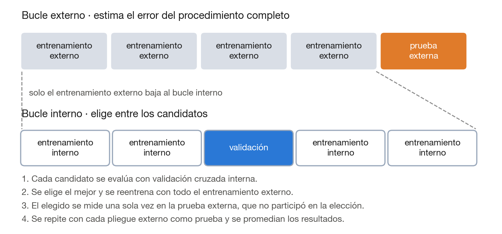

<style>
/* Estilo propio de la C7: se suma al estilo común del curso (_pdf/estilo.html) */
h1 { font-size: 22pt; color: #14365e; }
h2 { color: #14365e; border-bottom: 2px solid #2a78d6; break-before: auto; }
h3 { color: #1f4f86; }
blockquote { border-left: 4px solid #2a78d6; background: #f1f6fd; color: #1a1a1a; border-radius: 0 4px 4px 0;
             break-inside: auto; }
blockquote strong:first-child { color: #14365e; }
pre { background: #f6f7f9; border: 1px solid #e3e6eb; border-radius: 4px; padding: 8px 10px; font-size: 8.4pt;
      line-height: 1.35; white-space: pre-wrap; break-inside: avoid; -webkit-print-color-adjust: exact; print-color-adjust: exact; }
pre code { background: none; padding: 0; font-size: 8.4pt; }
pre:not(.sourceCode) { background: #fff8f1; border: 1px solid #f3d3b5; border-left: 4px solid #e07b2a; }
div.sourceCode { margin: .8em 0 .3em; }
table { font-size: 8.6pt; }
th { background: #e8eef7; color: #14365e; }
tbody tr:nth-child(even) td { background: #fafbfc; -webkit-print-color-adjust: exact; print-color-adjust: exact; }
figure { margin: 1.2em 0 1.4em; }
figure img { max-height: 9.5cm; }
figcaption { border-top: 1px solid #e3e6eb; padding-top: .35em; }
</style>

# C7 — El proceso de modelación y evaluación

*Elementos de Inteligencia Artificial · Ciencia de Datos · Curso 2026-2027*

*Las figuras de esta nota son de elaboración propia, y todas las cuentas y la salida del código se han rehecho y
comprobado para ella con scikit-learn 1.6. La sección 3 traslada a modelos de aprendizaje el análisis de rendimiento
de la sección 1.7 de Talbi, "Metaheuristics: From Design to Implementation" (2009), el mismo que se usó en la C3. Las
fuentes principales de cada sección se indican en sus recuadros "Para ampliar" y en las referencias del final. Los
fragmentos de código están pensados para ejecutarse en orden en un mismo notebook: los de las secciones 5 a 8 reutilizan
las importaciones de los anteriores.*

---

Empecemos por una frase que bien podría estar al final de cualquier informe de proyecto:

> "Nuestro árbol de decisión alcanza una exactitud del 94 % en la detección de tumores malignos, frente al 92 % de la
> regresión logística. Por lo tanto, el árbol es el mejor modelo para este problema."

Léanla otra vez. Suena a conclusión, ¿verdad? Tiene un número, una comparación y una recomendación. Y sin embargo, con
lo que dice, no tenemos forma de saber si es cierta. ¿El 94 % es mucho o poco para este problema? ¿Cómo se midió?
¿Dos puntos de diferencia son una ventaja real o pura suerte? Al terminar la clase van a poder señalar por lo menos
cinco problemas en esa frase.

Recuerden lo que vimos en la C5: la pregunta "¿cuál algoritmo es mejor?" no tiene respuesta en general, porque ninguno
gana en todos los problemas. Lo que sí podemos preguntar es cuál es mejor **para un problema concreto**. Y esa pregunta
solo se contesta de una manera: experimentando. De eso trata esta conferencia, de cómo hacer ese experimento sin
engañarnos a nosotros mismos.

La buena noticia es que no empiezan de cero. En la C3 y en la CP2 ya compararon metaheurísticas: corrieron cada una
muchas veces, reportaron la media y la dispersión, y separaron las instancias con que ajustaban los parámetros de las
instancias con que evaluaban. Todo eso lo vamos a reutilizar. Lo que el aprendizaje agrega es una complicación nueva, y
es la que hace caer a casi todo el mundo: **los datos con que evaluamos un modelo son del mismo tipo que los datos con
que aprende**, así que es facilísimo que se mezclen sin que nos demos cuenta.

> **Objetivos de esta nota.** Al terminarla deberían poder:
>
> 1. plantear una pregunta de modelación como un experimento controlado, y decir qué tipo de afirmación permite
>    sostener;
> 2. aplicar los tres principios del diseño experimental —aleatorizar, replicar y reducir el ruido— y explicar por qué
>    sin baseline no hay resultado;
> 3. elegir un esquema de partición que respete la estructura de los datos, y explicar qué estima la validación
>    cruzada anidada;
> 4. comprobar que un modelo aprendió algo y diagnosticar si le faltan datos;
> 5. elegir y defender una métrica a partir del costo real de los errores;
> 6. decidir si una diferencia entre modelos sostiene la conclusión que se afirma;
> 7. diseñar un estudio de ablación para medir qué aporta cada componente de un sistema;
> 8. seleccionar un modelo con criterios que van más allá del error y dejar el estudio en condiciones de ser
>    reproducido.

---

## 1. El aprendizaje automático como ciencia experimental

### Por qué hay que experimentar

Piensen en un bosque aleatorio, o en una red neuronal. ¿Alguien podría decirnos, con lápiz y papel, qué exactitud va a
tener sobre las biopsias de un hospital? No. Estos algoritmos son demasiado complejos para predecir analíticamente cómo
se van a comportar con unos datos concretos. En la C5 aprendimos qué *suponen*, pero eso no nos dice cuánto van a
acertar en este problema. Para saberlo hay que correrlos y medir. Por eso decimos que el aprendizaje automático
aplicado es una **ciencia experimental**, y que quien lo practica trabaja como un científico: se hace una pregunta,
diseña un experimento, lo ejecuta y saca solo la conclusión que el experimento le permite sostener.

Y aquí tenemos una ventaja enorme sobre casi todas las demás ciencias experimentales. Piensen en un ensayo clínico:
cada paciente cuesta tiempo y dinero, y no se puede probar el tratamiento dos veces sobre la misma persona. Nosotros, en
cambio, **controlamos todo el experimento** y podemos repetirlo cuantas veces queramos, con los mismos datos o con
otros. Así que no tenemos excusa para hacerlo mal. La dificultad no está en correr experimentos, sino en saber cuáles
hay que correr.

### El experimento controlado

La forma más básica de experimento es la que seguramente conocen de otras ciencias: el **experimento controlado**. Hay
unas cosas que el experimentador cambia a propósito, los **factores** o variables independientes; en nuestro caso, el
algoritmo, los atributos o algún paso del preprocesamiento. Hay otra cosa que se mide, la **respuesta** o variable
dependiente, que para nosotros es casi siempre el rendimiento en datos no vistos. Y todo lo demás se **mantiene fijo**.
Se cambia un factor por vez, para que, si la respuesta cambia, podamos echarle la culpa a ese factor y no a otro.

Falta una pieza: el **control**. Decir "mejor" o "peor" solo tiene sentido frente a una referencia. En aprendizaje,
ese control se llama **baseline**, y en la sección 2 vamos a ver que no es opcional.

### ¿Qué tipo de afirmación quieren hacer?

Antes de diseñar nada conviene hacerse una pregunta: ¿qué quiero poder afirmar al final? Parece obvio, pero no lo es,
porque afirmaciones distintas exigen experimentos muy distintos. Una forma útil de pensarlo es imaginar un **espectro
que va de lo específico a lo genérico**. Volvamos a los tumores y pensemos en cuatro objetivos posibles, del más
específico al más genérico:

1. un clasificador que detecte tumores malignos **en las biopsias de este hospital**;
2. un buen tipo de modelo para **detectar tumores a partir de medidas de biopsias**, en cualquier hospital;
3. un buen tipo de modelo para **datos tabulares médicos**;
4. una técnica nueva —un tipo de regularización, por ejemplo— que mejore **cualquier** modelo de clasificación.

Si lo que buscan es algo **específico**, como el objetivo 1, necesitan un conjunto de datos **representativo de ese
uso**: las biopsias de ese hospital, con la mezcla de pacientes que el modelo va a ver de verdad. Agréguenle una
métrica pertinente y un buen esquema de validación, y con eso pueden concluir legítimamente que un modelo es mejor que
otro **para esa tarea**. Para esa, y para ninguna otra.

Si en cambio apuntan a algo **genérico**, como el objetivo 4, un solo conjunto de datos no prueba nada, por bueno que
sea. ¿Cómo voy a decir que mi técnica mejora *cualquier* clasificador si la probé en un solo problema? Hace falta una
colección de conjuntos de datos variados, representativos de la clase de problemas a la que apunto, medir en cada uno
y usar una prueba estadística que diga si la ventaja se sostiene en todos ellos (lo vemos en la sección 7). Fíjense,
cuando lean artículos, cuántos se quedan a medio camino: presentan tablas enormes con resultados en muchos conjuntos de
datos y dejan que el lector saque la conclusión a ojo.

Lo interesante es que uno se puede equivocar en las dos direcciones. La primera trampa es saltar **de lo específico a
lo genérico**: que el modelo A le gane al B en las biopsias de un hospital no dice que A sea mejor para clasificar
tumores en general, y mucho menos para clasificar cualquier cosa. Es el NFL otra vez. La segunda trampa es la
contraria, y es más sutil: saltar **de lo genérico a lo específico**. Que una técnica sea mejor *en promedio* sobre
muchos problemas no garantiza que lo sea en **su** problema. Miren la figura 1. X le gana a Y con una prueba
estadística en regla, y sin embargo, si su problema se parece al conjunto 2, lo que deberían usar es Y. Los resultados
genéricos sirven para decidir qué probar primero, pero no los liberan de validar en su propio problema.


¿Y si no tienen claro si su trabajo es específico o genérico? Pregúntense **cómo se va a usar**. Si el modelo se va a
aplicar directamente a casos reales, tal cual, sin reentrenarlo, es específico, y hay que evaluarlo con datos de ese
uso. Si lo que proponen es una *manera* de construir modelos, que cada usuario va a entrenar con sus propios datos, es
genérico, y hay que evaluarlo sobre muchos conjuntos.

El Proyecto 2 de ustedes va a ser casi siempre del primer tipo: un problema, un conjunto de datos. Y eso no es ninguna
debilidad. Lo único que les pido es que la conclusión no diga más de lo que ese diseño permite.

> **Para ampliar.** *Controlled experiments in machine learning* (Machine Learning Mastery, 2019) y *A quick guide to
> design rigorous machine learning experiments* (Towards Data Science, 2023), dos lecturas cortas sobre estas ideas.

---

## 2. El ciclo completo

Ya sabemos qué tipo de afirmación queremos hacer. Ahora, ¿cómo se organiza un estudio completo? Les va a resultar
familiar, porque tiene la misma forma que el análisis de rendimiento de metaheurísticas de la C3. Talbi lo dividía en
tres pasos: **diseñar** el experimento, **medir** y **reportar**. Aquí agregamos uno antes de todos, que en la C3 nos
venía dado porque el problema de optimización ya estaba formulado: decidir qué queremos saber (figura 2).


### De un problema a una pregunta

"Detectar tumores malignos" es un problema, pero todavía no es una pregunta. No hay experimento que lo conteste tal
como está. Una pregunta que sí se puede contestar con un experimento se parece más a esta:

> ¿Un clasificador entrenado con las 30 medidas de la imagen de una biopsia detecta al menos el 95 % de los tumores
> malignos, con menos falsas alarmas que el criterio que se usa hoy?

¿Ven lo que ganamos al formularla así? Sin darnos cuenta, ya fijamos tres cosas que el resto del estudio va a
necesitar.

La primera es **la unidad de análisis**: qué es una fila y qué cuenta como "un caso nuevo". Aquí es un tumor. Pero
imaginen que cada paciente aportara varias imágenes: ¿la unidad sería la imagen o la paciente? La respuesta cambia la
forma de partir los datos, y en la sección 4 vamos a ver que equivocarse ahí sale carísimo.

La segunda es **la variable objetivo**: qué predecimos exactamente y cuándo se conoce. "Maligno según la biopsia" no es
lo mismo que "maligno según el primer diagnóstico". Y, como vimos en la C6, todo lo que usemos para predecir tiene que
estar disponible **en el momento de la predicción**; si no, tenemos una fuga de información.

La tercera es **el criterio de éxito**: con qué medimos y contra qué comparamos. Lo primero es la métrica, que veremos
en la sección 6. Lo segundo es el baseline, y con él seguimos ahora mismo.

### Sin baseline no hay resultado, solo un número

Volvamos a la frase del principio. Dice "94 % de exactitud". ¿Y eso es bueno? No lo podemos saber, porque le falta el
**baseline**: el control del experimento, el punto de referencia contra el que se mide cualquier modelo. Hay tres
tipos, y en un estudio serio suelen aparecer los tres:

1. **El trivial**: predecir siempre la clase mayoritaria (la "regla cero"), la media en regresión, o el último valor
   observado en una serie temporal (persistencia). Dice cuánto se puede lograr sin aprender nada. En scikit-learn son
   `DummyClassifier` y `DummyRegressor`.
2. **El simple y razonable**: una regresión logística, Naive Bayes (C4), un árbol pequeño, o el algoritmo propuesto con
   su configuración por defecto. Dice cuánto aporta la complejidad.
3. **La práctica actual**: lo que se usa hoy para resolver el problema, aunque no sea un modelo. Talbi lo señala para
   metaheurísticas: en problemas reales, la referencia de calidad suele ser la solución que ya está implementada.

**En código: el baseline y la dispersión desde el principio.** Vamos a verlo con datos. Durante toda la clase vamos a
usar el conjunto de cáncer de mama de Wisconsin, que viene con scikit-learn: 569 tumores descritos por 30 medidas, de
los cuales 212 son malignos. Marcamos *maligno* como la clase positiva, porque es la que nos importa detectar.

```python
import numpy as np
from sklearn.datasets import load_breast_cancer
from sklearn.dummy import DummyClassifier
from sklearn.linear_model import LogisticRegression
from sklearn.neighbors import KNeighborsClassifier
from sklearn.tree import DecisionTreeClassifier
from sklearn.pipeline import make_pipeline
from sklearn.preprocessing import StandardScaler
from sklearn.model_selection import RepeatedStratifiedKFold, cross_validate

X, y = load_breast_cancer(return_X_y=True)
y = 1 - y                      # 1 = maligno, la clase que importa detectar
print(f"{len(y)} tumores, {y.mean():.1%} malignos")

modelos = {
    "baseline (mayoritaria)": DummyClassifier(strategy="most_frequent"),
    "regresión logística":    make_pipeline(StandardScaler(), LogisticRegression(max_iter=1000)),
    "k vecinos (k=5)":        make_pipeline(StandardScaler(), KNeighborsClassifier()),
    "árbol de decisión":      DecisionTreeClassifier(random_state=0),
}
cv = RepeatedStratifiedKFold(n_splits=10, n_repeats=10, random_state=0)
for nombre, m in modelos.items():
    r = cross_validate(m, X, y, cv=cv, scoring=["accuracy", "recall"])
    acc, rec = r["test_accuracy"], r["test_recall"]
    print(f"{nombre:24s} exactitud {acc.mean():.3f} ± {acc.std():.3f}   "
          f"sensibilidad {rec.mean():.3f} ± {rec.std():.3f}")
```

```
569 tumores, 37.3% malignos
baseline (mayoritaria)   exactitud 0.627 ± 0.007   sensibilidad 0.000 ± 0.000
regresión logística      exactitud 0.978 ± 0.018   sensibilidad 0.960 ± 0.042
k vecinos (k=5)          exactitud 0.967 ± 0.024   sensibilidad 0.928 ± 0.055
árbol de decisión        exactitud 0.921 ± 0.037   sensibilidad 0.902 ± 0.081
```

Detengámonos un momento en esta salida, porque cuenta tres cosas.

Miren primero la línea del baseline. Un modelo que no aprende absolutamente nada, que dice "benigno" a todo, ya tiene
una exactitud de 0.627. Y su sensibilidad es cero: no detecta ni un solo tumor maligno. Esa línea **pone la escala**, y
cualquier cifra del informe hay que leerla contra ella.

Ahora miren el árbol. Si alguien nos dijera solo "92 % de exactitud", nos parecería un éxito. Pero al lado de una
regresión logística, que casi no tiene nada que ajustar, resulta ser el peor de los tres modelos. Lo que era un buen
número aislado se vuelve un mal número en contexto.

Y por último, fíjense en que **cada cifra viene con su dispersión**. Son 100 evaluaciones, 10 pliegues repetidos 10
veces, y el "±" es su desviación típica. La sensibilidad del árbol oscila 8 puntos de un pliegue a otro. ¿Qué hacemos
con esa variabilidad? Esa pregunta nos va a acompañar en las secciones 3 y 7.

### Diseñar, medir, reportar: lo mismo que en la C3

Les dije que esto se parecía a lo de la C3. Para que lo vean con claridad, la tabla pone lado a lado el análisis de
rendimiento de metaheurísticas y el de modelos de aprendizaje. Es el mismo protocolo, solo que con otros nombres.

| En la C3 (metaheurísticas) | En la C7 (modelos de aprendizaje) |
|---|---|
| Instancia del problema | Pliegue de la partición, o conjunto de datos |
| Varias ejecuciones con distintas semillas | Validación cruzada repetida con distintas semillas |
| Calidad de la solución: distancia al óptimo, a una cota o a la mejor conocida | Error en datos no vistos, comparado con el baseline |
| Esfuerzo computacional: tiempo, evaluaciones de la función objetivo | Costo de entrenar y de predecir |
| Robustez entre instancias y entre ejecuciones | Variabilidad entre pliegues, repeticiones y subgrupos |
| Un conjunto de instancias para ajustar parámetros y otro para evaluar | Datos de validación y datos de prueba |
| Instancias aleatorias que no se parecen a las reales | Datos que no se parecen a los de uso: sesgo de muestreo (C5) |
| Clasificar métodos por su posición en cada instancia (Borda, Copeland) | Rangos promedio sobre varios conjuntos de datos (sección 7) |

De la penúltima fila quiero rescatar un ejemplo de Talbi que vale la pena recordar. ¿Se acuerdan del viajante? Si uno
genera instancias con distancias uniformes e independientes entre las ciudades, resulta que casi cualquier ruta tiene
un costo cercano al promedio, por el teorema central del límite. En esas instancias cualquier metaheurística parece
buena, y el experimento no dice nada sobre los problemas reales. Con los modelos pasa exactamente lo mismo: si los
evaluamos con datos más fáciles o más limpios que los que van a encontrar en el uso, vemos el mismo espejismo.

### El ciclo itera, y cada vuelta cuesta

Ahora, no se imaginen este proceso como una línea recta. En la práctica uno formula, diseña, mide, mira el resultado y
vuelve atrás: cambia el modelo, prueba otros atributos, ajusta el preprocesamiento. Eso es perfectamente legítimo, pero
tiene un precio que casi nunca se ve: **cada vez que tomamos una decisión mirando un resultado, los datos que
produjeron ese resultado se gastan un poco como evaluadores**. Es como un examen que uno ya vio: cuantas más veces lo
mira, menos dice sobre lo que de verdad sabe. Cómo administrar ese gasto es justamente el tema de la sección 4. Por
ahora, quédense con una regla práctica: antes de empezar, escriban qué van a comparar, con qué métrica y con qué
partición, y dejen constancia de cada cambio de plan.

---

## 3. Los tres principios del diseño experimental

Hace un momento vimos que el árbol oscilaba 8 puntos de un pliegue a otro. Eso nos dice algo importante: un resultado
de aprendizaje es una **medida con ruido**. Si repetimos el experimento cambiando algo que no debería importar, como
qué ejemplos caen en la prueba o con qué semilla se inicializa el modelo, el número cambia. ¿Cómo hacemos entonces para
que la conclusión no dependa de esa suerte? El diseño experimental clásico lleva mucho tiempo resolviendo este problema,
y lo resuelve con tres principios que se trasladan directamente al aprendizaje automático:

| Principio | Qué pide | Cómo se hace en aprendizaje |
|---|---|---|
| **Aleatorizar** | Que las ejecuciones sean aleatorias e independientes entre sí | Partir los datos al azar; usar una semilla distinta en cada repetición |
| **Replicar** | Repetir el experimento muchas veces para que la conclusión tenga respaldo estadístico | Validación cruzada; repetirla remuestreando los datos |
| **Reducir el ruido** | Que las diferencias se deban a los algoritmos, no a la muestra de datos | Comparar todos los modelos sobre los mismos datos; estratificar |

Veamos qué nos protege cada uno. **Aleatorizar** nos cuida de una suerte muy concreta. Si siempre evaluamos con la
misma partición, el resultado puede estar reflejando lo favorable que fue esa partición y no lo bueno que es el modelo.
En cambio, si cambiamos la partición y la semilla en cada repetición, lo que se mantiene en común entre todas es lo que
se debe de verdad al modelo.

**Replicar** es lo que nos deja *medir* esa suerte. Con una sola ejecución no tenemos idea de cuánto podría haber
cambiado el resultado; con diez o con cien, sí. Y ojo con la tentación: el reporte final tiene que resumir **todas**
las ejecuciones, no la que salió mejor.

**Reducir el ruido** es lo que en diseño de experimentos se llama **bloqueo**. La idea es muy intuitiva: si los dos
modelos se evalúan sobre exactamente los mismos pliegues, un pliegue difícil es difícil para los dos, y esa dificultad
se cancela al compararlos (lo aprovecharemos en la sección 7). Hay otra cara de este principio: los datos de prueba
tienen que parecerse a los del uso real. Si en la realidad hay una clase rara, la prueba tiene que tener esa misma
proporción, y para eso se **estratifica**. Evaluar con una distribución distinta nos da estimaciones demasiado
optimistas o demasiado pesimistas.

> **Aleatorio y reproducible a la vez.** Parece contradictorio: el primer principio pide cambiar la semilla y la
> sección 9 pide fijarla. No lo es. Se usa una **lista fija de semillas distintas** —por ejemplo, de 0 a 9—, una por
> repetición. Cada repetición es distinta de las demás, y cualquiera puede rehacer exactamente las diez. Es lo que hace
> `RepeatedStratifiedKFold(..., random_state=0)`. Ojo: pasar `None` en lugar de un entero no da lo mismo (anexo, A.1).

### Dos fuentes de variabilidad

Hemos hablado de "ruido" como si fuera una sola cosa, pero en realidad viene de dos lugares distintos, y conviene
tenerlos separados porque se controlan de forma distinta.

Una fuente es **la de los datos**: qué ejemplos usamos para entrenar y cuáles para evaluar. Esa cambia con la
partición. La otra es **la del modelo**, la aleatoriedad del propio algoritmo: los pesos iniciales de una red neuronal,
el orden en que el descenso por gradiente recorre los datos, el muestreo de un bosque aleatorio. Esa cambia con la
semilla del modelo, **aunque los datos sean exactamente los mismos**.

**En código: las dos fuentes, medidas.** ¿Cuánto pesa cada una? Vamos a medirlo. Repetimos tres mediciones distintas
con 20 semillas. En las dos primeras solo cambia la partición de los datos; en la tercera dejamos la partición fija y lo
único que cambia es la semilla de una red neuronal pequeña.

```python
import numpy as np
from sklearn.datasets import load_breast_cancer
from sklearn.tree import DecisionTreeClassifier
from sklearn.neural_network import MLPClassifier
from sklearn.pipeline import make_pipeline
from sklearn.preprocessing import StandardScaler
from sklearn.model_selection import train_test_split, StratifiedKFold, cross_val_score

X, y = load_breast_cancer(return_X_y=True)
arbol = DecisionTreeClassifier(random_state=0)

# 1. Una partición 80/20 y un número, con 20 particiones distintas
una_particion = []
for semilla in range(20):
    Xtr, Xte, ytr, yte = train_test_split(X, y, test_size=0.2, stratify=y, random_state=semilla)
    una_particion.append(arbol.fit(Xtr, ytr).score(Xte, yte))

# 2. Validación cruzada de 10 pliegues, barajando con 20 semillas distintas
cv10 = [cross_val_score(arbol, X, y,
                        cv=StratifiedKFold(10, shuffle=True, random_state=s)).mean()
        for s in range(20)]

# 3. Partición FIJA: lo único que cambia es la semilla interna de la red
Xtr, Xte, ytr, yte = train_test_split(X, y, test_size=0.3, stratify=y, random_state=0)
red = [make_pipeline(StandardScaler(),
                     MLPClassifier(hidden_layer_sizes=(5,), max_iter=50, random_state=s))
       .fit(Xtr, ytr).score(Xte, yte) for s in range(20)]

for nombre, v in [("árbol, una partición", una_particion), ("árbol, VC de 10", cv10),
                  ("red, semilla del modelo", red)]:
    v = np.array(v)
    print(f"{nombre:24s} mín {v.min():.3f}  máx {v.max():.3f}  desv. {v.std():.3f}")
```

```
árbol, una partición     mín 0.886  máx 0.974  desv. 0.026
árbol, VC de 10          mín 0.905  máx 0.935  desv. 0.008
red, semilla del modelo  mín 0.789  máx 0.924  desv. 0.029
```


Miren la figura 3 con calma, porque resume toda la lección. Con una sola partición, la pura suerte mueve el resultado
casi 9 puntos. ¡Eso es más de lo que separa a casi todos los modelos de la sección 2! La validación cruzada reduce ese
rango, pero no lo elimina. Y la variabilidad del modelo puede ser todavía mayor: una red pequeña, entrenada con pocas
iteraciones (aquí lo hicimos a propósito, para que el efecto se vea), da resultados muy distintos según dónde empiece.
Ahora entienden por qué el informe del principio, con un único número por modelo, no permite concluir nada.

> **Para ampliar.** El video *The three basic principles of experimental design in machine learning* (canal *Machine
> learning classroom*, unos 3½ minutos) presenta los tres principios con estas mismas palabras. La guía de usuario de scikit-learn, sección 3.1.3 (*A note on shuffling*).

---

## 4. Particiones: con qué datos se mide

### Entrenamiento, validación y prueba

Empecemos por lo más básico. Si queremos saber cómo se va a portar un modelo con datos nuevos, tenemos que medirlo con
datos que no usó para aprender. Hasta ahí, nada nuevo. Lo que conviene tener muy claro es que los datos que tenemos
cumplen tres papeles distintos. Con los de **entrenamiento** se ajustan los parámetros del modelo. Con los de
**validación** se toman decisiones sobre el proceso de aprendizaje: qué modelo usar, qué atributos, cuándo parar, qué
umbral de decisión. Y con los de **prueba** se estima el error del modelo elegido, una sola vez y al final.

Ahora, piensen un momento: validación y prueba se parecen mucho, porque en los dos casos son datos que el modelo no vio
al entrenar. Entonces, ¿qué los distingue? El uso que les damos. Abu-Mostafa y sus coautores lo dicen de una forma que
me gusta mucho: en el momento en que un conjunto de datos afecta *de cualquier manera* el proceso de aprendizaje, deja
de ser un conjunto de prueba. Dicho de otro modo: **lo que convierte un conjunto de prueba en uno de validación no es
cómo se llama, sino que alguien haya tomado una decisión mirándolo.** Y en la C5 vimos cuánto cuesta eso: si elegimos
el mejor entre $M$ candidatos mirando su error en un conjunto, la cota de Hoeffding para ese error se multiplica por
$M$.

> **Una buena imagen: los datos reservados.** En los ensayos clínicos, quien evalúa el tratamiento no sabe qué
> pacientes lo recibieron. Es el diseño doble ciego, y existe porque la gente se engaña sin querer, incluso la gente
> honesta. El equivalente en aprendizaje sería un conjunto de prueba que **otra persona guarda** y que el equipo que
> desarrolla no ve nunca. En el Proyecto 2 no van a tener a esa otra persona, pero pueden imitarla: separen la prueba al
> principio, guárdenla en un archivo aparte, no la abran hasta el final y, si la miraron antes, digan cuántas veces y
> para qué.

### Validación cruzada

Claro que reservar datos tiene su costo: lo que usamos para validar no lo podemos usar para entrenar. Si tenemos pocos
datos, eso duele. La **validación cruzada** es la forma de pagar menos. La idea es repartir el papel de validador entre
todos los datos, por turnos. Partimos el conjunto $D$ en $K$ partes del mismo tamaño, que llamamos **pliegues**,
$D_1, \dots, D_K$. Para cada $k$, entrenamos con todos los pliegues menos $D_k$ y medimos el error en $D_k$. La
estimación es el promedio:

$$E_{cv} = \frac{1}{K} \sum_{k=1}^{K} E\big(g^{(-k)}, D_k\big)$$

donde $g^{(-k)}$ es el modelo entrenado sin el pliegue $k$. Así, cada ejemplo se usa una vez para validar y $K - 1$
veces para entrenar. Nadie se queda sin trabajar.

Hay un detalle que se pasa por alto con mucha frecuencia, y quiero que lo tengan claro: ¿**qué estima** exactamente
$E_{cv}$? No el error de *un* modelo concreto, porque entrenamos $K$ modelos distintos. Lo que estima es el error de un
**procedimiento** (este algoritmo, con esta configuración y este preprocesamiento) cuando se entrena con una fracción
$(K-1)/K$ de los datos. Como al final vamos a entrenar con todos los datos, la estimación sale ligeramente pesimista.

¿Y qué $K$ elegimos? Lo habitual es **$K = 5$ o $K = 10$**, que equilibran el costo (hay que entrenar $K$ veces) con el
tamaño de los conjuntos de entrenamiento. En el extremo está **dejar uno fuera** (*leave-one-out*, LOO), el caso
$K = N$. Parecería lo ideal, porque la estimación es casi insesgada, pero obliga a entrenar $N$ veces y su varianza
puede ser alta: los $N$ modelos son casi idénticos y sus errores están muy correlacionados. Se reserva para conjuntos
muy pequeños. Y la **validación cruzada repetida**, como la de la sección 2, repite todo con distintas formas de barajar
y promedia, para reducir la variabilidad que viene de la partición concreta.

Una advertencia de scikit-learn: `cross_val_score` y `cross_validate` dan un puntaje por pliegue, pero
`cross_val_predict` devuelve, para cada ejemplo, la predicción del modelo que no lo vio. Sirve para construir una
matriz de confusión o elegir un umbral (sección 6), pero **no** para estimar el error, porque mezcla modelos distintos
en un solo número.

### La partición tiene que imitar el uso

Hasta aquí parece sencillo: barajamos, partimos y listo. Pero la validación cruzada de los libros supone que los
ejemplos son independientes y salen todos de la misma distribución. Cuando eso no se cumple, partir al azar da
estimaciones optimistas, a veces de forma espectacular. Todo lo que sigue se resume en un principio:

> **Los datos de prueba tienen que relacionarse con los de entrenamiento como los datos futuros se van a relacionar con
> el modelo desplegado.**


Veamos qué significa esto en tres situaciones que se van a encontrar todo el tiempo.

**Clases raras: partición estratificada.** Supongan que solo el 2 % de los casos son positivos. Si parten al azar, un
pliegue puede quedarse con muy pocos positivos, o con ninguno, y en ese pliegue la sensibilidad ni siquiera se puede
calcular. La partición **estratificada** resuelve esto manteniendo la proporción de cada clase en todos los pliegues.
Háganlo por defecto en clasificación: es la forma concreta del tercer principio de la sección 3.

**Varias filas por unidad: partición por grupos.** Esta es la más traicionera. Piensen en un paciente con varias
imágenes, un cliente con varias compras o una casa que se vendió varias veces: las filas de una misma unidad se parecen
entre sí mucho más que a las demás. Si unas caen en entrenamiento y otras en prueba, el modelo puede acertar
**reconociendo la unidad**, sin haber aprendido nada del problema. La partición **por grupos** pone todas las filas de
una unidad del mismo lado. (Lo mismo pasa con los fotogramas consecutivos de un video.)

**En código: el modelo que reconoce pacientes.** Para que vean hasta dónde llega esto, construimos un caso extremo: 60
pacientes con 10 imágenes cada uno. El diagnóstico de cada paciente lo sorteamos **al azar**, así que nada en las
imágenes lo puede predecir. Pero las imágenes de un mismo paciente se parecen mucho entre sí.

```python
import numpy as np
from sklearn.ensemble import RandomForestClassifier
from sklearn.model_selection import KFold, GroupKFold, cross_val_score

rng = np.random.default_rng(0)
n_pacientes, imagenes_por_paciente, d = 60, 10, 20

# Cada paciente tiene un diagnóstico al azar y un "estilo" propio: sus imágenes
# se parecen mucho entre sí, pero el estilo NO dice nada sobre el diagnóstico.
diagnostico = rng.integers(0, 2, n_pacientes)
estilo = rng.normal(0, 1, (n_pacientes, d))
X = np.repeat(estilo, imagenes_por_paciente, axis=0) \
    + rng.normal(0, 0.3, (n_pacientes * imagenes_por_paciente, d))
y = np.repeat(diagnostico, imagenes_por_paciente)
paciente = np.repeat(np.arange(n_pacientes), imagenes_por_paciente)

bosque = RandomForestClassifier(n_estimators=200, random_state=0)
por_imagen = cross_val_score(bosque, X, y, cv=KFold(5, shuffle=True, random_state=0))
por_paciente = cross_val_score(bosque, X, y, groups=paciente, cv=GroupKFold(5))
print(f"Partiendo por imagen:   {por_imagen.mean():.3f}")
print(f"Partiendo por paciente: {por_paciente.mean():.3f}")
```

```
Partiendo por imagen:   0.993
Partiendo por paciente: 0.542
```

¡Un 99.3 % de acierto prediciendo diagnósticos que son puro azar! ¿Cómo lo logra el bosque? Haciendo trampa sin
saberlo: para cada imagen de prueba encuentra en el entrenamiento otra imagen del mismo paciente y copia su etiqueta.
Cuando partimos por paciente, la estimación cae a 0.542, que es lo que esperaríamos adivinando. ¿Cuál de las dos cifras
es la verdadera? Pregúntense qué va a pasar en el uso: cuando llegue un paciente nuevo, el modelo no lo va a conocer.
La segunda cifra es la que describe esa situación.

**El tiempo importa: partición temporal.** Si el modelo va a predecir el futuro (la demanda de la semana que viene, si
un cliente se va a dar de baja), la única evaluación honesta es hacerle predecir el futuro: entrenar con datos hasta
una fecha y probar con datos posteriores. Barajar mete información del futuro en el entrenamiento. El esquema habitual
es la **ventana creciente**: entrenamos con los primeros meses y probamos con el siguiente, agregamos un mes y probamos
con el siguiente, y así. Si la variable objetivo tarda en conocerse, dejamos un hueco entre entrenamiento y prueba. La
misma lógica vale en el espacio: si el modelo se va a usar en regiones nuevas, se prueba con regiones que no estuvieron
en el entrenamiento.

Estos esquemas se combinan: unas ventas de casas pueden necesitar partición por grupos (la casa) **y** temporal (la
fecha). Y todos comparten una regla que ya conocen de la C6: **todo lo que se aprende de los datos va dentro del
pliegue**. El escalado, la imputación y la selección de atributos se ajustan solo con la parte de entrenamiento de cada
pliegue, y por eso van dentro de un `Pipeline`. Los iteradores de scikit-learn para cada esquema están en la tabla A.1
del anexo.

### Validación cruzada anidada

Nos falta el caso que más se da en la práctica. Casi nunca hacemos "entrenar este modelo"; hacemos "**probar varios
candidatos y quedarnos con el mejor**". Si usamos la validación cruzada para elegir y después reportamos el puntaje de
validación del elegido, ese puntaje es optimista: es el **máximo** de $M$ estimaciones con ruido, y el máximo de varios
números con ruido tiende a estar por encima de su valor verdadero. Si veinte estudiantes adivinan las respuestas de un
examen, alguno va a sacar buena nota por suerte, y esa nota no dice nada de lo que sabe. Es el factor $M$ de la C5
otra vez.

La salida es tratar la elección como parte del procedimiento y evaluar el procedimiento completo con datos que la
elección no vio. Para eso hacen falta dos bucles, uno dentro del otro (figura 5).



**En código: elegir entre veinte candidatos cuando no hay nada que aprender.** Volvamos al truco de las etiquetas al
azar, porque así sabemos de antemano la respuesta correcta: ningún modelo puede superar en serio el 50 % de exactitud.
Probamos veinte candidatos de familias y configuraciones distintas, y comparamos las dos formas de reportar.

```python
import numpy as np
from sklearn.base import clone
from sklearn.linear_model import LogisticRegression
from sklearn.neighbors import KNeighborsClassifier
from sklearn.tree import DecisionTreeClassifier
from sklearn.naive_bayes import GaussianNB
from sklearn.model_selection import StratifiedKFold, cross_val_score

rng = np.random.default_rng(0)
X = rng.normal(size=(100, 30))
y = rng.integers(0, 2, 100)          # etiquetas al azar: nadie puede pasar de 0.5

# Veinte candidatos de familias y configuraciones distintas
candidatos = ([KNeighborsClassifier(k) for k in (1, 3, 5, 7, 9, 15)]
              + [DecisionTreeClassifier(max_depth=p, random_state=0) for p in (1, 2, 3, 5, None)]
              + [LogisticRegression(C=c, max_iter=1000) for c in (0.001, 0.01, 0.1, 1, 10, 100)]
              + [GaussianNB(), DecisionTreeClassifier(min_samples_leaf=10, random_state=0),
                 KNeighborsClassifier(25)])

def mejor_candidato(X, y, cv):
    puntajes = [cross_val_score(m, X, y, cv=cv).mean() for m in candidatos]
    i = int(np.argmax(puntajes))
    return candidatos[i], puntajes[i]

# Sin anidar: se elige el mejor y se reporta SU puntaje de validación
interna = StratifiedKFold(5, shuffle=True, random_state=1)
_, puntaje_elegido = mejor_candidato(X, y, interna)
print(f"Sin anidar: {puntaje_elegido:.3f}")

# Anidada: la elección se repite dentro de cada pliegue externo,
# y se evalúa en datos que la elección no vio
externa = StratifiedKFold(5, shuffle=True, random_state=2)
resultados = []
for entr, prueba in externa.split(X, y):
    m, _ = mejor_candidato(X[entr], y[entr], interna)
    resultados.append(clone(m).fit(X[entr], y[entr]).score(X[prueba], y[prueba]))
print(f"Anidada:    {np.mean(resultados):.3f}")
```

```
Sin anidar: 0.610
Anidada:    0.480
```

Sin anidar, el estudio reportaría un 61 % de exactitud en un problema donde no hay nada que aprender. Son once puntos
que salen de la nada, inventados por el simple acto de elegir. La estimación anidada, 0.480, está donde tiene que
estar, cerca de 0.5. Con datos reales el sesgo suele ser menor, pero no se confíen: crece con el número de candidatos
y decrece con el tamaño de los datos. Justo la situación de un proyecto con pocos datos y muchas pruebas.

Tres preguntas que siempre aparecen sobre la validación anidada. *¿Qué estima?* Otra vez un procedimiento, no un
modelo: "elegir entre estos candidatos con validación cruzada interna y entrenar el elegido". En cada pliegue externo
puede salir elegido un candidato distinto, y eso es información útil: si cambia mucho, la elección es inestable.
*¿Cuánto cuesta?* Con $K_{ext}$ pliegues externos, $K_{int}$ internos y $M$ candidatos, hay que entrenar
$K_{ext}\,(M\,K_{int} + 1)$ modelos; con 5, 5 y 20, son 505 entrenamientos. *¿Cuál es el modelo final?* Ninguno de los
de adentro: se repite la elección interna con todos los datos, se entrena el elegido y para él se reporta la
estimación anidada.

Guarden esta idea para la C8, donde los candidatos dejarán de ser una lista escrita a mano y pasarán a salir de una
estrategia de búsqueda. La validación anidada es lo que nos deja evaluar esa búsqueda sin engañarnos, y es lo que van
a usar en la CP5.

> **Para ampliar.** Abu-Mostafa et al., *Learning from Data*, sección 4.3. Murphy, *Probabilistic Machine Learning: An
> Introduction*, secciones 4.5.5 y 5.4.3. Guía de usuario de scikit-learn, sección 3.1 (validación cruzada e
> iteradores). Sobre el sesgo de no anidar: Varma y Simon (2006) y Cawley y Talbot (2010).

---

## 5. ¿El modelo aprendió algo?

Ya sabemos con qué datos medir. Antes de lanzarnos a comparar modelos entre sí, hay dos preguntas más básicas que
conviene hacerse. La primera: ¿el resultado es mejor que lo que obtendríamos por azar? La segunda: si el modelo no
rinde lo suficiente, ¿es porque le faltan datos?

### La prueba de permutación

El baseline trivial ya nos dice cuánto se logra sin mirar los atributos. Pero podemos afinar más la pregunta: ¿cuánto
lograría **este mismo modelo, con este mismo protocolo**, si no hubiera ninguna relación entre los atributos y la
etiqueta? La **prueba de permutación** lo averigua con una idea muy elegante. Barajamos la columna de etiquetas, lo que
rompe cualquier relación que hubiera, y repetimos la validación cruzada. Si hacemos eso muchas veces, obtenemos la
distribución de puntajes que produce "el azar". El valor $p$ es simplemente la fracción de permutaciones que igualan o
superan el puntaje real:

$$p = \frac{1 + \#\{\text{permutaciones con puntaje} \ge \text{puntaje real}\}}{1 + \text{número de permutaciones}}$$

```python
import numpy as np
from sklearn.datasets import load_breast_cancer
from sklearn.linear_model import LogisticRegression
from sklearn.pipeline import make_pipeline
from sklearn.preprocessing import StandardScaler
from sklearn.model_selection import StratifiedKFold, permutation_test_score

X, y = load_breast_cancer(return_X_y=True)
rng = np.random.default_rng(0)
X_ruido = rng.normal(size=(100, 30))          # un problema sin nada que aprender
y_ruido = rng.integers(0, 2, 100)

modelo = make_pipeline(StandardScaler(), LogisticRegression(max_iter=1000))
cv = StratifiedKFold(5, shuffle=True, random_state=0)
for nombre, (A, b) in {"cáncer de mama": (X, y), "etiquetas al azar": (X_ruido, y_ruido)}.items():
    real, permutados, p = permutation_test_score(modelo, A, b, cv=cv,
                                                 n_permutations=200, random_state=0)
    print(f"{nombre:18s} real {real:.3f}   permutadas: media {permutados.mean():.3f}, "
          f"máx {permutados.max():.3f}   p = {p:.3f}")
```

```
cáncer de mama     real 0.979   permutadas: media 0.604, máx 0.633   p = 0.005
etiquetas al azar  real 0.470   permutadas: media 0.526, máx 0.670   p = 0.851
```


Con los datos de cáncer, ninguna de las 200 permutaciones se acerca siquiera al 0.979, y $p = 1/201 \approx 0.005$ es
el valor más pequeño posible con 200 permutaciones. Con etiquetas al azar, en cambio, el puntaje real cae en medio de
la distribución, como tiene que ser. Pero hay un detalle que quiero que no se les escape: con los datos de cáncer, la
media de las permutaciones es 0.604, no 0.5. ¿Por qué? Porque las clases no están equilibradas, así que el azar de
**este** problema no es un 50 %. Esa es la gracia de la prueba de permutación: nos da el punto de referencia exacto para
cada problema y cada protocolo.

Eso sí, tengan presentes dos advertencias. La primera es que la prueba dice si el modelo aprendió **algo**, no si
aprendió **lo suficiente**: un $p$ pequeño es perfectamente compatible con un modelo inútil en la práctica. La segunda
es que la permutación tiene que respetar la estructura de los datos. Si hay grupos, scikit-learn baraja las etiquetas
**dentro** de cada grupo. Y en un caso como el de los pacientes de la sección 4, donde todas las filas de un paciente
tienen la misma etiqueta, barajar dentro del grupo no cambia nada, y la prueba, tal cual, no sirve.

### La curva de aprendizaje

Vamos a la segunda pregunta. Tenemos un modelo que no rinde lo suficiente, y alguien propone salir a conseguir más
datos, lo que suele ser caro. ¿Valdrá la pena? La **curva de aprendizaje** nos lo dice antes de gastar: entrenamos con
fracciones crecientes de los datos que ya tenemos y medimos el rendimiento en entrenamiento y en validación.

```python
from sklearn.model_selection import learning_curve

cv = StratifiedKFold(10, shuffle=True, random_state=0)
for nombre, m in [("logística", make_pipeline(StandardScaler(), LogisticRegression(max_iter=1000))),
                  ("árbol", DecisionTreeClassifier(random_state=0))]:
    n, entr, val = learning_curve(m, X, y, cv=cv, train_sizes=[0.1, 0.25, 0.5, 0.75, 1.0])
    print(nombre)
    for ni, e, v in zip(n, entr.mean(axis=1), val.mean(axis=1)):
        print(f"  n = {ni:3d}   entrenamiento {e:.3f}   validación {v:.3f}")
```

```
logística
  n =  51   entrenamiento 0.978   validación 0.873
  n = 128   entrenamiento 0.984   validación 0.946
  n = 256   entrenamiento 0.987   validación 0.965
  n = 384   entrenamiento 0.983   validación 0.970
  n = 512   entrenamiento 0.988   validación 0.977
árbol
  n =  51   entrenamiento 1.000   validación 0.812
  n = 128   entrenamiento 1.000   validación 0.884
  n = 256   entrenamiento 1.000   validación 0.903
  n = 384   entrenamiento 1.000   validación 0.893
  n = 512   entrenamiento 1.000   validación 0.923
```


¿Cómo se lee la figura 7? Fíjense en la distancia entre las dos curvas y en dónde terminan.

En la regresión logística **las curvas se juntan arriba**. El modelo ya extrae casi todo lo que puede de estos datos, y
más datos mejorarían poco. Si queremos mejorar, hay que cambiar de modelo o de atributos.

En el árbol, en cambio, **hay una brecha grande**. El modelo memoriza el entrenamiento (fíjense en esa exactitud de
1.000) y generaliza bastante peor. Eso es **varianza alta**, y aquí sí hay esperanza: la curva de validación sigue
subiendo con más datos. También ayudaría restringir el modelo.

Hay un tercer caso que no aparece en la figura, pero que conviene saber reconocer: cuando **las dos curvas quedan bajas
y juntas**. Eso es **sesgo alto**. El modelo es demasiado simple para el problema, y por más datos que le den, no se va
a arreglar.

La curva de aprendizaje tiene una hermana, la **curva de validación**, que mide lo mismo pero variando un hiperparámetro
en lugar del tamaño de los datos. Es una herramienta de ajuste, así que la dejamos para la C8.

> **Para ampliar.** Guía de usuario de scikit-learn, secciones 3.1.5 (*Permutation test score*) y 3.5.2 (*Learning
> curve*). Ojala y Garriga (2010) para la prueba de permutación aplicada a clasificadores.

---

## 6. Métricas: la métrica es una decisión del dominio

### Las métricas habituales

Hasta ahora hemos usado casi siempre la exactitud, pero desde la sección 2 tenemos una pista de que no alcanza: el
baseline tenía un 63 % de exactitud sin detectar ni un solo tumor. ¿Qué estamos midiendo, entonces?

En clasificación binaria, casi todo se calcula a partir de la **matriz de confusión**: verdaderos positivos (VP), falsos
positivos (FP), verdaderos negativos (VN) y falsos negativos (FN). Con ellas se construye un verdadero zoológico de
métricas (exactitud, sensibilidad, especificidad, precisión, $F_1$, AUC...), y en regresión y agrupamiento hay otras
tantas. La tabla A.2 del anexo las reúne, con lo que mide cada una y cuándo engaña.

Pero esa tabla no sirve para elegir. Todas esas métricas son correctas, y cada una responde a una pregunta distinta.
Para saber cuál nos importa hay que saber **cuánto cuesta equivocarse**, y eso no está en los datos.

### Elegir por el costo del error

Volvamos a los tumores con un ejemplo. Supongamos que tenemos dos modelos evaluados sobre 1 000 pacientes, de las
cuales 100 tienen un tumor maligno:

| | Modelo A | Modelo B |
|---|---|---|
| Malignos detectados (VP) | 80 | 95 |
| Malignos no detectados (FN) | 20 | 5 |
| Falsas alarmas (FP) | 10 | 60 |
| Benignos reconocidos (VN) | 890 | 840 |
| Exactitud | **0.970** | 0.935 |
| Sensibilidad | 0.800 | **0.950** |
| Especificidad | **0.989** | 0.933 |

¿Cuál elegirían? Si miramos la exactitud, gana A sin discusión. Pero detengámonos en qué significa cada error. Un falso
negativo es un tumor maligno que no se trata a tiempo. Un falso positivo es una biopsia innecesaria: molesta, sí, pero
sin consecuencias graves. ¿De verdad estos dos errores valen lo mismo? Claro que no. Supongamos que un equipo médico
estima que un falso negativo es 50 veces peor que un falso positivo. Con $c_{FN} = 50$ y $c_{FP} = 1$:

$$\text{costo}(A) = 20 \cdot 50 + 10 \cdot 1 = 1\,010 \qquad \text{costo}(B) = 5 \cdot 50 + 60 \cdot 1 = 310$$

Ahora B es más de tres veces mejor. La decisión se dio vuelta por completo. Y aquí alguien podría objetar: "¿y de dónde
sale ese 50? ¿Y si los médicos no se ponen de acuerdo?". Buena objeción, pero no hace falta que se pongan de acuerdo en
el número exacto. Basta con saber a partir de qué cociente $c = c_{FN}/c_{FP}$ cambia la decisión. Los costos son
iguales cuando

$$20c + 10 = 5c + 60 \quad\Longrightarrow\quad c = \tfrac{10}{3} \approx 3.3$$

Es decir: si un tumor no detectado cuesta más que unas tres biopsias innecesarias, B es mejor. ¿Conocen a algún médico
que diga que no? El estudio puede reportar ese umbral y dejar la decisión en manos de quien conoce el dominio.

Si de toda la sección se llevan una sola idea, que sea esta: **la métrica no se elige por costumbre ni porque sea la
que trae la librería por defecto; se elige por el costo real de los errores, y ese costo lo pone el dominio.** A
ustedes, que hacen el modelo, les toca preguntarlo. Y si nadie lo sabe, reporten en qué rango de costos gana cada
modelo.

### El costo también decide el umbral

El costo de los errores decide algo más, que casi siempre se deja en piloto automático. Un clasificador que da
probabilidades no decide solo: alguien tiene que fijar a partir de qué probabilidad se dice "positivo". Hagamos la
cuenta. Si $p = P(y = 1 \mid x)$ está bien calibrada, decir
"positivo" cuesta en promedio $(1-p)\,c_{FP}$, y decir "negativo" cuesta $p\,c_{FN}$. Conviene decir "positivo" cuando

$$p > \frac{c_{FP}}{c_{FP} + c_{FN}}$$

Con $c_{FP} = 1$ y $c_{FN} = 50$, el umbral es $1/51 \approx 0.02$. Fíjense lo que significa: basta un 2 % de
probabilidad de malignidad para mandar a la paciente a biopsia. ¿Y el famoso 0.5 que se usa por defecto? Solo es
correcto si los dos errores cuestan lo mismo, cosa que casi nunca pasa.

En la práctica, las probabilidades no están perfectamente calibradas, así que es mejor elegir el umbral
**empíricamente**: probar muchos umbrales con validación cruzada sobre el entrenamiento y quedarse con el de menor
costo. scikit-learn lo hace con `TunedThresholdClassifierCV`.

```python
from sklearn.metrics import make_scorer, confusion_matrix
from sklearn.model_selection import TunedThresholdClassifierCV

X, y = load_breast_cancer(return_X_y=True)
y = 1 - y                                               # 1 = maligno
Xtr, Xte, ytr, yte = train_test_split(X, y, test_size=0.3, stratify=y, random_state=0)

def costo(y_real, y_pred, c_fn=50, c_fp=1):
    vn, fp, fn, vp = confusion_matrix(y_real, y_pred, labels=[0, 1]).ravel()
    return c_fn * fn + c_fp * fp
menos_costo = make_scorer(costo, greater_is_better=False)

base = make_pipeline(StandardScaler(), LogisticRegression(max_iter=1000))
por_defecto = base.fit(Xtr, ytr)
# El umbral se elige con validación cruzada SOBRE EL ENTRENAMIENTO
ajustado = TunedThresholdClassifierCV(base, scoring=menos_costo,
                                      cv=StratifiedKFold(5, shuffle=True, random_state=0)).fit(Xtr, ytr)
for nombre, m in [("umbral 0.5", por_defecto), (f"umbral {ajustado.best_threshold_:.3f}", ajustado)]:
    vn, fp, fn, vp = confusion_matrix(yte, m.predict(Xte)).ravel()
    print(f"{nombre:14s} FN = {fn:2d}  FP = {fp:2d}  costo en prueba = {50*fn + fp}")
```

```
umbral 0.5     FN =  4  FP =  4  costo en prueba = 204
umbral 0.071   FN =  1  FP = 15  costo en prueba = 65
```


Es el mismo modelo, no le tocamos nada más. Solo con mover el umbral, el costo en la prueba baja de 204 a 65: tres
tumores menos sin detectar, a cambio de once biopsias más. Y noten un detalle de procedimiento: el umbral es una
decisión más, así que se toma con datos de **validación**, nunca con los de prueba. Aquí la prueba se usa una sola vez,
para comparar los dos umbrales que ya estaban elegidos.

### Qué se pierde al resumir en un número

Toda métrica es un resumen, y todo resumen esconde algo. Esconde **el tipo de error**: una exactitud del 97 % no dice
si los errores son falsos positivos o falsos negativos, y ya vimos que eso lo cambia todo. Esconde **lo que pasa en el
umbral que importa**: el AUC-ROC promedia sobre todos los umbrales, incluidos muchos que nadie usaría, y dos modelos con
el mismo AUC pueden ser muy distintos justo en el suyo. Esconde **los subgrupos**, y esto tiene consecuencias éticas:
un 95 % de sensibilidad global puede ser un 98 % en un grupo de pacientes y un 80 % en otro minoritario, y por eso el
Proyecto 2 les pide reportar por subgrupos. Y esconde **la dispersión**, que es el tema de la sección siguiente.

En la práctica, entonces, declaren **antes** de experimentar una métrica principal, justificada por el costo de los
errores, y acompáñenla de dos o tres secundarias y de la matriz de confusión.

> **Para ampliar.** Murphy, *Probabilistic Machine Learning: An Introduction*, sección 5.1: 5.1.2 (decisión con costos
> asimétricos y el umbral óptimo), 5.1.3 (curvas ROC) y 5.1.4 (curvas de precisión y sensibilidad). Guía de usuario de
> scikit-learn, secciones 3.3 (*Tuning the decision threshold*) y 3.4 (*Metrics and scoring*), con la lista completa de
> métricas y los estimadores triviales de 3.4.8.

---

## 7. Comparar modelos

Llegamos al corazón del asunto, a la pregunta con que empezamos la clase: ¿este modelo es mejor que aquel? A estas
alturas ya no tenemos un número por modelo, sino una colección de evaluaciones, una por pliegue. Así que la pregunta se
vuelve más precisa: ¿cuándo es lo bastante grande la diferencia entre dos colecciones para afirmar que un modelo es
mejor? Es exactamente la pregunta que se hicieron en la C3 con las metaheurísticas, con las ejecuciones en el papel de
los pliegues.

### La comparación es pareada

Aquí cobra sentido algo que dijimos en la sección 3. Si los dos modelos se evalúan en **los mismos pliegues**, podemos
compararlos pliegue a pliegue. Piensen que algunos pliegues son difíciles para todos los modelos y otros son fáciles.
Si restamos los puntajes en cada pliegue, esa dificultad compartida desaparece y nos queda solo la diferencia que nos
interesa. Es el principio de reducir el ruido, puesto a trabajar. Para cada pliegue $i$ calculamos
$d_i = \text{puntaje}_A(i) - \text{puntaje}_B(i)$, y la pregunta pasa a ser si la media de las $d_i$ es distinta de cero.

### Una prueba que no se engañe

¿Cómo lo decidimos? Lo primero que a uno se le ocurre, después de un curso de estadística, es una prueba $t$ pareada
sobre las $k$ diferencias:

$$t = \frac{\bar d}{\hat\sigma / \sqrt{k}}$$

con $k - 1$ grados de libertad. Parece razonable, pero tiene una trampa. La prueba supone que las $d_i$ son
independientes, ¿y lo son? Piénsenlo: los conjuntos de entrenamiento de dos pliegues comparten la mayor parte de los
datos, y en la validación cruzada repetida cada ejemplo aparece una y otra vez. Las diferencias no son independientes
para nada. Eso hace que la varianza real de $\bar d$ sea mayor que $\hat\sigma^2/k$, y la prueba termina declarando
significativas diferencias que no lo son.

Por suerte, Nadeau y Bengio (2003) propusieron una corrección sencilla, que es hoy la más usada. Si $n_1$ es el tamaño
de cada conjunto de entrenamiento y $n_2$ el de cada conjunto de prueba:

$$t = \frac{\bar d}{\sqrt{\left(\dfrac{1}{k} + \dfrac{n_2}{n_1}\right)\hat\sigma^2}}$$

con los mismos $k - 1$ grados de libertad. El término $n_2/n_1$ es el que se suma para tener en cuenta el solapamiento.
Y no es un retoque menor: con 10 pliegues, $n_2/n_1 = 1/9$, mucho mayor que $1/k$ cuando $k = 100$.

**En código: ¿la regresión logística es mejor que $k$ vecinos?** Recuerden que en la sección 2 la logística tenía una
exactitud de 0.978 y $k$ vecinos de 0.967. ¿Es real esa diferencia? Comparémoslas como corresponde, con las dos
pruebas, para ver qué nos diría cada una.

```python
from scipy import stats

X, y = load_breast_cancer(return_X_y=True)
logistica = make_pipeline(StandardScaler(), LogisticRegression(max_iter=1000))
vecinos = make_pipeline(StandardScaler(), KNeighborsClassifier())

# La MISMA partición para los dos modelos: la comparación es pareada
cv = RepeatedStratifiedKFold(n_splits=10, n_repeats=10, random_state=0)
a = cross_val_score(logistica, X, y, cv=cv)
b = cross_val_score(vecinos, X, y, cv=cv)
d = a - b                                   # 100 diferencias, una por pliegue
k = len(d)
n_prueba = len(y) // 10
n_entr = len(y) - n_prueba

print(f"Diferencia media: {d.mean():.4f}  (logística gana en {np.sum(d > 0)}, "
      f"empatan en {np.sum(d == 0)}, pierde en {np.sum(d < 0)})")

# Prueba t pareada ingenua: trata los 100 pliegues como independientes
t_ing = d.mean() / np.sqrt(d.var(ddof=1) / k)
p_ing = 2 * stats.t.sf(abs(t_ing), k - 1)

# Prueba t corregida (Nadeau y Bengio, 2003): los conjuntos de entrenamiento
# se solapan, así que la varianza real es mayor que var/k
ee = np.sqrt((1 / k + n_prueba / n_entr) * d.var(ddof=1))
t_cor = d.mean() / ee
p_cor = 2 * stats.t.sf(abs(t_cor), k - 1)

print(f"t ingenua:   t = {t_ing:.2f}, p = {p_ing:.4f}")
print(f"t corregida: t = {t_cor:.2f}, p = {p_cor:.4f}")

# Intervalo de confianza del 95 % para la diferencia, con el error corregido
margen = stats.t.ppf(0.975, k - 1) * ee
print(f"IC 95 %: [{d.mean() - margen:.4f}, {d.mean() + margen:.4f}]")
```

```
Diferencia media: 0.0111  (logística gana en 57, empatan en 23, pierde en 20)
t ingenua:   t = 4.89, p = 0.0000
t corregida: t = 1.42, p = 0.1602
IC 95 %: [-0.0045, 0.0266]
```


Miren la diferencia. La prueba ingenua da un valor $p$ por debajo de 0.0001, y con eso en la mano cualquiera escribiría
muy tranquilo "la regresión logística es significativamente mejor". La corregida da $p = 0.16$, y el intervalo de
confianza para la diferencia va de $-0.45$ a $+2.66$ puntos: incluye el cero. Entonces, ¿qué podemos afirmar? Algo más
modesto, pero bastante más útil: **no hay evidencia de que la logística sea mejor que $k$ vecinos en este problema, y
si lo es, la ventaja está por debajo de unos tres puntos de exactitud.** Y no se dejen impresionar por que la logística
gane en 57 de los 100 pliegues: esos pliegues no son 100 experimentos independientes.

Por si se las encuentran, hay otras pruebas para el mismo problema: la validación cruzada $5 \times 2$ de Dietterich
(1998), que evita que los conjuntos de entrenamiento se solapen, y la prueba de McNemar, para cuando solo hay un
conjunto de prueba.

### Significativo no quiere decir importante

Supongamos que la prueba sí sale significativa. ¿Ya está? Todavía no. Con suficientes datos, una diferencia de una
décima de punto puede ser significativa: probablemente no es ruido, pero ¿le cambia algo a alguien? Por eso conviene
fijar **antes** de experimentar la diferencia mínima que tendría consecuencias en el uso, idealmente traducible a
costos, como en la sección 6, y reportar el intervalo de confianza de la diferencia, que dice a la vez si hay diferencia
y cuánto podría valer. El valor $p$ solo contesta lo primero.

### Muchas comparaciones

En un proyecto real uno no compara dos modelos, sino cinco, seis, diez. Si cada comparación se hace con un nivel de significación $\alpha = 0.05$ y no hay ninguna diferencia real, la
probabilidad de declarar al menos una diferencia falsa en $m$ comparaciones independientes es

$$1 - (1 - \alpha)^m$$

Con $m = 10$, esa probabilidad ya es 0.40. Con seis modelos comparados todos contra todos hay 15 comparaciones, y pasa
de la mitad: es más probable que encuentren una "diferencia significativa" falsa que no encontrarla. ¿Les suena? Es el
mismo fenómeno del factor $M$ de la C5: cuantas más veces se mira, más fácil es encontrar algo por casualidad.

Hay dos correcciones habituales. La de **Bonferroni** es la más simple: usar $\alpha/m$ en cada comparación en lugar de
$\alpha$. Funciona, pero es muy conservadora. La de **Holm** es un poco más fina: se ordenan los $m$ valores $p$ de
menor a mayor y se compara el $i$-ésimo con $\alpha/(m - i + 1)$. Se declaran significativas todas las comparaciones
hasta la primera que no pase su umbral, y ninguna de ahí en adelante. Controla lo mismo que Bonferroni, pero detecta
más diferencias reales.

Y hay una tercera corrección, que no es estadística y que es la que más les recomiendo: **comparar menos**. Decidan de
antemano qué comparaciones les interesan, típicamente el modelo propuesto contra el baseline y contra el mejor
competidor. Eso es mucho mejor que comparar todo con todo y corregir después.

### Muchos conjuntos de datos: Wilcoxon y Friedman

Si la afirmación es genérica (sección 1), hay que comparar en varios conjuntos de datos, y ahí los puntajes no son
comparables entre sí: un 80 % puede ser excelente en un problema y mediocre en otro, y promediarlos es mezclar peras
con manzanas. La salida es trabajar con **rangos**, es decir, con posiciones en lugar de puntajes.

Si comparamos **dos métodos**, la herramienta es la **prueba de los rangos con signo de Wilcoxon**. Calculamos la
diferencia en cada conjunto, ordenamos las diferencias por su valor absoluto y sumamos por separado los rangos de las
positivas y los de las negativas. Si ningún método es mejor que el otro, las dos sumas deberían parecerse. ¿Recuerdan
la figura 1? Allí la única diferencia negativa es la del conjunto 2, y es la tercera más pequeña en valor absoluto, así
que la suma de rangos negativos es 3, y $p = 0.010$. Demšar (2006) recomienda Wilcoxon por encima de la prueba $t$
porque no supone normalidad y no se deja arrastrar por un conjunto con diferencias enormes. Es la opción por defecto
para afirmaciones genéricas.

Si comparamos **varios métodos**, usamos la **prueba de Friedman**. En cada conjunto de datos, el mejor modelo recibe
rango 1, el segundo rango 2, y así; después se promedian los rangos de cada modelo. Si les parece conocido, es porque es
exactamente el método de Borda que vieron en la C3. Con $N$ conjuntos de datos, $k$ modelos y $R_j$ el rango promedio
del modelo $j$:

$$\chi^2_F = \frac{12N}{k(k+1)} \left[ \sum_{j=1}^{k} R_j^2 - \frac{k(k+1)^2}{4} \right]$$

Si todos los modelos son equivalentes, este estadístico sigue aproximadamente una $\chi^2$ con $k - 1$ grados de
libertad. Si la prueba rechaza, todavía no sabemos *cuáles* difieren; para eso hace falta una prueba posterior
(Nemenyi, o comparaciones con corrección de Holm). Una advertencia: estas pruebas necesitan bastantes conjuntos de
datos para tener potencia. Con cuatro o cinco, casi nunca rechazan.

En el Proyecto 2 lo habitual es tener un solo conjunto de datos, y lo que necesitan es la comparación pareada
corregida. Las pruebas por rangos quedan para afirmaciones genéricas y para comparar metaheurísticas en muchas
instancias, como en la CP2. En `scipy.stats` están como `wilcoxon` y `friedmanchisquare`.

> **Para ampliar.** Dietterich (1998) para la comparación de dos clasificadores; Nadeau y Bengio (2003) para la
> corrección por solapamiento; Demšar (2006) para comparar clasificadores en varios conjuntos de datos, con ejemplos
> completos de Wilcoxon, Friedman y las pruebas posteriores. Talbi, sección 1.7.2, para el análisis estadístico y de
> rangos en metaheurísticas.

---

## 8. Estudios de ablación

Hasta aquí hemos comparado modelos enteros. Pero imaginen que construyeron un sistema con varias piezas (un
preprocesamiento, unos grupos de atributos, un par de módulos en una red) y funciona bien. **¿Qué aporta cada pieza?**
¿Hay alguna de adorno? El experimento que lo contesta se llama **estudio de ablación**.

### De dónde viene el nombre

En medicina, *ablación* es extirpar un tejido. La neuropsicología experimental usó esa idea para estudiar el cerebro:
se extirpaba una región del cerebro de un animal y se observaba qué conducta perdía. En aprendizaje automático hacemos
lo mismo, por suerte sin bisturí: **quitamos una pieza, volvemos a entrenar y evaluar, y medimos cuánto cae el
rendimiento**. No es más que el experimento controlado de la sección 1: cambiamos un solo factor, la presencia de la
pieza, y mantenemos todo lo demás igual. Así se estudian, por ejemplo, los módulos de un sistema de detección de
objetos o las compuertas de una LSTM; las GRU, con menos compuertas, salieron en parte de estudios así.

### El procedimiento

Son cuatro pasos. **Listamos los componentes** que queremos estudiar. Evaluamos el **sistema completo** con un protocolo
fijo: la misma partición, la misma semilla y la misma métrica para todo el estudio. Para cada componente, lo
**quitamos** (o lo reemplazamos por la alternativa más simple), **reentrenamos** y evaluamos con ese mismo protocolo. Y
comparamos cada variante con el sistema completo **teniendo en cuenta su variabilidad**: una ablación es una
comparación de modelos, y vale todo lo de la sección 7.

**En código: qué aporta cada parte de los datos de cáncer.** Volvamos a nuestros tumores. Las 30 columnas son en
realidad 10 medidas del núcleo celular (radio, textura, perímetro...), cada una resumida de tres formas: la **media**
sobre las células de la imagen, su **error estándar** y el **peor valor** (el promedio de las tres más grandes). Vamos a
tratar esos tres grupos, y también la estandarización, como componentes del sistema, y a quitar uno cada vez.

```python
from sklearn.model_selection import cross_validate

datos = load_breast_cancer()
X, y = datos.data, 1 - datos.target
# Las 30 columnas son 10 medidas del núcleo celular, cada una resumida de tres formas
grupos = {"media": range(0, 10), "error estándar": range(10, 20), "peor valor": range(20, 30)}
cv = RepeatedStratifiedKFold(n_splits=10, n_repeats=5, random_state=0)   # los MISMOS pliegues siempre

def evaluar(columnas, escalar=True):
    pasos = ([StandardScaler()] if escalar else []) + [LogisticRegression(max_iter=5000)]
    r = cross_validate(make_pipeline(*pasos), X[:, columnas], y, cv=cv,
                       scoring=["accuracy", "recall"])
    return r["test_accuracy"], r["test_recall"]

todas = list(range(30))
variantes = {"sistema completo": evaluar(todas)}
for nombre, g in grupos.items():                       # quitar un componente cada vez
    variantes[f"sin {nombre}"] = evaluar([c for c in todas if c not in g])
variantes["sin estandarizar"] = evaluar(todas, escalar=False)

for nombre, (acc, rec) in variantes.items():
    print(f"{nombre:20s} exactitud {acc.mean():.3f} ± {acc.std():.3f}   "
          f"sensibilidad {rec.mean():.3f} ± {rec.std():.3f}")
```

```
sistema completo     exactitud 0.979 ± 0.018   sensibilidad 0.962 ± 0.038
sin media            exactitud 0.980 ± 0.021   sensibilidad 0.962 ± 0.046
sin error estándar   exactitud 0.976 ± 0.017   sensibilidad 0.951 ± 0.039
sin peor valor       exactitud 0.956 ± 0.028   sensibilidad 0.925 ± 0.057
sin estandarizar     exactitud 0.954 ± 0.022   sensibilidad 0.925 ± 0.057
```


### Cómo leer una ablación

Lo que más cuesta es quitar **el peor valor**: más de dos puntos de exactitud y casi cuatro de sensibilidad. Es el
grupo que más información aporta **que los otros no tienen**.

Ahora miren lo que pasa al quitar **las medias**: no cuesta nada. ¿Son inútiles, entonces? No. Lo que aportan ya está
en los otros grupos, porque la media y el peor valor de una misma medida están muy correlacionados. Una ablación mide la
contribución **marginal** de una pieza en presencia de las demás, no su importancia aislada. Si quitáramos a la vez las
medias y los peores valores, la caída sería mucho mayor que la suma de las dos caídas por separado.

Fíjense también en que **la estandarización es un componente como cualquier otro**. Sin ella, la logística pierde dos
puntos y medio, porque su regularización por defecto penaliza por igual coeficientes de atributos con escalas muy
distintas. La ablación sirve también para justificar cada paso del preprocesamiento: si alguien les pregunta "¿y por
qué estandarizaron?", aquí tienen la respuesta con números.

Por último, **las diferencias hay que probarlas**: las desviaciones entre pliegues son del mismo orden que las
diferencias. Antes de escribir "el grupo X es imprescindible", hagan la comparación pareada corregida de la sección 7.

Tres cuidados más para cuando diseñen su propia ablación. Hay que **reentrenar** después de cada ablación, no quitarle
la pieza a un modelo ya entrenado, salvo que la pregunta sea justamente esa. Quitar una pieza por vez no ve las
**interacciones**: si sospechan que dos piezas se sustituyen, como las medias y los peores valores, quítenlas también
juntas. Y la variante inversa, **agregar una pieza por vez** a un sistema mínimo, responde otra pregunta (cuánto aporta
cada pieza por sí sola) y puede dar otro orden de importancia.

> **Para ampliar.** *Machine learning: what is ablation study?* (Baeldung), una introducción breve. Meyes et al. (2019), *Ablation studies in artificial neural networks*, para un estudio
> sistemático en redes neuronales.

---

## 9. Elegir un modelo y dejar constancia

### Criterios además del error

Después de todo este trabajo, ¿con qué modelo me quedo? Acabamos de ver que muchas veces dos modelos no se distinguen
por su error, o se distinguen por menos de lo que importa. Entonces se elige con otros criterios, tan legítimos como
el error.

El primero es la **parsimonia**: entre modelos equivalentes, el más simple. No porque la simplicidad sea verdad (la C5
dejó claro que Occam es una preferencia), sino porque un modelo simple es más fácil de entender, depurar y mantener.
Una regla práctica muy usada es la **regla de un error estándar** (Hastie y coautores, sección 7.10): elegir el modelo
más simple cuyo error esté a menos de un error estándar del mejor. Los otros tres son el **costo de cómputo** (entrenar,
predecir, memoria; `cross_validate` ya les da los tiempos), la **interpretabilidad**, que pesa mucho cuando un médico,
un comité de crédito o un regulador tiene que justificar la decisión, y la **mantenibilidad**: dependencias, costo de
reentrenar, fragilidad ante cambios en los datos. Talbi proponía criterios equivalentes para las metaheurísticas.

En nuestro ejemplo la elección es fácil: la regresión logística tiene el mejor promedio, no es significativamente peor
que nadie, y es la más barata y la más fácil de explicar. Cuando los criterios tiran en direcciones distintas, lo que
les pido es que la elección se haga **explícitamente** y se justifique en el informe.

### Reproducibilidad

Un estudio que nadie puede repetir no es un resultado: es un relato. Los requisitos que siguen son los que pide el
enunciado del Proyecto 2; no son trámites, y cada uno tiene su razón.

Las **semillas fijadas y declaradas** (en cada partición, cada modelo y cada librería) permiten que otra persona obtenga
exactamente sus números; si algo no es determinista, como ciertos cálculos en GPU, hay que decirlo. El **entorno
declarado**, con las versiones exactas de las librerías, importa porque otra versión de scikit-learn puede cambiar los
valores por defecto de un modelo. Los **datos identificados**, con su origen, su versión y una huella (*hash*) del
archivo, garantizan que hablamos de los mismos datos. Y tener **todo en código**, desde la descarga hasta las figuras,
evita esos pasos manuales que nadie recuerda haber hecho.

El más importante es quizás el **registro de experimentos**: cada vez que corran algo, guarden qué corrieron, con qué
configuración y qué salió, **incluidos los experimentos que no funcionaron**. Solo ese registro les permite decir
honestamente cuántas comparaciones hicieron (sección 7) y cuántas veces miraron la prueba (sección 4). Y no necesita
herramientas especiales; basta con agregar una línea a un archivo por cada experimento:

```python
import json, hashlib, platform, datetime
import sklearn

registro = {
    "fecha": datetime.datetime.now().isoformat(timespec="seconds"),
    "datos_sha256": hashlib.sha256(open("data/raw/datos.csv", "rb").read()).hexdigest(),
    "python": platform.python_version(),
    "sklearn": sklearn.__version__,
    "particion": "RepeatedStratifiedKFold(n_splits=10, n_repeats=10, random_state=0)",
    "modelo": "StandardScaler + LogisticRegression(max_iter=1000)",
    "exactitud_por_pliegue": a.tolist(),     # las 100 cifras, no solo la media
    "nota": "comparación con k vecinos; ver sección 7 del informe",
}
with open("outputs/experimentos.jsonl", "a") as f:
    f.write(json.dumps(registro, ensure_ascii=False) + "\n")
```

### El reporte

El último paso del ciclo, reportar, se traslada de Talbi sin cambios: los resultados se interpretan **en función de las
preguntas que planteamos al principio**, no de lo que salió mejor. Usen esta lista para revisar su reporte:

- Tablas con media, dispersión y número de evaluaciones para cada modelo y cada métrica, incluido el baseline.
- Gráficos que muestren la distribución, no solo el promedio. Un diagrama de caja o de puntos con el puntaje de cada
  pliegue les dice de un vistazo cuánto se solapan dos modelos.
- Las comparaciones con su intervalo de confianza y la corrección que usaron.
- Lo que probaron y no funcionó, y cuántas configuraciones compararon en total.
- **El alcance de la conclusión**: si es específica o genérica (sección 1), para qué datos, qué población y qué
  protocolo vale, y para cuáles no se sabe.
- **Lo que no hicieron.** Casi nunca se pueden correr todos los experimentos que harían falta, ya sea por tiempo, por
  presupuesto o porque no hay datos. Eso no es grave, siempre que el informe lo diga y ajuste sus conclusiones a lo que
  sí se hizo. Lo que no vale es afirmar algo que ningún experimento respalda.

---

## 10. Qué llevarse de esta nota

Volvamos, para cerrar, a la frase con que empezamos: "el árbol es el mejor modelo para este problema". Ahora saben por
qué no se sostiene, y saben qué tendrían que hacer para escribir una que sí. Si tuviera que resumir la clase en unas
pocas ideas, serían estas:

1. **El aprendizaje automático es una ciencia experimental.** Cada conclusión necesita un experimento controlado que
   la sostenga, y el tipo de afirmación —específica o genérica— decide qué experimento hace falta.
2. **Sin baseline no hay resultado**, solo un número. El ciclo empieza con una pregunta que fija la unidad de
   análisis, la variable objetivo y el criterio de éxito.
3. **Aleatorizar, replicar y reducir el ruido.** Un resultado tiene variabilidad que viene de los datos y del modelo;
   se mide repitiendo con semillas distintas pero declaradas, y se controla comparando sobre los mismos pliegues.
4. **Un conjunto de datos deja de ser de prueba en cuanto se toma una decisión mirándolo.** La partición tiene que
   imitar el uso, todo lo que se aprende de los datos va dentro del pliegue, y elegir entre candidatos se evalúa con
   validación cruzada anidada.
5. **Antes de comparar, comprobar que hay algo que comparar**: la prueba de permutación dice si el modelo supera al
   azar, y la curva de aprendizaje si le faltan datos.
6. **La métrica, y el umbral, los decide el costo real de los errores**, y ese costo lo pone el dominio.
7. **Una diferencia sin su variabilidad no es una diferencia.** Las comparaciones son pareadas, la prueba tiene en
   cuenta que los pliegues no son independientes, y cuantas más comparaciones, más estricto hay que ser.
8. **La ablación mide cuánto aporta cada pieza**, en presencia de las demás.
9. **Error, parsimonia, costo, interpretabilidad y mantenibilidad** son criterios legítimos para elegir; el estudio
   tiene que poder repetirse y el informe tiene que decir lo que no se hizo.

**Hacia la C8.** En esta clase los candidatos nos venían dados: una lista que alguien escribió a mano. En la C8 los
vamos a generar. Ajustar los hiperparámetros de un modelo no es otra cosa que buscar en un espacio de configuraciones,
el mismo problema de búsqueda de la C3, y todo lo que vimos hoy es lo que nos va a permitir evaluar el resultado de esa
búsqueda sin engañarnos. Y más adelante nos haremos una pregunta incómoda: ¿qué pasa cuando deja de cumplirse la
suposición que hace funcionar todo esto, la de que los datos futuros se parecen a los de entrenamiento?

---

## 11. Ejercicios

**1.** Vuelve a la frase del informe del principio de la nota. *(a)* Enumera todos los problemas metodológicos que
tiene. *(b)* Reescríbela de forma que diga solo lo que un estudio bien hecho podría sostener, inventando los números
que hagan falta.

**2.** Para cada afirmación, di si es específica o genérica y qué experimento haría falta para sostenerla:
*(a)* "Nuestro modelo predice la demanda eléctrica de La Habana con un error medio del 3 %." *(b)* "Los bosques
aleatorios son mejores que las redes neuronales para datos tabulares." *(c)* "Esta técnica de aumento de datos mejora
la clasificación de imágenes médicas." *(d)* Un equipo leyó que la afirmación *(b)* está bien respaldada y decide usar
un bosque aleatorio en su proyecto sin probar nada más. ¿Qué le dirías?

**3.** Para cada caso, di qué esquema de partición usarías y por qué. Si hace falta combinar varios, dilo.
*(a)* Predecir si un paciente va a reingresar al hospital en 30 días, a partir de los datos de cada ingreso; muchos
pacientes tienen varios ingresos. *(b)* Pronosticar la demanda eléctrica diaria de una ciudad. *(c)* Detectar
transacciones fraudulentas, que son el 0.2 % del total. *(d)* Predecir el precio de venta de viviendas a partir de
diez años de ventas, en los que muchas viviendas se vendieron más de una vez.

**4.** Elige y defiende una métrica principal para cada caso, diciendo qué error es más caro y por qué:
*(a)* un filtro de correo no deseado; *(b)* la estimación del tiempo de entrega de un pedido, cuando llegar tarde
genera una compensación al cliente y llegar antes no cuesta nada; *(c)* un modelo que decide a qué solicitantes de un
crédito se les hace una entrevista adicional.

**5.** Una estudiante hizo lo siguiente: estandarizó los atributos con todos los datos; seleccionó los 10 atributos más
correlacionados con la variable objetivo, también con todos los datos; comparó ocho modelos con validación cruzada de 5
pliegues usando `random_state=None`, y reportó como resultado final la exactitud de validación del mejor. *(a)*
Identifica cada error de procedimiento. *(b)* ¿Hacia dónde sesga cada uno la estimación? *(c)* Describe el
protocolo correcto.

**6.** La curva de aprendizaje de un modelo da, con el máximo de datos, una exactitud de 0.99 en entrenamiento y 0.81
en validación, y la de validación sigue subiendo. La de otro modelo da 0.83 y 0.82, ya planas. Para cada uno, di si
el problema es de sesgo o de varianza y si conseguir más datos valdría la pena.

**7.** Un sistema de clasificación de reseñas tiene cuatro componentes: limpieza del texto, un vocabulario ampliado
con sinónimos, un modelo de lenguaje preentrenado que produce las representaciones y un clasificador final. *(a)*
Diseña un estudio de ablación: qué variantes entrenarías y con qué protocolo. *(b)* Quitar la limpieza no cambia nada,
y quitar el vocabulario ampliado tampoco, pero quitar los dos a la vez hace caer la exactitud cuatro puntos. ¿Cómo se
explica? *(c)* ¿Qué falta para poder afirmar que el modelo preentrenado "aporta 6 puntos"?

**8.** *(Entrega: la semana próxima.)* Escribe el diseño experimental de tu Proyecto 2 en una página: el tipo de afirmación
(específica o genérica), la pregunta, la unidad de análisis, la variable objetivo, los baselines, el esquema de
partición con su justificación, la métrica principal con su justificación en términos de costos, las secundarias, qué
comparaciones vas a hacer y con qué prueba, y qué ablaciones. Después revisa tu propio diseño con estas preguntas: ¿hay
un baseline honesto?, ¿la métrica está justificada por el costo de los errores?, ¿la partición respeta la estructura
de los datos?, ¿hay alguna fuga posible?, ¿las conclusiones que piensas sacar no exceden lo que el diseño permite?

<!-- ---

## 12. Soluciones

**1.** *(a)* No hay baseline, así que 94 % no se puede juzgar: el trivial ya da 63 %. No dice cómo se midió (¿una
partición?, ¿cuál?, ¿validación cruzada?) ni da dispersión, así que no se sabe si dos puntos de diferencia son más que
ruido. Usa la exactitud en un problema donde los dos errores tienen costos muy distintos. Dice "el mejor modelo", que
excede lo que un experimento sobre un solo conjunto de datos puede afirmar (C5 y sección 1). No dice si la prueba se
usó una sola vez. *(b)* Por ejemplo: "Con validación cruzada estratificada de 10 pliegues repetida 10 veces, la
regresión logística detecta el 96 % de los tumores malignos (desviación 4 puntos entre pliegues), frente al 90 % del
árbol de decisión y al 0 % del baseline trivial. La diferencia de sensibilidad entre los dos modelos es de 6 puntos (IC
95 % con corrección de Nadeau y Bengio: [x, y]). La conclusión vale para tumores medidos con este protocolo de imagen;
no se ha evaluado en otras poblaciones."

**2.** *(a)* Específica: basta un conjunto de datos representativo de La Habana, con partición temporal y una métrica
justificada; no dice nada de otras ciudades. *(b)* Genérica: hacen falta muchos conjuntos de datos tabulares variados,
una métrica por conjunto y una prueba como la de Wilcoxon o la de Friedman. *(c)* Genérica dentro de un dominio: varios
conjuntos de imágenes médicas representativos de ese dominio (distintas modalidades, distintos hospitales) y una prueba
sobre todos. *(d)* Que un resultado genérico dice qué conviene probar primero, no que vaya a ganar en su problema
(figura 1). Tienen que compararlo, en sus datos, con al menos un baseline y otra alternativa razonable.

**3.** *(a)* Por grupos, con el paciente como grupo: los ingresos de un mismo paciente comparten historia clínica. Si
el modelo se va a usar hacia adelante en el tiempo, además temporal: entrenar con ingresos hasta una fecha y probar con
los posteriores, de pacientes que no estén en el entrenamiento. *(b)* Temporal, con ventana creciente; nunca barajar.
Si el pronóstico se hace con varios días de anticipación, dejar ese hueco entre entrenamiento y prueba. *(c)*
Estratificada, para que todos los pliegues tengan fraudes; con 0.2 % de positivos, un pliegue al azar podría tener
muy pocos. Si el fraude cambia con el tiempo, también temporal. *(d)* Temporal y por grupos: las ventas de una misma
vivienda del mismo lado, y la prueba con ventas posteriores a las del entrenamiento. Si se baraja, el modelo puede
"predecir" una venta mirando la venta anterior o posterior de la misma casa.

**4.** No hay una única respuesta; lo que se evalúa es el razonamiento. *(a)* Mandar a la carpeta de no deseados un
correo legítimo importante es peor que dejar pasar algo de publicidad: el error caro es el falso positivo. Métrica
principal: precisión de la clase "no deseado", o sensibilidad con un límite muy bajo de falsos positivos. *(b)* El error
es asimétrico: subestimar el tiempo genera compensaciones, sobreestimarlo no cuesta. El MAE o el RMSE cuentan igual los
dos lados; conviene una pérdida asimétrica, como la cuantílica con un cuantil alto, o reportar la fracción de pedidos
que llegan después de lo prometido. *(c)* Una entrevista adicional es barata; no hacerla a quien la necesitaba puede
costar un crédito impagado. El error caro es el falso negativo: sensibilidad, con un límite a la carga de entrevistas.
Además conviene reportarla por subgrupos de solicitantes, porque una sensibilidad distinta entre grupos es un problema
de equidad.

**5.** *(a)* Cuatro errores. Estandarizar con todos los datos es una fuga leve: la media y la desviación de los pliegues
de validación influyen en el entrenamiento. Seleccionar atributos con todos los datos es una fuga grave: los atributos
se eligieron mirando las etiquetas de los ejemplos con que después se valida. Con `random_state=None`, cada modelo se
evaluó sobre pliegues distintos, así que la comparación no es pareada y parte de las diferencias se debe a la
partición. Reportar la exactitud de validación del mejor de ocho es sobreajustar la validación: es el máximo de ocho
estimaciones. *(b)* Las dos fugas y la elección del máximo hacen la estimación optimista; la selección de atributos es
el que más pesa, sobre todo con muchos atributos y pocos ejemplos. Los pliegues
distintos no sesgan en una dirección fija, pero añaden ruido a la comparación. *(c)* Un `Pipeline` con el escalado y la
selección dentro; un entero en `random_state` para que todos los modelos usen los mismos pliegues; validación cruzada
anidada para estimar el error del procedimiento "elegir entre ocho modelos", o un conjunto de prueba separado al
principio y usado una sola vez para el elegido.

**6.** El primero tiene **varianza alta**: memoriza el entrenamiento y generaliza peor; como la validación sigue
subiendo, más datos ayudarían, y también restringir el modelo. El segundo tiene **sesgo alto**: rinde igual de mal en
entrenamiento y en validación y las curvas ya no se mueven; más datos no lo arreglan, hace falta un modelo más flexible
o mejores atributos.

**7.** *(a)* El sistema completo y cuatro variantes, cada una sin un componente (sin limpieza; sin vocabulario
ampliado; con una representación simple, como bolsa de palabras, en lugar del modelo preentrenado; con un clasificador
más simple), todas reentrenadas y evaluadas sobre los mismos pliegues, con las mismas semillas y la misma métrica, y
con varias repeticiones para estimar la variabilidad. *(b)* Los dos componentes se sustituyen: cada uno arregla en
buena parte lo mismo (variantes de escritura de las palabras), así que quitar uno solo no se nota porque el otro lo
cubre. Es una interacción que la ablación de a uno no ve; por eso conviene probar también las combinaciones
sospechosas. *(c)* La variabilidad y la prueba: la diferencia de 6 puntos con su intervalo de confianza corregido, y
decir con qué se reemplazó el modelo preentrenado, porque "aporta 6 puntos" solo tiene sentido frente a una
alternativa concreta.

**8.** No hay una única respuesta. Un buen diseño contesta todo esto antes de entrenar nada: qué
tipo de afirmación se quiere hacer, qué baseline trivial y qué baseline simple se usan, por qué el esquema de
partición imita el uso del modelo, por qué la métrica principal refleja el costo de los errores en su dominio, qué
comparaciones se van a hacer (pocas y decididas de antemano), con qué prueba y con qué diferencia mínima relevante,
qué componentes se van a estudiar por ablación, y cómo se va a garantizar la reproducibilidad. -->

---

<div style="break-before: page"></div>

## Anexo. Tablas de consulta

Estas tablas no hace falta leerlas de corrido: están para consultarlas mientras trabajan en el Proyecto 2.

### A.1 Iteradores de partición en scikit-learn

Cada esquema de la sección 4 tiene su iterador:

| Situación | Iterador | Qué hace |
|---|---|---|
| Datos independientes, regresión | `KFold`, `RepeatedKFold` | $K$ pliegues, opcionalmente barajados y repetidos |
| Clasificación | `StratifiedKFold`, `RepeatedStratifiedKFold` | $K$ pliegues con la proporción de clases de los datos |
| Muchos datos, pocas repeticiones | `ShuffleSplit`, `StratifiedShuffleSplit` | Particiones aleatorias independientes de tamaño fijo |
| Varias filas por unidad | `GroupKFold`, `StratifiedGroupKFold` | Ningún grupo queda partido entre entrenamiento y prueba |
| Pocos grupos | `LeaveOneGroupOut` | Cada partición deja fuera un grupo entero (un hospital, una región) |
| Series temporales | `TimeSeriesSplit` | Ventana creciente; parámetro `gap` para el hueco |
| Conjuntos muy pequeños | `LeaveOneOut`, `LeavePOut` | Dejar fuera uno, o $p$, ejemplos cada vez |
| Partición impuesta desde fuera | `PredefinedSplit` | Usa una partición ya decidida, por ejemplo la oficial de un concurso |

**Sobre `random_state` al barajar.** El parámetro `random_state` de los objetos que parten datos acepta tres
cosas, y no son equivalentes. Con un **entero**, cada llamada a `split` da la misma partición: es lo que hace falta
para que todos los modelos se evalúen sobre los mismos pliegues. Con `None`, cada llamada da una partición distinta,
y dos modelos evaluados por separado quedan con pliegues distintos. Con un objeto `RandomState`, cada llamada
sucesiva da otra partición, lo que es útil para repetir pero rompe la comparación pareada. Recomendación: un entero,
declarado en el informe.

### A.2 Métricas habituales

| Tipo de problema | Métrica | Qué mide | Cuándo engaña |
|---|---|---|---|
| Clasificación (clase predicha) | Exactitud $\frac{VP+VN}{N}$ | Fracción de aciertos | Con clases desbalanceadas (C4) |
| | Exactitud balanceada | Promedio de la sensibilidad de cada clase | Ignora cuánto pesa cada clase en el uso |
| | Sensibilidad (*recall*) $\frac{VP}{VP+FN}$ | Qué fracción de los positivos se detecta | Sola: se maximiza diciendo siempre "positivo" |
| | Especificidad $\frac{VN}{VN+FP}$ | Qué fracción de los negativos se reconoce | Sola: se maximiza diciendo siempre "negativo" |
| | Precisión $\frac{VP}{VP+FP}$ | De lo que se marca positivo, cuánto lo es | Depende de la proporción de positivos |
| | $F_1$ | Media armónica de precisión y sensibilidad | Supone que los dos errores importan lo mismo |
| | Coeficiente de Matthews (MCC) | Correlación entre predicción y realidad, usa las cuatro casillas | Difícil de traducir a costos |
| Clasificación (puntaje o probabilidad) | AUC-ROC | Capacidad de ordenar positivos por encima de negativos | Con muchos negativos parece mejor de lo que es |
| | AUC-PR (precisión promedio) | Lo mismo, centrado en la clase positiva | Difícil de comparar entre conjuntos de datos |
| | *Log-loss*, Brier | Calidad de las probabilidades | Castigan mucho la confianza excesiva |
| Regresión | MAE | Error absoluto medio, en unidades de $y$ | No distingue un error grande de varios pequeños |
| | RMSE | Raíz del error cuadrático medio | Dominado por unos pocos errores grandes |
| | MAPE | Error porcentual medio | Explota cuando $y$ está cerca de cero |
| | Pérdida cuantílica (*pinball*) | Error asimétrico: castiga más quedarse corto, o pasarse | Hay que elegir el cuantil |
| | $R^2$ | Fracción de la varianza explicada | No dice si el error es aceptable para el uso |
| Agrupamiento, sin etiquetas | Silueta, Calinski-Harabasz, Davies-Bouldin | Cohesión y separación de los grupos | Favorecen grupos convexos |
| Agrupamiento, con etiquetas de referencia | ARI, AMI, homogeneidad, completitud | Acuerdo con una partición conocida | Requieren etiquetas que casi nunca hay |

En scikit-learn todas se piden por nombre en el parámetro `scoring` (`"recall"`, `"balanced_accuracy"`,
`"neg_mean_absolute_error"`...), se pueden pedir varias a la vez, y cualquier función propia se convierte en métrica con
`make_scorer`, como se hace con el costo en la sección 6.

---

## Referencias

**Libros**

Talbi, E.-G. *Metaheuristics: From Design to Implementation*, Wiley, 2009. Sección 1.7: análisis de rendimiento de
metaheurísticas (1.7.1 diseño experimental, 1.7.2 medición, con el análisis estadístico y de datos ordinales, y 1.7.3
reporte).

Abu-Mostafa, Y., Magdon-Ismail, M. y Lin, H. *Learning from Data*, AMLBook, 2012. Sección 4.3: validación, selección de
modelos y validación cruzada.

Murphy, K. *Probabilistic Machine Learning: An Introduction*, MIT Press, 2022. Secciones 4.5.4 y 4.5.5 (conjunto de
validación y validación cruzada), 5.1.2 a 5.1.4 (decisión con costos, curvas ROC y de precisión y sensibilidad) y
5.4.3 (validación cruzada como estimación del riesgo).

Hastie, T., Tibshirani, R. y Friedman, J. *The Elements of Statistical Learning*, 2.ª edición, Springer, 2009. Sección
7.10 (validación cruzada y la regla de un error estándar).

**Artículos**

Dietterich, T. "Approximate statistical tests for comparing supervised classification learning algorithms", *Neural
Computation*, 10(7), 1895–1923, 1998.

Nadeau, C. y Bengio, Y. "Inference for the generalization error", *Machine Learning*, 52(3), 239–281, 2003.

Demšar, J. "Statistical comparisons of classifiers over multiple data sets", *Journal of Machine Learning Research*, 7,
1–30, 2006.

Varma, S. y Simon, R. "Bias in error estimation when using cross-validation for model selection", *BMC
Bioinformatics*, 7, 91, 2006.

Cawley, G. y Talbot, N. "On over-fitting in model selection and subsequent selection bias in performance evaluation",
*Journal of Machine Learning Research*, 11, 2079–2107, 2010.

Ojala, M. y Garriga, G. "Permutation tests for studying classifier performance", *Journal of Machine Learning
Research*, 11, 1833–1863, 2010.

Meyes, R., Lu, M., de Puiseau, C. W. y Meisen, T. "Ablation studies in artificial neural networks", arXiv:1901.08644,
2019.

**Recursos en línea**

Guía de usuario de scikit-learn, capítulo 3, *Model selection and evaluation*: 3.1 (validación cruzada), 3.3 (ajuste
del umbral de decisión), 3.4 (métricas y estimadores triviales) y 3.5 (curvas de aprendizaje). La sección 3.2, sobre
búsqueda de hiperparámetros, corresponde a la C8. <https://scikit-learn.org/stable/model_selection.html>

Guerin, J. "A quick guide to design rigorous machine learning experiments", *Towards Data Science*, 8 de febrero de
2023. <https://towardsdatascience.com/a-quick-guide-to-designing-rigorous-machine-learning-experiments-21b19f067703>

Brownlee, J. "Controlled experiments in machine learning", *Machine Learning Mastery*, 8 de agosto de 2019.
<https://machinelearningmastery.com/controlled-experiments-in-machine-learning/>

Antoniadis, P. "Machine learning: what is ablation study?", *Baeldung on Computer Science*, actualizado el 7 de octubre
de 2026. <https://www.baeldung.com/cs/ml-ablation-study>

*The three basic principles of experimental design in machine learning*, canal *Machine learning classroom*, YouTube.
<https://www.youtube.com/watch?v=VMccb8XG0G0>

<div class="nota-ia" style="margin-top:2.5em;padding-top:.5em;border-top:1px solid #e3e6eb;font-size:7.5pt;color:#8a8f98;line-height:1.35;">
Nota sobre la elaboración de este texto: elaborado con asistencia de inteligencia artificial, con los modelos de Anthropic Claude Opus 5 (identificador <code>claude-opus-5</code>), en septiembre de 2026, y Claude Opus 5.5 (identificador <code>claude-opus-5-5</code>), entre octubre y noviembre de 2026, a partir del esquema, las fuentes y las indicaciones de la profesora de la asignatura.
</div>
